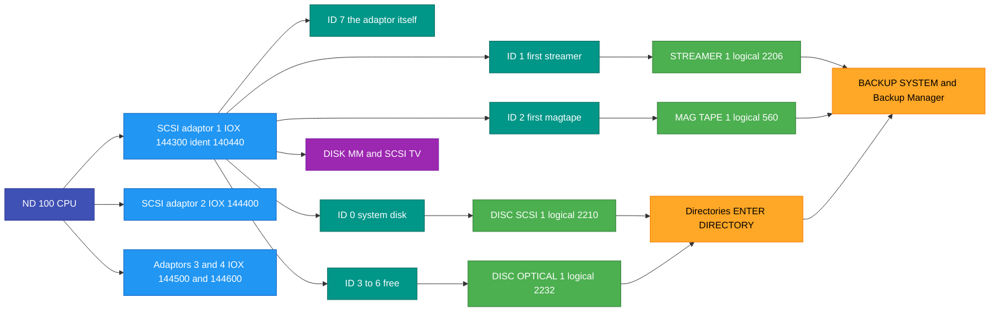
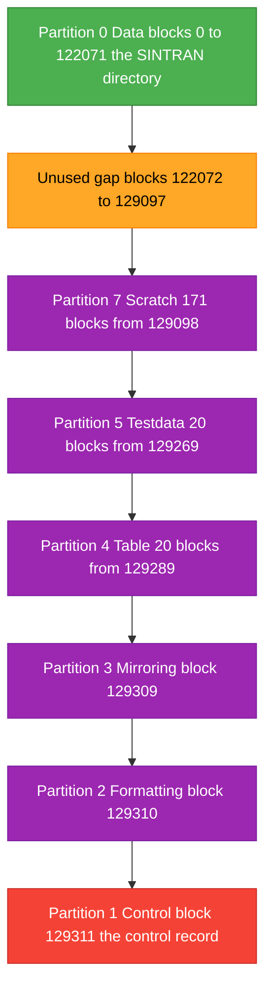
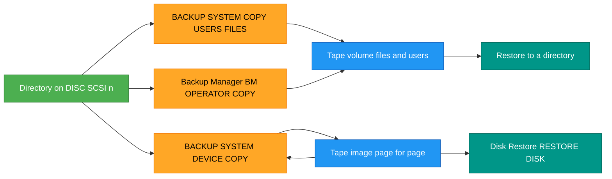

# SCSI storage under SINTRAN III - everything we know

Written 2026-10-31 from the sources in this repository. Every fact has a source.
Anything marked **inferred** is reasoning from the sources, not a quote. Anything
marked **not found** was searched for here and is not there.

## Contents

1. [Sources and how they are cited](#1-sources-and-how-they-are-cited)
2. [The big picture](#2-the-big-picture)
3. [The hardware: adaptor, buses, IDs](#3-the-hardware-adaptor-buses-ids)
4. [SINTRAN device names and logical device numbers](#4-sintran-device-names-and-logical-device-numbers)
5. [Supported devices and sizes](#5-supported-devices-and-sizes)
6. [What is on a SCSI disk: blocks, pages, partitions, control record](#6-what-is-on-a-scsi-disk-blocks-pages-partitions-control-record)
7. [Setting up SCSI devices in SINTRAN](#7-setting-up-scsi-devices-in-sintran)
8. [Using disks: create, enter, subunits, directory size](#8-using-disks-create-enter-subunits-directory-size)
9. [Using tapes: streamer and magtape](#9-using-tapes-streamer-and-magtape)
   - [9.0 Getting a SCSI streamer going - the short version](#90-getting-a-scsi-streamer-going---the-short-version-measured)
10. [Backup to tape and restore](#10-backup-to-tape-and-restore)
    - [Quick procedure: whole-disk backup and restore on a SCSI streamer](#quick-procedure-whole-disk-backup-and-restore-on-a-scsi-streamer-measured)
    - [10.1 File backup with BACKUP-SYSTEM (not possible on a streamer)](#101-file-backup-with-backup-system)
    - [10.3 Backup Manager: back up and restore single files](#103-backup-manager-back-up-and-restore-single-files)
11. [Optical disk (LD 1200 WORM)](#11-optical-disk-ld-1200-worm)
12. [CD-ROM](#12-cd-rom)
13. [Maintenance programs: DISK-MM and SCSI-TV](#13-maintenance-programs-disk-mm-and-scsi-tv)
14. [Errors and status words](#14-errors-and-status-words)
15. [DOMINO SCSI on ND-5000 - a different system](#15-domino-scsi-on-nd-5000---a-different-system)
16. [Known facts vs not found](#16-known-facts-vs-not-found)

---

## 1. Sources and how they are cited

All paths are inside the NDInsight repository. The text names a document in plain words and
then gives a line number in that file, for example (SINTRAN K release notes, line 13105).
This table gives the file for each name.

| Named in the text as | File |
|---|---|
| SINTRAN K release notes | `SINTRAN/Release-Documentation/ND-60230-5-EN SINTRAN III - Release Information - K-version.md` |
| SINTRAN L release notes | `SINTRAN/Release-Documentation/ND-860230-6-EN Sintran III - Release Information - L-Version.md` |
| SINTRAN M release notes | `SINTRAN/Release-Documentation/ND-860230-7A-EN SINTRAN III - Release Information - M-Version.md` |
| SINTRAN N release notes | `SINTRAN/Release-Documentation/ND-860230-8-EN SINTRAN III - Release Information - N-version.md` |
| SINTRAN Reference Manual | `Reference-Manuals/ND-60.128.5 EN SINTRAN III Reference Manual.md` |
| System Supervisor manual | `Operations/SINTRAN/ND-30.003.007 EN SINTRAN III System Supervisor.md` |
| Norwegian operator handbook | `Reference-Manuals/SINTRAN III Håndbok for driftsansvarlig.md` |
| BACKUP-SYSTEM User Guide | `Reference-Manuals/ND-60.250.1_EN_BACKUP_User_Guide.md` |
| Test program manual | `Reference-Manuals/ND-210523G_Test_Programs_for_ND-100_110_120__ND_Software_Library.md` |
| Test program addendum 1998 | `Reference-Manuals/ND-899159-1-EN_Test_Program_Description_for_ND-100_ND-110_-_Addendum_December_1998.md` |
| Old test program manual | `Reference-Manuals/ND-830005.3 EN Test Program Description for ND-100-110.md` |
| SCSI-TV-C product note | `Installation/Installation-Description/ND-895076-1p-EN.md` (test programs product info, SCSI-TV-C) |
| Test program note 210523I | `Installation/Installation-Description/ND-895076-2A-EN.md` (test programs 210523I, DISK-MM-C03, SCSI-TV-C04) |
| LD 1200 installation note | `Installation/Installation-Description/ND-99118-1-EN.md` (installing the LD 1200 optical drive) |
| ND-5000 ES installation guide | `Installation/Installation-Description/ND-895560-2-EN.md` (ND-5000 ES basic software install) |
| Installation note ND-895496-1 | `Installation/Installation-Description/ND-895496-1-EN.md` |
| Backup Manager installation note | `Installation/Installation-Description/ND-895055-1A-EN.md` (Backup Manager) |
| Backup Manager User Guide | Backup Manager User Guide, ND-860276.2 EN (version B). A scan without a text layer, not in this repository (`ND-860276-2-EN.pdf` in the Oddene manual collection). Cited by the manual's own page numbers ("book page"). |
| The Backup Manager floppies | The RetroCore Labs software archive (`RetroCoreLabs/norskdata-software-archive`, folder `images/<md5>/`): the six 211226B02 floppy images, listed with `ndtool`, mode files read with the parity bit stripped, 2026-11-02. |
| Backup Manager source note | `Installation/Installation-Description/ND-250351-3-EN.md` (Backup Manager source/C01) |
| SINTRAN patch notes ND-895230 | `Installation/Installation-Description/ND-895230-1A-EN.md` (SINTRAN patch notes) |
| Patch notes ND-896058-2 | `Installation/Installation-Description/ND-896058-2-EN.md` |
| ND-5000 ES administrator guide | `Reference-Manuals/500/ND-830147-3-EN ND-5000 ES System Administrator Guide.md` |
| DOMINO operator guide | `Reference-Manuals/500/ND-814009-1-EN DOMINO SCSI Operator Guide.md` |
| LD 1200 product sheet | `Installation/Product-Info/ND-110230-A1-EN.md` (LD 1200 product sheet) |
| 310/630 MB disk product sheet | `Installation/Product-Info/ND-110326-A1-EN.md` (310/630 MB SCSI disk) |
| Gigatape product sheet | `Installation/Product-Info/ND-110579-A1-EN.md` (ND Gigatape) |
| SCSI magtape product sheet | `Installation/Product-Info/ND-110580-A1-EN.md` (free-standing SCSI magtape) |
| SCSI board notes | `SINTRAN/Devices/SCSI/nd-scsi-3201.md` |
| Control record notes | `SINTRAN/Devices/SCSI/scsi-control-record-and-mount-math.md` |
| SCSI disk format notes | `SINTRAN/Devices/SCSI/scsi-disk-format.md` |
| ENTER-DIRECTORY notes | `SINTRAN/Devices/SCSI/SCSI-ENTER-DIRECTORY-COMPLETE.md` |
| Drive name tables | `tools/boot-floppy/SCSI-DEVICE-STRINGS.md` |
| Boot floppy README | `tools/boot-floppy/README.md` |
| Boot floppy install notes | `tools/boot-floppy/INSTALL-PROCEDURE.md` |
| Carved disc notes | `tools/boot-floppy/CARVED-DISC-SUPPORT.md` |
| Logical device number list | `SINTRAN/SINTRAN Structures/LOGICAL-DEVICE-NUMBERS.md` |
| OPCOM command reference | `Operations/SINTRAN/OPCOM-COMMAND-REFERENCE.md` |
| SINTRAN symbol listing | `SINTRAN/NPL-SOURCE/s3vs-4.symb` (SINTRAN symbol listing) |
| SCSI disk driver source | `SINTRAN/NPL-SOURCE/NPL/IP-P2-SCSI-DISK.NPL` |
| SCSI magtape driver source | `SINTRAN/NPL-SOURCE/NPL/IP-P2-SCSI-MAGTP.NPL` |
| SCSI optical driver source | `SINTRAN/NPL-SOURCE/NPL/IP-P2-SCSI-OPDI.NPL` |
| Nd100x run 2026-10-31 | A run on the nd100x emulator, 2026-10-31: DISK-MM-B00 and SCSI-TV-B00 from floppy 210523G02-XX-02D. Measured, but not written down anywhere else in this repository. |
| Nd100x SCSI-TV runs 2026-11-01 | Runs on the nd100x emulator, 2026-11-01: SCSI-TV-B00 (floppy 210523G02-XX-02D) and SCSI-TV-C04 (floppy 210523I01-XX-02D) against an emulated Tandberg TDC 3600 at SCSI ID 1, with the SCSI command log on. |
| Nd100x backup runs 2026-11-01 | Runs on the nd100x emulator, 2026-11-01, on copies of the nd100x `SMD0.IMG` pack (SINTRAN III VSX/500 L, system disk `DISC-75MB-1` unit 0) with an emulated Tandberg TDC 3600 at SCSI ID 1 and the SCSI command log on: S3-CONFIG, `@DEVICE-FUNCTION`, BACKUP-SYSTEM I02. |
| BACKUP-SYSTEM install notes | `Installation/INSTALL-ND-LINKAGE-LOADER-AND-BACKUP-SYSTEM.md` (Backup System I04 install, verified live 2026-07-19) |
| ND-5000 platform installation note | `Installation/Installation-Description/ND-895560-1-EN.md` (ND-5000 basic platform install, Disk Restore from `STREAMER-1`) |
| Installation note ND-896058-4 | `Installation/Installation-Description/ND-896058-4-EN.md` (Backup Manager restore from `STREAMER-1`) |
| DISK-MM trace 2026-10-31 | DISK-MM-B00 FORMAT-INITIALIZE traced on the nd100x emulator under its DAP debugger, 2026-10-31, with the SCSI command log on. DISK-MM is loaded at file word + 065400; the numbers given are its memory addresses (octal), read with nd100-dis. |
| ND board list | The ND board list (PCB number, part number, short description per board), entries for PCB 3112 and 3201-3207, supplied by the repository owner 2026-11-02. Not in this repository. |
| Micropolis 1370 manual | Micropolis 1370 Series product description, document 101689 rev D (not in this repository; a scan is on the bitsavers mirrors). Appendix A: formatted capacity. Appendix B: MODE SENSE pages and their default values. It refers to Micropolis document 110011 (SCSI implementation) for the details; 110011 is **not found**. |

Numbers ending in `B` or written with a subscript 8 are octal. The release notes
were scanned and OCR'd; where the OCR is plainly broken, that is said.

---

## 2. The big picture



In words:

- The ND-100 has up to **4 SCSI adaptors**. Each adaptor is one SCSI bus with 8 IDs,
  0-7. The adaptor takes ID 7, so each bus has room for 7 devices (SINTRAN K release notes, line 13045,
  13093, 13198).
- SINTRAN does not find devices by itself. An operator ties each SINTRAN device
  name (for example `DISC-SCSI-1`) to an **adaptor number and an ID** in the
  configuration program, then warm starts (SINTRAN K release notes, lines 6936-6971).
- Disks get directories with `@CREATE-DIRECTORY` / `@ENTER-DIRECTORY`. Tapes are
  used by the BACKUP-SYSTEM, the Backup Manager, `@DEVICE-FUNCTION` and the tape
  monitor calls.
- The stand-alone programs **DISK-MM** (format and prepare disks) and **SCSI-TV**
  (test) talk to the bus directly, by adaptor and ID.
- The SINTRAN driver itself only reads the device **type** from INQUIRY (byte 0,
  8-byte request). It never sees the vendor or product name. Only the test
  programs check vendor and product (drive name tables, section 5.3; boot floppy README, lines 217-258).

---

## 3. The hardware: adaptor, buses, IDs

### 3.1 The board

| Fact | Value | Source |
|---|---|---|
| Board | ND-3201 SCSI/floppy controller, PN 350001; variants 3204/3205/3206/3207 | SCSI board notes, line 3 |
| Same board as named in the install guide | "ND-100 PCB 350004 FLOPPY/SCSI", holds the old floppy controller and the SCSI adaptor, one SCSI bus per card, up to four cards | LD 1200 installation note, line 124 |
| Sales item | "ND-100 FLOPPY/SCSI adapter 110329" | LD 1200 installation note, line 88 |
| 3204 | the FLOPPY-STREA test program notes "Implemented Floppy/SCSI card 3204"; the 3204 adds an external word count register | test program manual, line 861; SCSI board notes, lines 726-727 |
| SCSI chip | NCR 5386, its registers sit straight on the ND-100 IOX bus; SINTRAN's driver runs the SCSI phases itself | SCSI board notes, line 18 |
| Floppy half | Z80 + AM9517 DMA + FD1797; the Z80 never touches the NCR 5386 | SCSI board notes, lines 19-21 |
| Interrupt | ND-100 **level 11**, when WCONT bit 0 is set | SCSI board notes, lines 770, 776; test program manual, line 1737 ("correct IDENT code on level 11") |
| Bus | 8-bit parallel; single-ended or differential receivers (RSTAU bits 7 and 15) | SINTRAN K release notes, line 13045; SCSI board notes, lines 760, 768 |
| Termination | "The complete SCSI bus ... MUST have a termination plug at BOTH ends." Part 517691 | LD 1200 installation note, lines 84, 223-229 |
| Cable | max 25 m from adaptor to disk (for the 310/630 MB drives) | 310/630 MB disk product sheet, line 46 |

PCB number: the SCSI board notes say 350001, the LD 1200 installation note says 350004. Both are right. The ND board
list (ND board list) gives one part number per board edition:

| PCB | Name | Part number |
|---|---|---|
| 3201 | N-100 SCSI/Floppy Ctrl | 350001 |
| 3204 | N-100 SCSI/Floppy Ctrl I | 350004 |
| 3205 | N-100 SCSI/Floppy Ctrl II | 350005 |
| 3206 | N-100 SCSI/Floppy Ctrl III | 350006 |
| 3207 | N-100 SCSI/Floppy Ctrl IV | 350007 |

The last edition, 3207, is described as "SCSI (DL or SE) and floppy interface" with
one 8192 x 8 SRAM (8 KB). Every edition carries the SCSI adaptor **and** a floppy
controller on the same card.

#### The other streamer: PCB 3112, not used with SCSI

| Fact | Value | Source |
|---|---|---|
| Board | N-100 8" + 5.25" Floppy & Streamer Ctrl, PCB 3112, part number 324012 | ND board list |
| Drives | up to 3 floppy drives (units 0, 1, 2) and one streamer (unit 0) | ND board list |
| Interrupt | level 11 | ND board list |
| Memory | two 2048 x 8 SRAM chips (4 KB) | ND board list |
| SINTRAN | "The streamer drive did not have it's own driver/data field in Sintran III, only accessible from the Backup-System." | ND board list |
| BACKUP-SYSTEM name | `STREAMER-TAPE-1` / `-2`. The I02 device table maps them to the floppy units: `STREAMER-TAPE-1` = 1000B `FLOPPY-1`, 1001B `FLOPPY-2`, 1002B `FLOPPY-3`; `STREAMER-TAPE-2` = 1003B-1005B `FLOPPY-4..6`. This fits the line above: the streamer is reached through the floppy controller's own units. | `BACKUP-SYS-I02:PROG` device table, decoded (10.1) |

The 3112 is a machine **without** SCSI. A machine with SCSI has a 3201-3207 card,
which already holds the floppy controller, so it does not also carry a 3112. That
means the two streamers belong to different machines:

- `STREAMER-TAPE-1` / `-2`: the 3112 streamer. BACKUP-SYSTEM file backup supports it,
  and the manual's tape examples use it.
- `STREAMER-1` / `-2`: the SCSI streamer on a 3201-3207 card (logical 2206B/2207B,
  I/O data field 2226B/2227B).

Text written for one of them does not hold for the other.

### 3.2 The four buses

| Adaptor | IOX range (octal) | Ident (octal) | SINTRAN logical device | Source |
|---|---|---|---|---|
| ADAPTOR-1 | 144300-144377 | 140440 | 2202B (1154 dec) | SCSI board notes, line 206; SINTRAN K release notes, line 13142; nd100x run 2026-10-31 |
| ADAPTOR-2 | 144400-144477 | 140441 | 2203B | SCSI board notes, line 207; SINTRAN K release notes, line 13144 |
| ADAPTOR-3 | 144500-144577 | 140442 | 2204B | SCSI board notes, line 208; SINTRAN K release notes, line 13145 |
| ADAPTOR-4 | 144600-144677 | 140443 | 2205B | SCSI board notes, line 209; SINTRAN K release notes, line 13146 |

The test programs take the adaptor in any of these forms: `ADAPTOR-n` (n = 1-4), the
number 1-4, the logical number 2202B-2205B, or the hardware number
144300B/144400B/144500B/144600B (test program manual, lines 1073-1076).

In the nd100x run of 2026-10-31, `LIST-DEVICES` showed ADAPTOR-1, hardware 144300, ident 140440,
logical 2202B, which matches the table.

### 3.3 Thumbwheels

| Source | What it says |
|---|---|
| SCSI board notes, lines 196-209 | TH1 = SCSI ID of the adaptor (strapped onto the NCR 5386 ID pins); TH2 = IDENT / IOX address (settings 0-3, repeated, select bus 1-4); TH3 = floppy |
| LD 1200 installation note, lines 126-167 | The figure labels **TH1** "IOX and Ident" with settings 0-3 = SCSI bus 1-4, and **TH2** "SCSI ID-no. Range 0-7 (7 means host computer)" |

**The two sources swap the names TH1 and TH2.** Both agree on what the two switches
do (one picks the bus 1-4, one the adaptor's own SCSI ID). Which label is printed on
the board I do not know.

### 3.4 SCSI ID rules

From the K release notes (SINTRAN K release notes, lines 13198-13204) and the LD 1200 install guide
(LD 1200 installation note, lines 180-191):

| ID | Standard use |
|---|---|
| 0 | Main swapping device (system disk). If the system disk is SCSI it **must** be ID 0 on adaptor 1. |
| 1 | The first streamer (`STREAMER-1`) **should** be ID 1 on adaptor 1. Free if no streamer. |
| 2 | The first magtape (`MAG-TAPE-1`) **should** be ID 2 on adaptor 1. Free if no magtape. |
| 3-6 | Free |
| 7 | The ND-100 SCSI adaptor (host). With more host adaptors on one bus, use 6, 5 and so on. |

More rules:

- The MEMTOS memory-dump program needs its streamer at "ID no. 1 on SCSI adaptor
  number 1 ... (hardware device number 144300)" (SINTRAN N release notes, line 1763).
- The test programs say "ID 0 is normally equivalent to "DISC-SCSI-1" which is the
  boot disk" (test program manual, line 1078).
- Two ND-100s may share one SCSI bus. `@DEVICE-FUNCTION ... RESERVE-DEVICE` /
  `RELEASE-DEVICE` give one CPU sole use of a tape on that bus (SINTRAN L release notes, lines 810-816).
- In a two-bus filestore cabinet, "optical disks can only be connected to the bus on
  the left side" (LD 1200 installation note, line 273).

### 3.5 Booting from SCSI

- The SCSI bootstrap driver is only in K standard system D (SINTRAN K release notes, line 934). It is in
  all L, M and N standard systems (SINTRAN L release notes, line 397; SINTRAN M release notes, line 466; SINTRAN N release notes, line 490).
- NDInsight's OPCOM command reference lists `#144300&` as the SCSI disk bootstrap command
  (OPCOM command reference, line 155). That table is NDInsight's own summary. I did not find the original
  ND manual line behind it.
- The ND-3201 ROM has an "autoload" path. It copies an ND-100 SCSI boot driver
  into ND-100 memory at 6000B and puts `JMP I` at address 0. That driver uses
  bus 1 (144300) (SCSI board notes, lines 83-131).
- MACM, the generation program, cannot talk to a SCSI disk. `IOXT` appears zero
  times in it, and 144300 needs 16 bits while `IOX` carries 11 (boot floppy README, lines 170-174).

---

## 4. SINTRAN device names and logical device numbers

### 4.1 The official name list

SINTRAN K release notes, section 22.2 (SINTRAN K release notes, lines 13091-13136), with the logical device numbers from 22.3
(SINTRAN K release notes, lines 13142-13190):

| Device type | Max per system (K) | SINTRAN device names | Logical device numbers (octal) |
|---|---|---|---|
| SCSI adaptor | 4 | (no file-system name; test programs call them ADAPTOR-1..4) | 2202-2205 |
| Magnetic disk | 14 | `DISC-SCSI-1` ... `DISC-SCSI-14` | 2210-2225 (DISC-SCSI-1 = 2210, ..., DISC-SCSI-7 = 2216, DISC-SCSI-8 = 2217, ..., DISC-SCSI-14 = 2225) |
| Optical disk | 4 | `DISC-OPTICAL-1` ... `DISC-OPTICAL-4` | 2232-2235 |
| Streamer tape | 2 | `STREAMER-1`, `STREAMER-2` | 2206, 2207 |
| Magnetic tape | 4 | `MAG-TAPE-1` ... `MAG-TAPE-4` | 560, 1111, 1231, 1224 |

The SINTRAN symbol listing agrees for the streamers, disks 1-8 and optical 1-2
(SINTRAN symbol listing, lines 25062-25092). The logical device number list gives the same ranges (lines 423-428).

**Subdivided disks.** "The device name is expanded (in the same way as for SMD
disks) with the number of subunits included in the name". The K notes give two
examples (SINTRAN K release notes, lines 13133-13136):

- `DISC-2-SCSI-3` means SCSI disk number 3 divided into 2 subunits.
- `DISC-8-OPTICAL-1` means optical disk 1 divided into 8 subunits.

So the full name set is `DISC-SCSI-n` and `DISC-k-SCSI-n`, for k = 2..8 and
n = 1..14. That is 112 names. The L07 and M06 images carry all 112; K images carry
fewer (boot floppy install notes, lines 402-424; carved disc notes, lines 285-290).

> Note on a wrong reading in NDInsight: boot floppy install notes, lines 426-431 guesses that the leading
> number in `DISC-n-SCSI-u` counts spindles. The K release notes say it is the
> number of **subunits** (SINTRAN K release notes, line 13135). The release notes are the authority.

**DISC vs DISK.** The manuals and the name table in the image say `DISC-SCSI-n`
(SINTRAN K release notes, line 13105; boot floppy install notes, line 406). Comments in the symbol listing and one patch note write
`DISK-SCSI-n` (SINTRAN symbol listing, line 25066; SINTRAN patch notes ND-895230, lines 251-252). Inferred: the name SINTRAN accepts is
`DISC-...`. The `DISK-...` spelling is loose writing in comments.

### 4.2 Two numbers per tape drive

A tape drive has more than one logical device number. The difference matters when
you make a peripheral file.

| Drive | Device / config number | Number used in the peripheral file | Source |
|---|---|---|---|
| SCSI streamer 1 | 2206B ("SCSI streamer tape drive no. 1") | **2226B** ("SCSI STREAMER 1 I/O, UNIT 0") | SINTRAN K release notes, line 13148; SINTRAN symbol listing, lines 25062, 25082; Backup Manager installation note, line 611; ND-5000 ES administrator guide, line 1675 |
| SCSI streamer 2 | 2207B | **2227B** | SINTRAN K release notes, line 13150; SINTRAN symbol listing, line 25084; Backup Manager installation note, line 612 |
| SCSI magtape 1 | 560B | `MAG-TAPE-0` = **40B** | SINTRAN K release notes, lines 13180, 13210; Backup Manager installation note, line 613 |
| SCSI magtape 2 | 1111B | `MAG-TAPE-4` = **32B** | SINTRAN K release notes, lines 13181, 13211; Backup Manager installation note, line 614 |
| SCSI magtape 3 | 1231B | `MAG-TAPE-8` = **1232B** | SINTRAN K release notes, lines 13182, 13212; Backup Manager installation note, line 615 |
| SCSI magtape 4 | 1224B | `MAG-TAPE-12` = **1225B** | SINTRAN K release notes, lines 13183, 13213; Backup Manager installation note, line 616 |

The streamers also have a "DF data field" number: 2230B / 2231B (logical device number list, line 427;
SINTRAN symbol listing, lines 25086-25088).

Inferred, from the tables above: the first number (2206B, 560B, ...) is the
device's data field. It is used to tie the drive to an adaptor and ID (MON IOMTY
function 300B accepts 560, 1111, 1224, 1231, 2210-2225, 2232-2235; SINTRAN K release notes, line 3700). The
second number (2226B, 40B, ...) is the I/O data field. A peripheral file for
`@DEVICE-FUNCTION` and for file-style tape access points at that one.

Two warnings from the source:

- **Overlap.** Magtape 3 and 4 numbers overlap the ST-506 (Winchester) controllers
  2 and 1. So with 1 ST-506 controller you can have at most 3 SCSI magtapes; with
  2, at most 2 (SINTRAN K release notes, line 13215).
- **Streamers missing from MON 300B.** The list of numbers accepted by MON IOMTY
  300B-303B does not include 2206/2207 (SINTRAN K release notes, lines 3700, 3719, 3747, 3766). Yet the
  configuration program has a "SCSI streamer 1" line (SINTRAN K release notes, line 6925). I have not found
  why. It could be an omission in the manual; I do not know.

### 4.3 Names used elsewhere for tapes - careful

| Name | What it is | Source |
|---|---|---|
| `STREAMER-1` / `STREAMER-2` | SCSI streamer, SINTRAN device name and Backup Manager device name | SINTRAN K release notes, line 13124; Backup Manager installation note, line 611; ND-5000 ES installation guide, lines 359, 461 |
| `STREAMER-TAPE-1` / `-2` | The streamer on the **3112 floppy-and-streamer controller**, not SCSI. It has no SINTRAN data field of its own; BACKUP-SYSTEM reaches it through the floppy units 1000B-1005B (3.1). | ND board list; old test program manual, lines 4001-4006; BACKUP-SYSTEM User Guide, line 4389; System Supervisor manual, line 11496 |
| `MAG-TAPE-1..4` | Used for both the old magtape controllers (Cipher, Pertec, STC) and SCSI magtapes | SINTRAN K release notes, lines 937-938, 13130 |

**Not found** anywhere in NDInsight: `SCSI-STREAMER`, `SCSI-MAGTAPE`, `SCSI-TAPE`,
`CDROM`, `CD-ROM` as a SINTRAN device name.

---

## 5. Supported devices and sizes

### 5.1 What SINTRAN K says it supports

SINTRAN K release notes, lines 13066-13081 lists:

- magnetic disks of 60, 125 and 150 MB (5 1/4 inch, fixed);
- magnetic disks of 310 and 630 MB (8 inch, fixed);
- a 1 GB optical disk drive (Laserdrive 1200);
- a 125 MB streamer tape drive;
- an STC magnetic tape drive.

All SCSI magnetic disks "may be divided into 2, 3, 4, 5, 6 or 8 subunits". The
optical disk may be divided into 2-8 subunits (SINTRAN K release notes, lines 13074-13077).

Later versions, per standard system (SINTRAN L release notes, lines 390-394; SINTRAN M release notes, lines 459-466; SINTRAN N release notes, lines 483-490):

| | L std A | L std B | Source |
|---|---|---|---|
| SCSI host adaptors | 3 | 2 | SINTRAN L release notes, line 390 |
| SCSI disks per system | 8 | 8 | SINTRAN L release notes, line 391 |
| SCSI streamers per system | 2 | 2 | SINTRAN L release notes, line 392 |
| SCSI magtapes per system | 3 | 2 | SINTRAN L release notes, line 393 |
| SCSI optical disks per system | 2 | 2 | SINTRAN L release notes, line 394 |

M adds "SCSI magnetic tape drives with several logical units on each controller"
(SINTRAN M release notes, line 435).

### 5.2 Drive models

The model names come from the test programs' supported-product lists (test program manual,
lines 1567-1575; test program addendum 1998, lines 944-955) and from the vendor/product tables decoded from the
program binaries (drive name tables, section 3). SINTRAN itself does not check any of these
names (section 2). The test programs do; 13.4 says which names each version accepts.

| Class | Vendor / product (INQUIRY strings) | What it is | Size | Source |
|---|---|---|---|---|
| Disk, 5 1/4" | `NDMICROP` / `1375` (also `MICROP`) | Micropolis 1375 | ND lists 60 MB and 125 MB variants; block size 1024 | test program manual, lines 1061, 1120-1125; drive name tables, line 63; nd100x run 2026-10-31 |
| Disk, 8" | `NDCDC` / `EMD 97201 (736)`, `(368)`, `(000)`, `(1.2)` | CDC EMD 97201 | 310 and 630 MB; block size 512 | test program manual, lines 1062, 1124-1125; drive name tables, lines 64, 211, 221; 310/630 MB disk product sheet, line 22 |
| Disk, 5 1/4" | `NDCDC` / `94171-9` (also -7, -5); listed as "WREN IV, 5 1/4" fixed disk" | CDC WREN IV | Inferred 310 MB (the DOMINO operator guide lists "310 Mbyte disk drive (5 1/4 inch WREN)") | SCSI-TV-C product note, line 339; DOMINO operator guide, lines 349-350; drive name tables, lines 192, 222 |
| Disk | `NDCDC` / `94181-15`, `94181-13` | CDC (family not named) | not found | drive name tables, lines 192, 223 |
| Disk, 5 1/4" | (not named) | "155MB SCSI 5.25" disk drive (326392)" | 155 MB | test program addendum 1998, line 51; installation note ND-895496-1, line 439 |
| Streamer | `TANDBERG` / ` TDC 3600`, ` TDC 3600 EXPR.`, `RG TDC 3600` | Tandberg TDC 3600 | Inferred: the "125-megabyte streamer" of SINTRAN K release notes, line 13079; not stated | test program manual, line 1570; drive name tables, line 156 |
| Streamer | `ARCHIVE` / `VIPER 150  21247` (and serial variants 99999, 25066, 21835) | Archive Viper 150 | "the 155MB Archive streamer" | test program manual, line 1575; drive name tables, line 193; Backup Manager installation note, line 91 |
| Streamer (8 mm) | `EXABYTE` / `EXB-8200`, later `EXB-8500` | ND Gigatape System (GTS), ND 110579 | 2.2 GB per cartridge | SCSI-TV-C product note, line 340; Gigatape product sheet, line 38; drive name tables, line 197 |
| Magtape | `NDSTK` / `2925` | StorageTek 2925, ND 110324 | "<250 Mb/tape" | test program manual, line 1574; LD 1200 installation note, line 77 |
| Magtape | `HP` / `88780` | HP 88780; inferred to be ND 110580, the free-standing 1600/6250 bpi SCSI magtape | 140 MB per 2400 ft reel at 6250 bpi GCR | SCSI-TV-C product note, line 341; test program addendum 1998, line 51; SCSI magtape product sheet, lines 3, 62 |
| Optical (WORM) | `OSI` / `LD 1200 SCSI` | Laserdrive LD 1200, ND 110230 | 1 GB per side, two sides | test program manual, line 1572; LD 1200 product sheet, line 23; LD 1200 installation note, line 76 |
| Disk (DOMINO operator guide only) | `CDC WREN IV` | | block size 512 | drive name tables, line 65 |

Notes:

- "Early versions of the MICROPOLIS disk 1370 for 60MB will not be recognized" by
  SCSI-TV-B (test program manual, line 1902). SCSI-TV-C04 fixed this (test program note 210523I, line 638).
- SCSI-TV-C04 "will now accept any SCSI device without giving any warnings. Devices
  unknown to the program are treated as standard disk/streamer/magtape devices"
  (test program note 210523I, line 634). DISK-MM-C "is now able to format disks not delivered from ND"
  (test program note 210523I, line 45).
- The test programs do not store the device class. They read it from the live
  INQUIRY reply (drive name tables, lines 136-141, 236-250).

### 5.3 The Micropolis 1375 as seen in the nd100x run of 2026-10-31

From the nd100x run of 2026-10-31 (not written down anywhere else in NDInsight):

- vendor `NDMICROP`, product `1375`, rev `B0C`;
- 1024-byte blocks, 129312 blocks.

The same block count is in NDInsight's decode of a real SCSI-K disk image: raw
129312 blocks = 64656 pages, of which 122072 blocks = 61036 pages are usable
(SCSI disk format notes, lines 44-47, 129-138).

SINTRAN shows this disk as `DISC-SCSI-1 UNIT 0 ** 125 Mb **`, with 61036 pages
(ENTER-DIRECTORY notes, lines 264-268).

Open: the Micropolis 1370-series data sheet (document 101689, on bitsavers;
not in this repository) says the 1375 has 8 heads, 1018 formatted cylinders and
18 blocks of 1024 bytes per track. That is 146592 blocks, about 150.1 MB. The ND disk
has 129312 blocks. 129312 = 898 x 8 x 18, so the ND disk may use only 898 of the
1018 cylinders. But SCSI disk format notes, line 133 warns that this split comes from our own emulator
and is not proven. The SINTRAN K release notes list both a 125 MB and a 150 MB 5 1/4-inch disk
(SINTRAN K release notes, lines 13069-13070). Why the ND unit is 129312 blocks is **not found**.

### 5.4 Block and page sizes

| Unit | Size | Source |
|---|---|---|
| SINTRAN "logical" block | always 1024 bytes | test program manual, line 1104 |
| SINTRAN file-system page | always 2048 bytes = 2 blocks | test program manual, line 1108; SCSI disk format notes, line 37 |
| Media block | the drive's own sector size (1024 for Micropolis 1375, 512 for CDC EMD 97201 and WREN IV) | test program manual, line 1100; drive name tables, lines 63-65 |
| Disk record size in the driver | 1024 bytes for direct-access devices | SCSI disk driver source, lines 1266-1267 |
| Tape | fixed block mode (1024-byte records) if READ BLOCK LIMITS gives min = max; otherwise variable, byte count | SCSI disk driver source, lines 1256-1273 |
| Streamer MODE SELECT | the driver sets block size 1024 unless the device is in fixed block mode | SCSI disk driver source, lines 555-556 |
| Optical | two disc types: `DTOD1` RS=1024 and `DTOD2` RS=2048 | SINTRAN symbol listing, lines 2977-2978; carved disc notes, lines 114-115 |
| LD 1200 medium | 32000 tracks x 32 sectors x 1024 user bytes per side | LD 1200 product sheet, line 57 |
| Hard limit in SINTRAN | block size must fit 16 bits, be > 1, and be a power of two, else `RSZER` / `ILRCS`. No maximum disk size anywhere | boot floppy README, lines 210-213 |

SINTRAN holds **no table of valid SCSI disk sizes**. Every `DISC-n-SCSI-m` and
`DISC-n-OPTICAL-m` entry in the name table has size 0. The size comes from READ
CAPACITY and from the disk's own control record (carved disc notes, lines 250-262; boot floppy README,
lines 182-208).

---

## 6. What is on a SCSI disk: blocks, pages, partitions, control record

A SCSI disk used by an ND-100 is not just a file system. DISK-MM puts a small
partition table at the top of the disk, and SINTRAN reads it when it mounts the
disk.

### 6.1 The partitions (from the nd100x run of 2026-10-31)

`LIST-DISK-INFORMATION` in DISK-MM, on a Micropolis 1375 of 129312 blocks (nd100x run 2026-10-31):

| No. | Name | Start block | Length (blocks) |
|---|---|---|---|
| 0 | Data | 0 | 122072 |
| 1 | Control | 129311 | 1 |
| 2 | Formatting | 129310 | 1 |
| 3 | Mirroring | 129309 | 1 |
| 4 | Table | 129289 | 20 |
| 5 | Testdata | 129269 | 20 |
| 6 | (none listed) | | |
| 7 | Scratch | 129098 | 171 |

The disk said "Formatted by DMM - Version C02, 1989-08-17". The test-program product
notes list DISK-MM B00, B01 and C03 (drive name tables, lines 39-43; test program note 210523I, line 473). A C02 is **not
listed** in NDInsight.

What the manuals say about partitions:

- "Table partition": REASSIGN and REFRESH-DATA are logged there (test program manual, lines 1165, 1177).
- "Data partition": SCSI-TV test 14 copies from it to the scratch area (test program manual, line 1858).
- "Scratch partition": SCSI-TV tests 12 and 14 write there (test program manual, lines 1850, 1858).
- DISK-MM-C03 has `LIST-DISK-PARTITIONS` and write protection levels Off / Normal /
  On. In Normal, every partition except Data is write-protected (test program note 210523I, lines 582-588).
  "If the disk is not initialized, the entire disk will be treated as a data
  partition" (test program note 210523I, line 522).

The names Control, Formatting, Mirroring and Testdata do **not** appear in any
manual in NDInsight. They come from the program's own output (nd100x run 2026-10-31).

The Scratch partition's length is not a fixed number. FORMAT-INITIALIZE works it out
from the drive: (heads + 1) x sectors per track, both read from MODE SENSE (DISK-MM trace 2026-10-31;
section 13.3). On the emulator, with 8 heads and 18 sectors per track, it is 162. The
171 above is 9 x 19, which fits a 1375 formatted with 19 sectors of 1024 bytes per
track, the example in the Micropolis 1370 manual, Appendix A. **Inferred**: that the disk in that run was
formatted that way is reasoning from the number, not read from the disk.

### 6.2 The control record (last block)

NDInsight decoded the last block of a real SCSI-K image byte by byte (control record notes,
lines 149-190; SCSI disk format notes, section 4):

- Header word 0 = `0x080054D9`. Its high byte 8 is read as **NPART = 8** (control record notes, line 169).
- Header word 3 = `0x0001DCD8` = 122072 = **UHLIM**, the usable block count
  (control record notes, line 172).
- Then 12-byte entries `{flag, LBA, length}`:

| Entry | Flag | LBA | Length |
|---|---|---|---|
| 0 | C0 | 129311 | 1 |
| 1 | C0 | 129310 | 1 |
| 2 | E0 | 129309 | 1 |
| 3 | E0 | 129289 | 20 |
| 4 | E0 | 129269 | 20 |
| 5 | (empty slot) | | |
| 6 | E0 | 129098 | 171 |

**Inferred, but the match is exact:** this record **is** DISK-MM's partition table.

- Header word 3 is the length of partition 0 (Data).
- Entry k is partition k+1: Control, Formatting, Mirroring, Table, Testdata, (6
  unused), Scratch.
- NPART = 8 is partitions 0-7.

NDInsight's SCSI disk format notes and control record notes call entries 2-6 "spare-pool extents" and block
129310 a "disk-parameter block". The names from the run should replace those guesses.
NDInsight also says block 129310 holds "device-type / vendor / revision /
format-date" (SCSI disk format notes, lines 61-62). That fits the name "Formatting partition" (inferred).

How SINTRAN uses the record:

- When a SCSI disk is connected, the driver's function 42 reads the last block. It
  checks NPART and an XOR checksum, sets UHLIM from header word 3, and copies the
  partition table (control record notes, lines 196-205; boot floppy README, lines 201-208).
- If the record is missing, the driver error is "11B No control record on magnetic
  disk" (SINTRAN K release notes, line 13322).
- READ CAPACITY reports the **raw** size (last LBA 129311), not the usable size
  (SCSI disk format notes, lines 49-53, 160-186).



What the 7026-block gap between the Data partition and the Scratch partition is for
is **not found** (SCSI disk format notes, lines 148-156 calls it open).

---

## 7. Setting up SCSI devices in SINTRAN

### 7.1 Order of work (put together from the sources)

This order is a summary. Each step has its own source.

1. **Hardware.** Set the adaptor's bus number (1-4) and its own SCSI ID (7), give
   each device a free ID (section 3.4), terminate both ends of the bus (LD 1200 installation note,
   lines 174-191, 227-229).
2. **Check the bus.** Run SCSI-TV `LIST-DEVICES` (C version: `LIST-PRESENT-DEVICES`)
   and see that every device answers (LD 1200 installation note, line 474; test program addendum 1998, line 1027).
3. **Prepare each new disk** with DISK-MM: `SELECT-DEVICE`, then `FORMAT-INITIALIZE`
   (or `INITIALIZE` on an already formatted disk). INITIALIZE "Prepares the disk for
   use under SINTRAN" (test program manual, lines 1112, 1129). See section 13.
4. **Tie names to adaptor and ID** in the SINTRAN configuration program (section
   7.2).
5. **Warm start** (or cold start, see below).
6. **Make peripheral files** for tapes (section 9.1), and add
   `@DEFINE-MASS-STORAGE-UNIT` lines to LOAD-MODE where needed (section 7.3).
7. **Create and enter directories** on disks (section 8).

### 7.2 The configuration program (S3-CONFIG), SCSI command

- The program is called **S3-CONFIG**, run as user SYSTEM. Give the command `SCSI`
  (LD 1200 installation note, line 317).
- Menu 1 (SINTRAN K release notes, lines 6911-6925; LD 1200 installation note, lines 319-328): lines "SCSI disk no. 1" to "SCSI disk
  no. 14", and "SCSI streamer 1" / "SCSI streamer 2". Each line has a **Current**
  and a **Next** column.
- Menu 2, reached with the scroll-down key or `N` (SINTRAN K release notes, lines 6949-6957; LD 1200 installation note,
  lines 339-347): "Optical disk no. 1-4" and "Mag. tape no. 1-4".
- **Each entry is `adaptor.ID`.** You type the adaptor number (1-4) left of the
  period and the SCSI ID (0-7) to the right. For example, `1.0` is adaptor 1, ID 0
  (SINTRAN K release notes, lines 6936, 6965).
- An example from the manual (SINTRAN K release notes, lines 6918-6925, 6953-6956):

| Line | Value |
|---|---|
| SCSI disk no. 1 | 1.0 |
| SCSI disk no. 2 | 1.3 |
| SCSI disk no. 3 | 1.5 |
| SCSI streamer 1 | 1.1 |
| Optical disk no. 1 | 1.4 |
| Mag. tape no. 1 | 1.2 |

- Changes "will be stored in the SINTRAN III image and save areas immediately, and
  ... a warm start is required for the changes to take effect" (SINTRAN K release notes, line 6971). The
  LD 1200 guide instead says "Do a COLD-START to make the new definition in
  S3-CONFIG active" (LD 1200 installation note, line 489). The two sources do not agree. A cold start
  would cover both cases (inferred).
- The same tie can be made by program: MON 336 (IOMTY) functions 300B (set), 301B
  (get), 302B (delete) and 303B (get current), "VSX only", user SYSTEM only. Word 1
  is the SINTRAN logical device number, word 2 the adaptor's logical number
  2202B-2205B, word 3 the SCSI ID 0-7 (SINTRAN K release notes, lines 2357-2360, 3692-3780).

### 7.3 @DEFINE-MASS-STORAGE-UNIT

- Format: `@DEFINE-MASS-STORAGE-UNIT <device name>,<device unit> [,<F or R>]
  [,<device sub-unit>]` (SINTRAN Reference Manual, line 2535).
- It reserves a directory-table index for a device that is not entered yet. "A
  definition of a device in the directory table does not survive a warm start"
  (SINTRAN Reference Manual, lines 2528, 2547). That is why it goes in **LOAD-MODE**.
- The LD 1200 guide says: put `@DEFINE-MASS-STORAGE-UNIT <device name> <device
  unit> ...` in LOAD-MODE. The device name is `DISC-OPTICAL-1` to `DISC-OPTICAL-4`
  and must match S3-CONFIG (LD 1200 installation note, lines 357-363).
- A real K load-mode file defines `FLOPPY-DISC-1 0` and also `STREAMER-1`
  (NDInsight paraphrase in `Installation/OS/research/HDD-IMAGE-FINDINGS.md`
  line 98; the exact line was not checked).
- On an ND-5000 ES system, `@LIST-MASS-STORAGE-DEVICES` shows `DIR INDEX 3 :
  STREAMER-1 UNIT 0` beside the SCSI disk subunits (ND-5000 ES administrator guide, lines 1642-1651).
- Related commands: `@DELETE-MASS-STORAGE-UNIT`, `@LIST-MASS-STORAGE-UNITS`
  (SINTRAN Reference Manual, lines 2531-2532, 2867).

---

## 8. Using disks: create, enter, subunits, directory size

### 8.1 Commands

| Command | Format | Source |
|---|---|---|
| `@CREATE-DIRECTORY` | `<directory name>,<device name>,<unit>[,<F or R>][,<subunit>],<bit file address>` - user SYSTEM only for hard disk; `<unit>` always required | SINTRAN Reference Manual, lines 2080-2109 |
| `@ENTER-DIRECTORY` | `<directory name>,<device name>,<unit>[,<F or R>][,<subunit>]`; from K, device unit is always required | SINTRAN Reference Manual, line 4669; SINTRAN K release notes, lines 1565-1569 |
| `@RELEASE-DIRECTORY` | `<directory name>` | SINTRAN Reference Manual, line 7434 |
| `@SET-MASS-STORAGE-SIZE` | `<device name>,<device unit>[,<F or R>][,<sub-unit>],<number of pages>` - set the directory size on a SCSI disk | SINTRAN K release notes, lines 1853-1863, 13376-13388 |
| `@EXPAND-DIRECTORY` | for SCSI/DOMINO disks, M version | SINTRAN M release notes, lines 1043, 1057 |

`F` / `R` (fixed / removable) does not apply to SCSI disks. It "only apply to disks
which have both a fixed and a removable part" (SINTRAN Reference Manual, line 2090).

Real examples:

- `@ENTER-DIRECTORY,,DISC-SCSI-1,0`, then `@DIR` gives `DIR INDEX 0 : DISC-SCSI-1
  UNIT 0 ** 125 Mb ** : PACK-ONE ... OUT OF 61036 PAGES` (ENTER-DIRECTORY notes, lines 264-268).
- 310 MB disk in 6 subunits: `@ENTER-DIRECTORY PACK-USERS-2 DISC-6-SCSI-1 0 3`
  (installation note ND-895496-1, line 470). "The device DISC-6-SCSI-1 is used for 310 MByte discs. The device
  DISC-3-SCSI-1 is used for 155 MByte discs" (installation note ND-895496-1, lines 438-439).
- ND-5000 ES system disk: `DISC-4-SCSI-1`, unit 0, subunits 0 and 1 (ND-5000 ES installation guide,
  lines 457-467, 525-533). Another ES system uses `DISC-2-SCSI-1,0,0` and `,0,1`
  (patch notes ND-896058-2, lines 134-135).

### 8.2 How directory size is set on SCSI

- For SMD and Winchester disks the size is part of the device name (for example
  DISC-70MB-1).
- On SCSI disks, "the directory size is set to the total disk capacity divided by
  the number of subunits on the device" (SINTRAN K release notes, line 13371). Here "total capacity" means
  the usable count from the control record, not the raw size (inferred from
  section 6.2: 61036 pages = UHLIM / 2).
- `@SET-MASS-STORAGE-SIZE` changes it, for example to match an SMD directory so a
  directory can be copied page for page. It cannot be changed while a directory on
  that device is entered. The unit and sub-unit parameters "are dummy, but must be
  within legal ranges" (SINTRAN K release notes, lines 13376-13383).
- Example: `@SET-MASS-STORAGE-SIZE DISC-2-OPTICAL-1,,,220584` matches the 450 MB
  SMD size (SINTRAN K release notes, line 13388). 220584 pages is the tabled size for 450 MB (boot floppy README, line 192).
- Error 3204, "INCOMPATIBLE DIRECTORY SIZES ON THIS CONTROLLER", belongs to the
  same area (SINTRAN K release notes, line 13358).

### 8.3 Sharing and reserve

New error texts for systems with SCSI (SINTRAN K release notes, lines 13357-13363):

- "3203 DIRECTORY ENTERED BY ANOTHER SYSTEM"
- "3210 DEVICE RESERVED BY ANOTHER SYSTEM"

These are about two ND-100s on one bus (inferred from the wording).

`@DISC-ACCESS-LOG` "does not support SCSI disks in generations 312 nor 406 nor 500"
(SINTRAN K release notes, line 6488).

---

## 9. Using tapes: streamer and magtape

### Streamer or magtape: the difference

Both store data on magnetic tape. The difference is the kind of drive and medium.

**Streamer**

- A small cartridge: quarter-inch tape in a closed plastic case, about the size of a
  paperback. The ones ND sold for SCSI are the Tandberg TDC 3600 and the Archive Viper 150
  (5.2); the Exabyte 8 mm drive of the ND Gigatape System is also handled as a streamer by the
  test programs (`tools/boot-floppy/SCSI-DEVICE-STRINGS.md`, section 4.6).
- Built to run the tape at full speed without stopping, which is what "streaming" means. The
  computer has to keep data coming. If it cannot, the drive stops, backs up and starts again,
  which is slow.
- Fixed block size. On the emulated TDC 3600 in nd100x every block is 512 bytes (measured in
  the nd100x backup runs).
- Cheap and small, made mainly for backups.
- SINTRAN device names `STREAMER-1`, `STREAMER-2`; peripheral files 2226B and 2227B.

**Magtape** ("tape" in ND papers)

- Large open reels of half-inch tape on a big floor-standing or rack drive, the classic
  computer-room tape. The ND SCSI ones are the StorageTek 2925 (`NDSTK 2925`) and the HP 88780
  (5.2).
- Can stop and start on every block, and blocks can have different sizes.
- Used for backups and also for moving data between different computers, since half-inch reel
  tape was the common exchange format.
- SINTRAN device names `MAG-TAPE-1` to `MAG-TAPE-4`. These names cover both the old non-SCSI
  magtape controllers (Cipher, Pertec, STC) and SCSI magtapes (SINTRAN K release notes,
  lines 937-938, 13130; sections 4.1 and 4.3). The peripheral files are named differently:
  `MAG-TAPE-0` = 40B, `MAG-TAPE-4` = 32B, `MAG-TAPE-8` = 1232B, `MAG-TAPE-12` = 1225B
  (SINTRAN K release notes, lines 13206-13213).

**General knowledge, not from an ND document:** the cartridge and reel sizes, what "streaming"
means for the drive, the start-stop and variable block size of a magtape, and the use of
half-inch tape for exchange. The rest of this section is from the ND documents named and from
nd100x.

For SINTRAN and the backup programs the two are separate kinds of device:

- different names (above);
- different driver code: the NPL sources have a separate SCSI magtape driver,
  `SINTRAN/NPL-SOURCE/NPL/IP-P2-SCSI-MAGTP.NPL`;
- different peripheral-file numbers in the Backup Manager table (Backup Manager installation
  note, lines 605-620; 10.3.8): `STREAMER-1` = 2226B, `MAG-TAPE-0` = 40B, and so on.

On the SCSI bus both answer INQUIRY with the same device type, "sequential access". The test
program SCSI-TV C04 tells a tape drive it does not know apart by asking for its smallest and
largest block size: equal means one class, different the other
(`SCSI-DEVICE-STRINGS.md`, section 4.6). nd100x emulates only the streamer:
`--scsiN=tape:FILE` is an emulated TDC 3600, and a magtape is not emulated (nd100x `BUGS.md`,
C6).

Both read and write in order from the start of the tape and put tape marks between files. A
program cannot jump straight to a block the way it can on a disk.

### 9.0 Getting a SCSI streamer going - the short version (measured)

Done on SINTRAN L with the streamer at adaptor 1, SCSI ID 1 (nd100x backup runs 2026-11-01). Three steps,
in this order:

| Step | What to do | What goes wrong if you skip it |
|---|---|---|
| 1 | In **S3-CONFIG**, menu `SCSI`, set **SCSI streamer 1** to `1.1` (adaptor 1, ID 1). Boot again. | Every `@DEVICE-FUNCTION STREAMER-1 ...` answers `ILLEGAL PARAMETER`, and **no SCSI command reaches the drive at all**. `READ-LAST-STATUS` still answers, so the file looks alive. |
| 2 | `@SET-PERIPHERAL-FILE "STREAMER-1" 2226B` (and `@SET-FILE-ACCESS STREAMER-1 RWACD RWACD RWACD`). | `NO SUCH FILE NAME` on every tape command. Use 2226B, not 2206B: 2206B gives `NO SUCH LOGICAL UNIT`. |
| 3 | Test: `@DEVICE-FUNCTION STREAMER-1 LOAD`, then `... REWIND`. Both return straight to `@` with no message. | - |

Step 1 is the trap. The pack used for the nd100x backup runs of 2026-11-01 came with **SCSI streamer 1 = 0.0**,
which means "not configured", while SCSI disk 1 was `1.0`.

What the drive saw on the first LOAD after the fix, in order (nd100x backup runs 2026-11-01, SCSI log):
INQUIRY (12h), TEST UNIT READY (00h), which got a UNIT ATTENTION, REQUEST SENSE (03h),
INQUIRY, TEST UNIT READY, MODE SENSE (1Ah, 12 bytes), MODE SELECT (15h, 12 bytes,
buffered mode 1, density 0), LOAD (1Bh, load bit set). REWIND then sent REWIND (01h).

**Driving S3-CONFIG from a plain terminal** (nd100x backup runs 2026-11-01). S3-CONFIG is a full-screen
program:

1. `@S3-CONFIG`, then answer the terminal type question (36 = Tandberg TDV 2215). The
   S3-CONFIG on the ND-5000 pack (`ND-211024E01`) has no type 36 and answers "This terminal
   type is unknown"; type 6 (DEC VT100) works there with the same keys below (2026-11-08).
2. Type `SCSI` and Return. The cursor lands on SCSI disk 1.
3. Each Return moves one half field: adaptor, then ID, for disk 1, 2, ... 8. The
   empty rows (disks 9-14) are skipped. **15 Returns** reach the adaptor field of
   SCSI streamer 1.
4. Type `1`, Return, `1`, Return.
5. Type `.` **without** Return. This leaves the form. A Return here would pick the
   SCSI menu again.
6. Type `E` **without** Return (it highlights EXIT), then Return. The program
   answers `- EXIT from SINTRAN III configuration program -`. Typing the whole word
   `EXIT` does not work: the menu jumps on every letter (E = EXIT, X = XMSG,
   I = IO-COMM), so Return then opens IO-COMM.
7. Boot again. The new value was in force after a fresh boot from the disk.

The sources disagree on whether a warm or a cold start is needed (section 7.2). The backup runs
only shows that a new boot from the disk is enough.

### 9.1 Peripheral file

To use a tape with `@DEVICE-FUNCTION` or a tape monitor call, you need a peripheral
file. The ND-5000 ES mode file `(MODE-FILES)DEF-PERIPHERALS:MODE` does this
(ND-5000 ES administrator guide, lines 1661-1676):

```
@DELETE-FILE STREAMER-1
@SET-PERIPHERAL-FILE "STREAMER-1" 2226B
@SET-FILE-ACCESS STREAMER-1 RWACD RWACD RWACD
```

`@SET-PERIPHERAL-FILE <file name>,<logical device no.>` (SINTRAN Reference Manual, line 9117). For SCSI
magtapes, the recommended peripheral files are `MAG-TAPE-0` = 40B, `MAG-TAPE-4` =
32B, `MAG-TAPE-8` = 1232B and `MAG-TAPE-12` = 1225B (SINTRAN K release notes, lines 13206-13213). The Backup
Manager needs exactly these files to find ND-100 tape drives (Backup Manager installation note, lines 607-616).

### 9.2 @DEVICE-FUNCTION

- Format: `@DEVICE-FUNCTION <peripheral file name>,<function> [,<opt1>[,<opt2>]]`
  (SINTRAN Reference Manual, line 3068).
- For **SCSI streamers**, K added two functions: `LOAD` - "should always be used
  after a new tape is inserted" - and `RESET-DEVICE` - "performs a hard reset of the
  device. Any tape loaded will be rewound" (SINTRAN K release notes, lines 1550-1555). The numbers 312 and
  406 printed beside them in the OCR text look like scan noise; I do not know what
  they are.
- L added `RESERVE-DEVICE` and `RELEASE-DEVICE`, for two ND-100s on one SCSI bus.
  "Note that the commands will not reserve any device for use by a program in the
  usual SINTRAN III way" (SINTRAN L release notes, lines 810-816).
- Other functions (REWIND, ADVANCE-RECORDS, ADVANCE-TO-EOF, WRITE-EOF, UNLOAD,
  ...) follow the SINTRAN Reference Manual, chapter from line 3087. Example after a backup:
  `@DEVICE-FUNCTION MAG-TAPE-1 WRITE-EOF`, then `@DEVICE-FUNCTION MAG-TAPE-1
  UNLOAD` (Norwegian operator handbook, lines 12519-12520).

### 9.3 Tape monitor calls

MON ABSTR (MON 131) supports SCSI streamers for these functions (SINTRAN K release notes, lines 13225-13254):

| Function | Name |
|---|---|
| 0 | read |
| 1 | write |
| 2 | read parity |
| 3 | compare |
| 7 | erase tape |
| 10 | advance through EOF |
| 12 | write EOF |
| 13 | rewind |
| 16 | advance records |
| 17 | unload |
| 20 | read status |
| 24 | read last status |
| 30 | load |
| 31 | reset |
| 34 | reserve unit |
| 35 | release unit |
| 37 | read extended status |
| 42 | read format |
| 54 | copy |
| 60-63 | double-amount versions |
| 70 | retension |
| 73 | test unit ready |
| 74 | execute user CDB |
| 75 | inquiry |
| 76 | advance to end of recorded area |

The functions marked with `*` in the manual are also allowed through MON MAGTP
(MON 144) and `@DEVICE-FUNCTION` (SINTRAN K release notes, line 13256).

The magtape driver has its own, longer list, including select density (23), read
error counters (25), byte records (26/27) and multiple records (50/51)
(SCSI magtape driver source, lines 10-53).

**Magtape density (MON 144 function 23):** the codes mean different things on
SCSI magtape and on STC (SINTRAN K release notes, lines 1941-1951):

| Code | SCSI magtape | STC |
|---|---|---|
| 0 | drive default | 1600 BPI |
| 1 | 800 BPI | 6250 BPI |
| 2 | 1600 BPI | 800 BPI |
| 3 | 6250 BPI | illegal |
| 800 / 1600 / 6250 | that density | that density |

---

## 10. Backup to tape and restore

### Quick procedure: whole-disk backup and restore on a SCSI streamer (measured)

Proven end to end on SINTRAN L, BACKUP-SYSTEM I02, a Tandberg TDC 3600 at adaptor 1,
SCSI ID 1 (nd100x backup runs 2026-11-01). Details and the errors you get when a step is missing: 9.0, 10.0a,
10.2.

```
-- once: S3-CONFIG, menu SCSI, "SCSI streamer 1" = 1.1, then boot again (9.0)
@SET-PERIPHERAL-FILE "STREAMER-1" 2226B
@DEFINE-MASS-STORAGE-UNIT STREAMER-1 0
@SINTRAN-SERVICE
START-XMSG
EXIT
@MODE (UTILITY)BACKUP-LOAD-I00:MODE TERMINAL
@RT DMASRV
@DUMP-PROGRAM-REENTRANT BACKUP-SYSTEM-I, (UTILITY)BACKUP-SYS-I02:PROG
@BACKUP-SYSTEM
Ba-sy: DEVICE-COPY STREAMER-1 0 DISC-75MB-1 0 COPY      <- backup  (disk to tape)
Ba-sy: DEVICE-COPY DISC-75MB-1 0 STREAMER-1 0 COPY      <- restore (tape to disk)
```

In the backup runs each name and the word COPY were typed as answers to the prompts, one per
line. Whether the program also takes them on one line was not tested. Replace
`DISC-75MB-1 0` with your own disk name and unit (`@LIST-DIRECTORIES-ENTERED`).

What does **not** work with this streamer and BACKUP-SYSTEM I02: file backup to a
volume (`CREATE-VOLUME` refuses the device, 10.1). For files, use the Backup Manager
(10.3).

### 10.0 Which tool does what with a SCSI streamer

| Tool | Backup to `STREAMER-1` | Restore from `STREAMER-1` | Source |
|---|---|---|---|
| **BACKUP-SYSTEM** (ND 210337), `@BACKUP-SYSTEM`, prompt `Ba-sy:` | **Whole disk unit only**, with `DEVICE-COPY`. Single files (`CREATE-VOLUME` + `COPY-USERS-FILES`) are refused for the streamer in I02 (measured, 10.1). | `DEVICE-COPY` the other way round, source `STREAMER-1` | SINTRAN L release notes, line 3572; BACKUP-SYSTEM User Guide, lines 4252-4500; nd100x backup runs 2026-11-01 |
| **Backup Manager** (ND 211226), `@BM-OPERATOR` | Files or whole directories, to a `VOLUME` or `TAR` on `STREAMER-1` | `COPY` with `From VOLUME ... STREAMER-1 0`, `To DIRECTORY` | Backup Manager installation note, lines 607-616; ND-5000 ES installation guide, lines 350-415; installation note ND-896058-4, lines 184-189 |
| **Disk Restore** (ND 211187B), stand-alone | - | A whole-disk image from `STREAMER-1` to a SCSI disk | ND-5000 platform installation note, lines 225-275; ND-5000 ES installation guide, lines 453-499 |
| DIR-BACKUP (stand-alone, SINTRAN stopped) | Not for SCSI. It asks for a "STREAMER system (1-2)" and handles disks up to 75 MB. Inferred: the 3106/3112 streamer. | same | BACKUP-SYSTEM User Guide, lines 3266-3555 |
| MCOPY (stand-alone) | No: "Cipher, Tandberg, Pertec and STC Mag-tape drives" | - | BACKUP-SYSTEM User Guide, line 3016 |

Versions (SINTRAN L release notes, lines 3571-3573; SINTRAN N release notes, lines 2353-2354): BACKUP-SYSTEM version H is needed for
more than 256 files per user. **Version I is needed for SCSI streamers.** Revision I05,
with DMA server I05, is needed for SCSI optical disks and SCSI magtapes. SINTRAN K release notes, line 14032
gives "revision I03 / DMA server I02" for the same optical and magtape support; the two
release notes do not agree.

### 10.0a Putting BACKUP-SYSTEM I on a pack (measured)

The official way is the installer on floppy 210337I04-XX-01S/02S/03S (or I05-XX-01D).
It copies the files and then does the steps below (BACKUP-SYSTEM install notes, section 3). The steps, as run by
hand in the backup runs:

```
@DUMP-PROGRAM-REENTRANT BACKUP-SYSTEM-I, (UTILITY)BACKUP-SYS-I02:PROG
@BACKUP-SYSTEM
BACKUP-SYSTEM / I02  870827
Ba-sy:
```

What each piece is, and what happens without it (nd100x backup runs 2026-11-01):

| File | Where | Without it |
|---|---|---|
| `BACKUP-SYS-I02:PROG` | UTILITY | - |
| `UE-ERMSG-EN-C05:ERR` (error texts; the program opens `UE-ERMSG-EN-C`) | SYSTEM | `@BACKUP-SYSTEM` prints `NO SUCH FILE NAME` and then hangs, with no prompt. An older `UE-ERMSG-EN-B03` on the pack does not match. |
| `BACKUP-SERV-I02:PROG` (the DMA server) and `BACKUP-LOAD-I00:MODE`, which loads it onto segment `DMASEG` with the RT-loader | UTILITY | BACKUP-SYSTEM still runs. For DEVICE-COPY its own text says "Unable to start DMA-server. Copy will be done using File-system". |
| XMSG running | - | `@RT DMASRV` stops at once: `(050003) Communication initial error / (041700) XMSG is not running`. |

The dump is lost at a cold start. The installer says to append the
`@DUMP-PROGRAM-REENTRANT` line to the DUMP-REENTRANT file on SYSTEM, and
`BACKUP-LOAD-I:MODE` to HENT-MODE (BACKUP-SYSTEM install notes, lines 102-109).

Two things that look like faults and are not:

- Running the program file directly (`@(UTILITY)BACKUP-SYS-I02`) prints `WARNING; NO
  SUCH PAGE IN DATA BANK, PROGRAM STARTS AS 1-BANK` and then `NO SUCH FILE NAME`.
  Use the reentrant dump above.
- `BAK01` in a SINTRAN error report is the console's own background program, not a
  backup program.

**A damaged copy of the program on the pack of the backup runs.** The `(UTILITY)BACKUP-SYS-I02:PROG`
on nd100x `SMD0.IMG` has 97 pages where the original has 120. Pages 85, 96-104 and
106-118 are holes. The dump fails with `NO SUCH PAGE / ERROR IN ACCESSING THE PROG-FILE
/ ERROR DETECTED BY RT-LOADER IN BUILDING SEGMENT`. In the original (floppy
210337I04-XX-02S) those pages are real pages holding zeros. Twelve more pages (0, 64,
65, 86, 87, 90-92, 94, 95, 105, 119) have different contents; why is not known. The
copy from the floppy works.

### 10.0b How BACKUP-SYSTEM writes a device copy to a tape (from the manual)

When DEVICE-COPY writes to a streamer or a magtape, the tape becomes a normal
**volume** holding one volume file (BACKUP-SYSTEM User Guide, lines 4733-4760):

- Volume name (VOL1 field 3): always `BACKUP`, picked by the program. Owner: `SYSTEM`.
- File name (HDR1 field 3): the source device name, for example `DISC-75MB-1`.
- File type (HDR1 field 4): the unit, for example `1`, or `1-2` for subunit 2.
- Labels follow ANSI X3.27-1969 with ND changes: 80-character labels, data in blocks
  of 1 to 8 pages of 2048 bytes, and a `HOLE` label in front of a block that does not
  follow on from the one before (BACKUP-SYSTEM User Guide, lines 4485-4530).
- On disk and streamer volumes all labels sit in one sector at fixed places
  (BACKUP-SYSTEM User Guide, lines 4865-4880).

The program itself decides between a volume and a plain directory copy: "The device
should contain a volume if it is a streamer or magnetic tape, or if the source and
destination devices have different sizes" (BACKUP-SYSTEM User Guide, line 4735).

The LD 1200 / filestore guide asks for SINTRAN K and "BACKUP-SYSTEM: Version 1I03 or
later" (LD 1200 installation note, lines 94-95; "1I03" is as printed, probably I03).



### 10.1 File backup with BACKUP-SYSTEM

1. Create a volume on the tape (BACKUP-SYSTEM User Guide, lines 985-998):

   ```
   @BACKUP-SYSTEM
   Ba-sy: CREATE-VOLUME
     Volume name: ANNUAL
     Device name: <tape device name>
     Device unit '0': 0
   ```

   The volume name is at most 6 characters and can never be abbreviated. The manual
   lists "FLOPPY-DISC-1, FLOPPY-DISC-2 or MAG-TAPE-1 to MAG-TAPE-4" as standard names
   and units 0-3 (BACKUP-SYSTEM User Guide, lines 996-998). It does not show a SCSI streamer here.

   **Measured with I02: a SCSI streamer cannot hold a BACKUP-SYSTEM file volume.**
   `CREATE-VOLUME TEST01 STREAMER-1 0` and `CREATE-VOLUME TEST01 STREAMER-SCSI-1 0`
   both answer `* Illegal device name` (nd100x backup runs 2026-11-01). The program's own help text for this
   field names only `FLOPPY-DISC-1, FLOPPY-DISC-2, or MAG-TAPE-1 to MAG-TAPE-4`.
   The same answer comes back with the full set-up of 9.0 in place (streamer in
   S3-CONFIG, peripheral file, `DEFINE-MASS-STORAGE-UNIT`, XMSG, DMA server).

   **Why: ND switched the SCSI streamer off in the program's device table.** The table
   in the `:PROG` file holds one group per device name the user can type: the name,
   then up to four pairs of (logical device number, peripheral file name). Decoded from
   the I02 floppy original (`210337I04-XX-02S`, `BACKUP-SYS-I02:PROG`):

   | Name the user types | Logical number, peripheral file |
   |---|---|
   | `MAG-TAPE-1` .. `MAG-TAPE-4` | 4 classic mag tape units each (40B `MAG-TAPE-0`, 41B `MAG-TAPE-1`, ...) |
   | `FLOPPY-DISC-1` | 1000B `FLOPPY-1`, 1001B `FLOPPY-2`, 1002B `FLOPPY-3` |
   | `STREAMER-TAPE-1` | the same three floppy units (the old floppy streamer, not SCSI) |
   | **`xTREAMER-1`** | **2206B `STREAMER-1`** (SCSI streamer tape drive 1) |
   | **`xTREAMER-2`** | **2207B `STREAMER-2`** |

   The SCSI entries exist and carry the right numbers, but the first letter of the
   name is `x` instead of `S`, so no name the user types can match them. The other
   versions confirm it is deliberate: BACKUP-H02 has no SCSI entries at all, and
   BACKUP-SYS-I05 (`210337I05-XX-01D`) has dropped them again. I02 and I05 keep
   `STREAMER-SCSI-` only for `DEVICE-COPY` through the DMA server (10.2).

   The S3-CONFIG SCSI menu of this SINTRAN (VSX/500 L) offers SCSI disks 1-14 and
   SCSI streamers 1-2, and no SCSI mag tape, so the streamer cannot be set up as a
   `MAG-TAPE-n` either.

   **Test with the entry switched back on (measured, nd100x backup runs 2026-11-01, 2026-11-02).** On a copy
   of `BACKUP-SYS-I02:PROG`, the two `x` were changed back to `S`. This is not an ND
   procedure, only a test of what the hidden entry does:

   | Change to the copy | Peripheral file `STREAMER-1` | Result |
   |---|---|---|
   | `S` only (table still says 2206B) | 2226B | `CREATE-VOLUME`: `* Not standard log. dev. no. for: or SYSTEM's peripheral file should be named: STREAMER-1` - the program checks that the peripheral file has the number in its table |
   | `S` only | 2206B | `CREATE-VOLUME`: `* Illegal device name` (SINTRAN L has no unit 2206B, 9.0) |
   | `S`, and the table number 2206B -> 2226B | 2226B | `CREATE-VOLUME`: `* Illegal device name` after the unit, no SCSI command sent. `LIST-VOLUME STREAMER-1 0` **works**: INQUIRY, TEST UNIT READY, MODE SENSE, MODE SELECT, LOAD, REWIND, READ 2 fixed blocks; on a blank tape it gets BLANK CHECK and prints `* No data detected` |

   So the program can read a SCSI streamer, but refuses to create a file volume on
   it. The manual says why, in its section on label layout for disk and streamer
   volumes: "... when normal file backup on disk or streamer volumes is implemented"
   (BACKUP-SYSTEM User Guide, line 4867). **File backup to any streamer, the 3112 one or SCSI, was never
   implemented in BACKUP-SYSTEM.** On a streamer the program writes only device
   copies (10.2), and it names that volume `BACKUP` itself (BACKUP-SYSTEM User Guide, lines 4733-4745).

   So no shipped ND-100 version of BACKUP-SYSTEM writes a file volume to a SCSI
   streamer. ND's tool for files on a SCSI streamer is the Backup Manager (10.3). It
   runs on the ND-500/5000. The full B02 floppy set is in the software archive (10.3.8).

2. Copy files (BACKUP-SYSTEM User Guide, lines 1013-1027):

   ```
   Ba-sy: COPY-USERS-FILES
     Destination type: VOLUME
     Destination volume name: ANNUAL
     Destination device name: <tape device name>
     Destination device unit: 0
     Destination file generation: 1
     Source type: DIRECTORY
     Source directory name: .
     Source user name: 'P-HANSEN'
     Source file name: '.;TEXT'
     Manual selection: YES
   ```

   "VOLUME to VOLUME copying is not implemented" (BACKUP-SYSTEM User Guide, line 1044). If a file
   reaches the end of the tape, its part on that tape is deleted. The program asks
   for a new tape and writes the file again as the first file there (BACKUP-SYSTEM User Guide, line 1139).

3. **Restore**: run `COPY-USERS-FILES` the other way round. The source is `VOLUME`
   with the volume name, the destination is `DIRECTORY` (BACKUP-SYSTEM User Guide, lines 1143-1145). To
   delete from a volume: `Ba-sy: DELETE-VOLUME-FILES <volume-name>,<device-name>,
   (<device-unit>),(<generation>),[(<file-name>)]` (BACKUP-SYSTEM User Guide, line 1170).

A mag-tape unit is reserved automatically. It "IS NOW RESERVED WHEN ACCESSED AND STAYS
RESERVED UNTIL A NEW UNIT IS ACCESSED OR EXIT FROM THE BACKUP-SYSTEM IS PERFORMED"
(`Installation/Installation-Description/ND-10337-2-EN.md` line 121). That note is
about the mag-tape unit; it says nothing about streamers.

### 10.2 Image backup with DEVICE-COPY

`Ba-sy: DEVICE-COPY` asks for `<Destination device name> <Destination device unit>
<Source device name> <Source device unit> <Function>`. The functions are `COPY`,
`APPEND-DEVICE`, `LIST-DEVICES-APPENDED` and `DELETE-LAST-APPENDIX` (BACKUP-SYSTEM User Guide,
lines 4373-4437).

- COPY counts the pages, copies, then compares, and prints `- OK` (BACKUP-SYSTEM User Guide, line 4439).
- The unit can be `<Unit:unit>`, "only ... for tapes", a list so that several tapes
  can be mounted in advance (BACKUP-SYSTEM User Guide, line 4405).

The manual's tape example uses the 3112 streamer (`STREAMER-TAPE-1`), not a SCSI
one. It still shows the dialogue (System Supervisor manual, lines 11489-11536):

```
@BACKUP-SYSTEM
Ba-sy: SERVICE-PROGRAM-CUF
Cuf-serv: COMPARE-MODE
Mode DEVICE: RETENTION
Cuf-serv: EXIT
Ba-sy: DEVICE-COPY
Destination device name: STREAMER-TAPE-1
Destination device unit: 0
Source device name: DISC-74MB-1
Source device unit: 1
Function: COPY
...
Continue copying by mounting a new medium: STREAMER-TAPE-1.0
For object DISC-74MB-1,1
Mounted (YES/NO, you can push ESC): Y
```

- `RETENTION` compare mode means "Compare for streamer tape. The tape is wound and
  rewound before use" (System Supervisor manual, line 11474).
- The cartridge size differs between sources: "60MB" (System Supervisor manual, line 11533) and "45MB"
  (Norwegian operator handbook, line 13599). Both are the 3112 streamer.

**DEVICE-COPY to a SCSI streamer, measured (nd100x backup runs 2026-11-01).** No BACKUP-SYSTEM example with a
SCSI streamer exists in NDInsight. This one ran on SINTRAN L, BACKUP-SYSTEM I02 and DMA
server C00, with the streamer set up as in section 9.0.

Everything that must be in place first, each step with the message you get without it:

| # | Command | Without it |
|---|---|---|
| 1 | S3-CONFIG: SCSI streamer 1 = `1.1`; peripheral file `STREAMER-1` = 2226B (section 9.0) | tape functions refused |
| 2 | `@DEFINE-MASS-STORAGE-UNIT STREAMER-1 0` | DEVICE-COPY asks for all four names, then answers `NO SUCH DEVICE NAME` |
| 3 | XMSG started: `@SINTRAN-SERVICE`, `START-XMSG`, `EXIT` | `COPY` answers `* RR: XMSG is not running` / `* Last command aborted` |
| 4 | DMA server loaded and started: `@MODE (UTILITY)BACKUP-LOAD-I00:MODE TERMINAL`, then `@RT DMASRV`. It answers `(050100) Ready, Version : C00 JULY 16, 1987`. | not tried without it |
| 5 | `@DUMP-PROGRAM-REENTRANT BACKUP-SYSTEM-I, (UTILITY)BACKUP-SYS-I02:PROG` (section 10.0a) | `@BACKUP-SYSTEM` is not a command |

Steps 2-5 do not survive a new boot. On a real system they belong in LOAD-MODE (step
2, section 7.3) and in the start-up mode files (steps 3-5). On the pack of the backup runs, XMSG is
not started at boot because LOAD-MODE calls `XMSG-START:MODE`, which is not on the pack.

Also learned from the program, without a manual saying so: `NO SUCH LOGICAL UNIT` for
a source unit means that unit does not exist in this SINTRAN (SMD unit 1 in the SINTRAN
generation of the backup runs).

The dialogue. The system pack itself, unit 0, is the source. The manual says to run
`RESERVE-SYSTEM:MODE` first on a real system, to stop all other work (BACKUP-SYSTEM User Guide, line 4268);
The backup runs had no other users.

```
@BACKUP-SYSTEM
BACKUP-SYSTEM / I02  870827
Ba-sy: DEVICE-COPY
   Destination device name: STREAMER-1
   Destination device unit and optional subunit: 0
   Source device name: DISC-75MB-1
   Source device unit and optional subunit: 0
   Function: COPY
Operation starts at : 88.12.16 - 09:39:46
Pages to copy: 36945
----------
Copying   >>>>>>>>>>
Comparing >>>>>>>>>>
Operation completed : 88.12.16 - 09:46:47
  - OK
Ba-sy:
```

36945 pages (75.6 MB) took 7 minutes of guest time to copy and compare. No question is
asked when the destination is a tape.

What the drive saw, in order (nd100x backup runs 2026-11-01, SCSI log):

| Phase | SCSI commands |
|---|---|
| Start | MODE SENSE (1Ah), INQUIRY (12h, 36 bytes), MODE SENSE |
| Labels | WRITE (0Ah) 2 blocks: VOL1 / HDR1 / HDR2 / UHL1 in one sector |
| Data | 279 × WRITE 528 blocks + 1 × WRITE 468 blocks = 147780 blocks of 512 bytes = 36945 pages. 528 blocks = 132 pages per command. |
| End | WRITE 2 blocks (end labels), WRITE FILEMARKS (10h) 1, REWIND (01h) |
| Compare | MODE SENSE, SPACE (11h) 2 blocks past the labels, 279 × READ (08h) 528 blocks + 1 × READ 468 blocks |
| Finish | REWIND, then UNLOAD (1Bh with the load bit clear) |

The tape starts with the labels described in 10.0b, read straight off the tape image:
`VOL1BACKUP ... SYSTEM`, then `HDR1DISC-75MB-1 ... 0`. The end label reads
`EOF1DISC-75MB-1 ... 036945SINTRAN III L`, which holds the page count.

**Restore from the streamer, measured (nd100x backup runs 2026-11-01).** Same set-up (steps 1-5 above), then
DEVICE-COPY with the names swapped. The system pack itself was restored while
SINTRAN ran from it, as the manual allows (BACKUP-SYSTEM User Guide, lines 4480-4490):

```
Ba-sy: DEVICE-COPY
   Destination device name: DISC-75MB-1
   Destination device unit and optional subunit: 0
   Source device name: STREAMER-1
   Source device unit and optional subunit: 0
   Function: COPY
   Operation starts at : 88.12.16 - 09:39:46
   Pages to copy: 36945
   Copying   >>>>>>>>>>
   Comparing >>>>>>>>>>
   Operation completed : 88.12.16 - 09:55:21
     - OK
   You should now restart the system.
```

- No `Copy to directory. OK?` question came, although the manual shows one when the
  destination is an entered directory (BACKUP-SYSTEM User Guide, line 4476).
- After `You should now restart the system.` the machine stopped. Expected behaviour,
  since the running system's own disk had just been overwritten.
- What the drive saw: REWIND, MODE SENSE, SPACE 2 blocks past the labels, 279 × READ
  528 + 1 × READ 468 (the copy), then the same again (the compare), REWIND, UNLOAD.
- Checked from outside: before the restore, the disk differed from the tape data in
  183 pages, and it carried a marker file that is not on the tape. After the restore,
  **all 36945 pages are identical to the tape data**, the marker file is gone, the
  file system check gives the same result as the original pack, and the pack boots,
  takes the SYSTEM login and enters PACK-ONE. Right after the DMA server's `Ready` line, the console shows
`ND-210337 Backup-System Version: I02 AUGUST 28, 1987` and `Special version for TDC 3640
REV.Y1`. So this BACKUP-SERV-I02 build names the Tandberg TDC 3640 itself.

Other CUF service commands (BACKUP-SYSTEM User Guide, lines 1961, 1971, 2084-2090, 2151-2153):

- `SET-DENSITY <device> <unit> <density>`: 1600 or 6250, STC tape only.
- `SET-BLOCK-SIZE-FOR-TAPE <pages>`: 0-8; 0 means the system chooses.

### 10.3 Backup Manager: back up and restore single files

The Backup Manager (ND product 211226) is ND's program for copying **single files** to and
from a SCSI streamer. BACKUP-SYSTEM cannot do that on a streamer (10.1). The Backup Manager
runs on the ND-500/5000, so the machine needs one.

This section has two halves. 10.3.1 to 10.3.6 say how to use it, with what was typed and
what the screen showed on the nd100x emulator. 10.3.7 and 10.3.8 are reference: the parts of
the manual not run yet, and the programs, floppies and install steps. Where a sentence comes
from a document instead of a run, the document is named in brackets; the file names are in
10.3.9.

#### 10.3.1 What works on nd100x

Measured 2026-11-03 and 2026-11-04 on copies of an ND-5000 pack. The pack has BACKUP-SYSTEM
I05, the ND-500 monitor, the Linkage-Loader H02, the LINKER B01 and Backup Manager B02,
installed by the nd100x scripts in `tools/installs/`. The machine is an ND-120/CX with
`fpp = 32` and an emulated Tandberg TDC 3600 streamer.

| What | Result |
|---|---|
| Back up one file to the streamer | works: "File(s) copied: 1" |
| Back up every file of a user (4 files) | works: "File(s) copied: 4" |
| Restore one file onto a pack where it was deleted | works: the file is back, byte for byte the same, with its date |
| Restore 4 files onto a pack where all were deleted | works: all four back, byte for byte the same |
| Two COPYs in one `BM-OPERATOR` run onto the same volume: the first with mode `OV`, the second with mode `AP` (append) | works: "File(s) copied: 1" each; the second winds to the end of the volume first ("Winding") and its file gets index 00002. A restore of the whole volume lists both files and brings both back byte for byte (2026-11-08). |
| List what is on a tape (`Services`, `Tape-operations`, `List-volume`) | works on terminal type 6 (DEC VT100): every file with user, name, type, date, pages and bytes |
| The menus `Backup`, `Restore`, `Services`, `BM` on terminal type 2 (Teletype) | do not work: error 36602B, "Invalid parameter value given", and the program ends (10.3.6). On terminal type 2 the prompt takes only the batch command words (`COPY`, `LIST-VOLUME` and a few more, 10.3.6). The menus work on terminal type 6 (DEC VT100). |

#### 10.3.2 Set-up before the first copy

**Once per pack:**

1. The streamer must be in SINTRAN's configuration: SCSI streamer 1 set up in S3-CONFIG, as
   9.0 describes. Without it `@DEVICE-FUNCTION STREAMER-1` answers ILLEGAL PARAMETER and
   `@DEFINE-MASS-STORAGE-UNIT` answers NO SUCH DEVICE NAME (measured on a fresh pack,
   2026-11-04).
2. The peripheral file for the streamer: `@SET-PERIPHERAL-FILE "STREAMER-1" 2226B` (9.1).
   The Backup Manager finds ND-100 tape drives only through these files (Backup Manager
   installation note, lines 605-616).
3. The message file `(SYSTEM)UE-ERMSG-EN-D05:ERR` (or another `UE-ERMSG-EN-D..`). Without it
   the first copy stops with "An internal error has occurred" (10.3.6). B02 does not bring it.
   It is on floppy `211075C03-EN-01D` (MD5 `be8441322f2c65076c48ecc3b4468eda`):
   `@COPY-FILE "(SYSTEM)UE-ERMSG-EN-D05:ERR",(211075C03-EN-01D:FLOPPY-USER)UE-ERMSG-EN-D05:ERR`.
   The file `UE-ERMSG-EN-C05` that BACKUP-SYSTEM brings is not taken. The nd100x install
   script copies the D05 file itself.
4. In `(ND-OPERATIONS)BM-PARAMETER-B02:DATA`, the file of Backup Manager settings:
   - `DOMINO-MODE = OFF`. The setting means "search for DOMINO tape drives". DOMINO is a
     different SCSI controller for the ND-5000 (section 15); this machine has none. With
     ON, every copy first asks for the DOMINO name server, does not find it, and stops
     with "No files copied".
   - The `IMAGE-NO-COMPARE-FILE` lines must name the swap and segment files this machine
     really has. As ND ships the file, it names `(SYSTEM)SWAP-FILE-0:SWAP`; on these packs
     the ND-500 swap file is `(SYSTEM)SWAP-FILE:DATA` (the ND-500 monitor command
     `LIST-SWAP-FILE-INFO`, number 0, shows it). With a name that does not exist, the
     program prints error 33626 at every start. ND's notes say to edit these lines for
     the machine (Backup Manager product information ND-895055-3A, "Information and
     Hints"; ND-5000 ES installation guide, "Defining Extra Swap-Files and Segment-Files").
     The nd100x install script `tools/installs/backup-manager-b02/install.py` does this
     itself: it asks the ND-500 monitor for the swap files and rewrites the lines.

**At every boot, in this order** (as SYSTEM):

1. Start XMSG: `@SINTRAN-SERVICE-PROGRAM`, `START-XMSG`, `EXIT`.
2. Start the servers: `@START-SERVERS`.
3. Start the ND-5000: `@ND-500-MONITOR`, `LOAD-CONTROL-STORE,,,,`, `START-SWAPPER`, `EXIT`.

   The order matters. Started the other way round, the ND-5000 takes the shared memory
   first, and the servers stop with "No LAMU area big enough" (the ND-5000 installation
   note ND-895061-1A gives the same order).
4. Load the tape: `@DEVICE-FUNCTION STREAMER-1` with `REWIND`, then `LOAD`, then `REWIND`.
5. `@DEFINE-MASS-STORAGE-UNIT STREAMER-1 0`. Without it the program cannot find the
   streamer and prints error 33575 `D100.STREAMER-1,0`.
6. Give the machine a name in XMSG: `@XMSG-COMMAND`, `DEFINE-REMOTE-NAME,,D100,100`, `EXIT`.
   The Backup Manager asks XMSG for it and puts it in front of directory names
   (`D100.PACK-ONE`). Without a name XMSG answers `*XM-FIDO`, the name of one of its own
   programs. **A backup needs this step**: without it the copy stops with
   `000021B: Illegal character in parameter` / `*XM-FIDO` and "No files copied" (measured
   2026-11-08). A restore of that backup worked without it: the directory showed as
   `D100.PACK-ONE`, the name the backup wrote to the tape, and the three files came back
   byte for byte the same.

`@RT DMASRV` is **not needed**. Measured 2026-11-08 on a pack fresh from the five install
scripts: a backup of three files of RONNY and two restores onto copies of the pack with the
files deleted, none with `@RT DMASRV` typed; all three files came back byte for byte the same
each time. Nothing at boot starts it either: the only line that would, in
`(SYSTEM)BACKUP-LOAD-I:MODE`, is `@CC @rt dmasrv`, a comment, and that file belongs to the
BACKUP-SYSTEM install, not to the boot.

In the copy form, **leave every "Computer name" field empty** when the files and the
streamer are on this machine. ND's notes say the same: "NEVER specify the 'Computer name'
field when copying files between local devices" (ND-895055-3A). With `D100` typed in, the
program treats the streamer as a file on another machine and SINTRAN answers 260B "File-access
reentrant segments are not loaded".

#### 10.3.3 Back up files

Start the program, give the terminal type, then the command `COPY` and the form. On terminal
type 2 (Teletype) the program asks one field at a time; Return alone leaves a field empty.

```
@BM-OPERATOR
What is your terminal type?  2
BmOp: COPY
Object        SINTRAN
Copy method   FILE
Incremental   NO
From          DIRECTORY
  Computer name   (empty)
  Directory name  PACK-ONE
  User area       RONNY
  Control         (empty)
To            VOLUME
  Volume name     BMTEST-1
  Computer name   (empty)
  Device name     STREAMER-1
  U (unit)        0
  S (subunit)     (empty)
  Mode            OV
Selection     INCLUDE
  File name       (empty = every file of the user)
BmOp: Execution method (Stop-on-error/Automatic) : STOP-ON-ERROR
```

What the screen showed for 4 files:

```
   Directory: PACK-ONE
   Index User area        File name        Type V   T Written  M Pages
   00000 RONNY            TEST             SYMB 1   I 98-09-22 Y     3
 Loading
   00001 RONNY            ALPHA-1          MODE 1   I 00-00-00 N     1
   00002 RONNY            ALPHA-2          MODE 1   I 00-00-00 N     1
   00003 RONNY            BETA             DATA 1   I 00-00-00 N     5
 File(s) copied: 4       Time used: 00:00:04
 Rewinding
BmOp:
```

- *Mode* `OV` overwrites the volume. The other modes (Backup Manager User Guide, pages 52-53):
  `Ap` append, `Ar` archive and delete the file, `Co` compare, `Re` retension, `Sm` shrinking
  mode, `Ul` unload after the copy. `AP` was run on nd100x: a second COPY with `AP` to the
  same volume adds its files after the ones already there (10.3.1).
- *Volume name*: up to 16 letters, digits and hyphens, not starting with a hyphen.
- *File name* takes a name (`TEST:SYMB`) or a pattern; empty means every file. *Copy method*
  `SELECTION FILE` instead takes a text file that lists the files (User Guide, pages 55-58).
- Execution method: *Stop-on-error* runs on its own and stops at an error; *Automatic* runs
  on its own and marks failed files `Er`; *Manual* asks before each file (User Guide,
  page 27).
- The files with `00-00-00` had no date on the pack (they were put there with `ndtool`); the
  program copied them anyway.

#### 10.3.4 Restore files

The same `COPY` form, the other way round: from the volume to the directory.

```
BmOp: COPY
Object        SINTRAN
Copy method   FILE
Incremental   NO
From          VOLUME
  Volume name     BMTEST-1
  Computer name   (empty)
  Device name     STREAMER-1
  U (unit)        0
  S (subunit)     (empty)
  Mode            (empty)
To            DIRECTORY
  Computer name   (empty)
  Directory name  PACK-ONE
  User area       RONNY
  Control         (empty)
Selection     INCLUDE
  File name       (empty = every file on the volume; or a name such as TEST:SYMB)
BmOp: Execution method (Stop-on-error/Automatic) : STOP-ON-ERROR
```

What the screen showed, restoring all four files onto a pack copy where they had been
deleted:

```
 Loading
   Reel:01 Volume: BMTEST-1         Directory: D100.PACK-ONE
   Index User area        File name        Type V   T Written  M Pages
   00001 RONNY            TEST             SYMB 1   I 98-09-22 Y     3
   00002 RONNY            ALPHA-1          MODE 1   I 00-00-00 N     1
   00003 RONNY            ALPHA-2          MODE 1   I 00-00-00 N     1
   00004 RONNY            BETA             DATA 1   I 00-00-00 N     5
 007707B: Error 33504 (octal). No message available.
 File(s) copied: 4       Time used: 00:00:01
 Rewinding
```

All four files came back byte for byte the same as before the backup. Error 33504 is not a
failure; 10.3.6 says what it is. The list before it also shows what is on the volume.

#### 10.3.5 List what is on a tape

`List-volume` shows the files on a Backup Manager volume without copying anything. It is
under the menu `Services`, then `Tape-operations`, on a screen terminal. On terminal type 2
(Teletype) the `Services` menu does not open (10.3.6), but the command `LIST-VOLUME` does the
same job (end of this section). Measured with terminal type 6 (DEC VT100), on the tape of
10.3.3:

1. `@BM-OPERATOR`, terminal type `6`. The menu bar shows
   `BmOp:  Backup   Restore   Copy   Services   BM   Exit`.
2. `S` and Return: the line under it shows `Tape-operations   Parameters   Automatic-help`.
3. `T` and Return: `List-volume   Erase-tape   Set-tape-density`, with List-volume already
   chosen, and its form opens at once. Type only the one letter per menu (more about the
   keys in 10.3.8).
4. Fill the form, Return after each field:

   ```
   List       Volume name      Computer name    Device name      U S Control
   VOLUME     BMTEST-1         (empty)          STREAMER-1       0 (empty) (empty)
   ```

   An empty *Volume name* matches every volume.
5. Three questions follow; Return takes the shown answer:

   ```
   BmOp: List objects (All/Files/Images): ALL
         Stop on full page (Yes/No)     : NO
         List file                      : TERMINAL
   ```

   *List objects* `FILES` lists only files, `IMAGES` only disk images. *List file* can name
   a file to write the list to instead of the screen.

What the screen showed:

```
   Reel:01 Volume: BMTEST-1         Directory: D100.PACK-ONE
   Index User area        File name        Type V   T Written  M Pages    Bytes
-  00001 RONNY            TEST             SYMB 1   I 98-09-22 Y     3     5340
-  00002 RONNY            ALPHA-1          MODE 1   I 00-00-00 N     1      329
-  00003 RONNY            ALPHA-2          MODE 1   I 00-00-00 N     1      286
-  00004 RONNY            BETA             DATA 1   I 00-00-00 N     5     9000
```

Error 33504 shows above the list, as in a restore: the program reads on past the last file
into blank tape (10.3.6). The help text says the contents can be listed "only if the backup
was made with Backup Manager. If the volume is a Backup System volume, the program informs
you about it" (the program's own help, `BM-OPERAT-EN-B02:SEG`).

Careful in this menu: `Erase-tape` sits next to `List-volume`, and asks "Erase whole volume
(Yes/No)". A wrong letter there can wipe the tape.

**On terminal type 2 (Teletype)** type the command `LIST-VOLUME` at the `BmOp:` prompt, then
the same form one field per line and the same three questions (measured on nd100x
2026-11-08, on a tape with two files of RONNY):

```
BmOp: LIST-VOLUME
VOLUME     BMTEST-1                          STREAMER-1       0
BmOp: List objects (All/Files/Images): ALL
      Stop on full page (Yes/No)     : NO
      List file                      : TERMINAL
   Reel:01 Volume: BMTEST-1         Directory: D100.PACK-ONE
   Index User area        File name        Type V   T Written  M Pages
   00001 RONNY            TEST             SYMB 1   I 98-09-22 Y     3
   00002 RONNY            ALPHA            DATA 1   I 00-00-00 N     2
 033504B: End of volume detected
BmOp:
```

The answers typed were: `BMTEST-1`, Return (computer name empty), `STREAMER-1`, `0`, Return,
Return, then Return to each of the three questions (the defaults ALL, NO and TERMINAL).
`033504B` here only says the list reached the blank tape after the last file. Only some
command words work at this prompt; see `036602B` in 10.3.6.

#### 10.3.6 Messages and what they mean

| Message | When | What it means |
|---|---|---|
| `Error 33504 (octal). No message available.` | at the end of a restore, before "File(s) copied" | The program read past the end of the backup into blank tape, while looking for more files that match. Not a fault: the files are restored. Traced on nd100x 2026-11-03, below. |
| `Error 33626 (octal)` with `(SYSTEM)SWAP-FILE-0:SWAP` | at every start | The settings file names a swap file this machine does not have. Fix: 10.3.2, "once per pack". |
| `Error 33575 (octal)` with `D100.STREAMER-1,0` | at a copy | The streamer is not defined as a mass-storage unit. Fix: `@DEFINE-MASS-STORAGE-UNIT STREAMER-1 0` (10.3.2). |
| `No files copied` | at a copy | With `DOMINO-MODE = ON` the program looks for DOMINO drives first and gives up when there are none. Fix: `DOMINO-MODE = OFF` (10.3.2). |
| `000021B: Illegal character in parameter` with `*XM-FIDO` | at a backup | The machine has no XMSG name, so XMSG gave the name of its own program `*XM-FIDO`, which is not a valid computer name. Fix: `DEFINE-REMOTE-NAME` (10.3.2, step 6). Measured 2026-11-08. |
| 260B `File-access reentrant segments are not loaded` | at a copy | A "Computer name" field was filled in for a local device. Leave it empty. |
| `036602B:` followed by the menu word, then `EXIT Backup Manager Operator` | typing `SERVICES` or `TAPE-OPERATIONS` at the `BmOp:` prompt on terminal type 2 | **"Invalid parameter value given"** (group 366B "Backup Manager - Operator/Definition", message 2, read from `UE-ERMSG-EN-D05:ERR`, 10.3.6a): the program did not take the word it printed after the code. On terminal type 2 it then ends. On terminal type 6 the same menus work, and `COPY` works on both. 36602B also showed on terminal type 6 when `EXIT` was typed into a form field, without ending the program. Measured 2026-11-04. **Why terminal type 2 refuses the menu words:** on terminal type 2 the `BmOp:` prompt takes the batch command words, not the menu words. The language file `BM-OPERAT-EN-B02:DATA` (floppy 211226B02-EN-02D) holds a table named `BATCH-COMMANDS` with `BACKUP-START`, `COPY`, `LIST-VOLUME`, `ERASE-TAPE` and `SET-TAPE-DENSITY`; `EXIT` also works. Measured 2026-11-08: `LIST-VOLUME` lists the tape (10.3.5), `SERVICES` right after it gives 36602B and the program ends. The User Guide ND-860276.2 (section 2.15, page 103) gives a longer list with other names (`LIST-VOLUME-ALL-OBJECTS`, `LIST-VOLUME-FILE`, `LIST-VOLUME-IMAGE`, `SET-DENSITY`); `LIST-VOLUME-ALL-OBJECTS` gave 36602B on B02, so the guide describes another version. This fits every measurement, but the code that reads the table was not traced, and why the program ends after the error, instead of asking again, is not known. |
| `Library UE-ERMSG-EN-D' not found` under "An internal error has occurred. Please, report the error to ND!" | at the first copy | The User Environment message file is missing from the pack. B02 neither brings it nor checks for it; ND fixed that in a later version ("The installation program did not check the presence of correct UE-ERRMSG-file. This is now delivered along with the product", Backup Manager installation note B04, line 523). Fix: 10.3.2, "once per pack". |
| `No message available` after any code | for the 33xxx codes | Seen in the runs of 2026-11-03. On a pack with `UE-ERMSG-EN-D05:ERR` (2026-11-08) the program printed `033504B: End of volume detected`, the text from that file. Which message file the 2026-11-03 pack had was not recorded. D05 has no text for 33626: its group 336B has 17 messages and 33626 is number 26B. |

#### 10.3.6a Reading a Backup Manager code in the message file

The codes the Backup Manager prints are one 16-bit number, **group × 64 + message number**.
In octal, the last two digits are the message number and the rest is the group:
`33504` is group `335`, message `04`. Read from `UE-ERMSG-EN-D05:ERR` (211075C03-EN-01D) on
2026-11-07:

| Code | Group | Message |
|---|---|---|
| 33504 | 335 "Backup Manager - Copy library" | 04 "End of volume detected" |
| 33575 | 335 "Backup Manager - Copy library" | 75 "No such device name" |
| 33626 | 336 "Backup Manager - Copy library" | none: the group has 17 messages |
| 36602 | 366 "Backup Manager - Operator/Definition" | 02 "Invalid parameter value given" |

The same rule gives SINTRAN's own file errors: `260` is group 2, message 60, "File access
reentrant segments are not loaded", the text SINTRAN prints for 260B. The two meanings found
on nd100x before (33504 the end of the recorded tape, 33575 the streamer not defined) agree
with the file's texts.

How the file is laid out (all numbers big-endian; offsets in bytes):

- Offset 0: one 16-bit word per group, the 256-byte block that holds the group's table, or 0
  when the group has no messages. The file has room for 2174 groups; 236 are used, the
  highest is 3620B.
- A group's table: one 32-bit byte offset per message. Entry 0 points at the group's name,
  entry N at message N. A table has at most 64 entries. The number of entries is not stored
  next to the table that was found; the reader used here stopped at the first entry that is
  not an offset into the file, which is how "17 messages" for group 336 was counted.
- A message: one length byte, then that many characters. Messages never cross a 256-byte
  block; the rest of a block is filled with zero bytes.

**How 33504 was traced.** The tape traffic of the restore, with the emulator's SCSI log: three
reads of 2 blocks (the volume headers and the file header), one read of 12 blocks (the file's
data), then a read that meets the first tape mark at once, a read that meets the second tape
mark, and a read that meets blank tape. SINTRAN answers those last three 3B, 3B and 143B. The
program turns the read status into its own code (code at 0x100636C9 in `BM-OPERATOR-B02:DOM`):
3B gives 33505, 143B gives 33504 when bit 10 of the device's flag bits is set, 100B or 146B
give 33503. The status line then shows 33504 in place of its progress text. The tape holds
exactly what the backup wrote, and the drive's answers are the ones the SCSI rules and the
TDC 3600 manual give. Not checked on a real machine; a real drive gives SINTRAN the same status
at the end of the recorded data.

#### 10.3.7 From the manual, not run yet: single files from a whole-disk tape

A whole-disk backup (BACKUP-SYSTEM `DEVICE-COPY`, 10.2, or the Backup Manager with copy method
`IMAGE`) is one disk image on the tape, not separate files. Single files are taken out of it
with a fourth program, BM-FileRestore. It also reads tapes written by BACKUP-SYSTEM: "Backup
Manager can restore from a tape produced by Backup System" (User Guide, page 17); such a volume
shows the name `Backup` (page 143). None of this has been run on nd100x yet. From the User
Guide, chapter 5 (pages 139-152):

1. Put the tape in. If the backup fills more than one tape, start with the first; the program
   asks "Mount medium number 2 on STREAMER-1 unit 0" when it needs the next.
2. Start the program and name the drive:

   ```
   @BM-FILERESTORE
   BmFi: Restore-file   File-statistics   User-statistics   BM   Exit
   From     Device name   U  S  Devs
   VOLUME   STREAMER-1    0
   BmFi: Continue with defined device(s)? (Yes/No): Yes
   BmFi: Start   Next-medium   Wrong-medium
   ```

   `Start` lists the disk copies on the tape (index, directory name, device name, unit, pages,
   date). Move the arrow to the one wanted and press Return.
3. `User-statistics` lists the user areas in the disk copy. `File-statistics (MARLEEN)` lists
   the files of one user area; `(MARLEEN)ADV` only names starting with ADV, `(MARLEEN):TEXT`
   only text files, `(MARLEEN);2` only version 2.
4. `Restore-file` copies one file back:

   ```
   BmFi: Restore-file
   Source file name     : (MARLEEN)REPORT:TEXT
   Destination file name: (MARLEEN)REPORT:TEXT
   ```

   - The source name must point at exactly one file. SYSTEM is the default user area.
   - An existing destination file is **overwritten**, unless the name is written in double
     quotes; then the file must not exist yet. A new name without a type gets `:DATA`.
   - It takes one file at a time ("It is not possible to select more than one file at a
     time", page 147). For several files, give `Restore-file` again for each, or put the
     commands in a mode or batch file (pages 151-152):

     ```
     @ENTER,<user area>,<password>,[<project password>],[<maximum time>]
     @BM-FILERESTORE
     Device,STREAMER-1,0
     User-statistics,MARLEEN
     File-statistics,(MARLEEN)
     Restore-file (MARLEEN)REPORT:TEXT,,
     Restore-file (MARLEEN)HOLIDAY:TEXT,"(CHARLES)HOLIDAY-RESTORE:TEXT"
     Exit
     ```

     The empty destination after `REPORT:TEXT,,` means "the same name as the source".

A whole-disk tape cannot be entered with `@ENTER-DIRECTORY` and listed with `@LIST-FILES`:
on a tape, `DEVICE-COPY` writes a **volume** with the disk copy as one file in it, not a
SINTRAN directory (BACKUP-SYSTEM User Guide, lines 4733-4745). The other ways to see inside
one:

| Way | Shows | State |
|---|---|---|
| BM-FileRestore, above | the user areas and the files inside the disk copy | from the manual; not run |
| Restore the tape onto a spare disk (10.2), then `@ENTER-DIRECTORY` and `@LIST-FILES` on that disk | everything | the restore is measured (10.2); the spare-disk step not done |
| `LIST-VOLUME STREAMER-1 0` in BACKUP-SYSTEM | the files of the volume, which on a device-copy tape is the one disk-copy file | `STREAMER-1` is switched off in every shipped BACKUP-SYSTEM (10.1); only tried on a blank tape with a test copy that has it switched on: `* No data detected` |

#### 10.3.8 Reference: programs, floppies, install

**The four programs** (Backup Manager installation note, lines 9-16; User Guide, page 5):

| Program | Start with | Does |
|---|---|---|
| BM-Operator | `@BM-OPERATOR` | the main program: copy files, directories or SIBAS databases, run predefined sets, tape services |
| BM-Definition | `@BM-DEFINITION` | define backup and restore sets (kept in the job database) |
| BM-Scheduler | `@BM-SCHEDULER` | run sets or batch jobs at set times, through the RT program `BMSERV` |
| BM-FileRestore | `@BM-FILERESTORE` | restore single files from a whole-disk backup (10.3.7) |

**What it needs** (installation note, lines 66-90 and section 1.3, unless said otherwise):

| Needs | Value |
|---|---|
| CPU | ND-500 or ND-5000. The programs are ND-500 domains (`:DOM`). |
| Operating system | SINTRAN III VSX for ND-500/5000, 210576L |
| Other products | ND LINKER 211224B01; BACKUP-SYSTEM 210337I05 (used by the installer, and its DMA server does the image copies on the ND-100) |
| Disk space | SYSTEM 230 pages; ND-OPERATIONS 34 pages, 2 files; BACKUP-MANAGER 2900 pages, 25 files (B version) |
| ND-100 side | 1 segment, 1 RT description (for `BMSERV`) |
| Login | image copies, database copies and BM-FileRestore need user SYSTEM when User Environment is not running (User Guide, pages 15-16) |
| Screen | the menus need a screen terminal, for example type 6 (DEC VT100); on terminal type 2 only the batch commands work (`COPY`, `LIST-VOLUME` ...); measured on nd100x, 10.3.6 |

The installation note is for B04 (1990), the product information ND-895055-3A for version C.
The floppies that exist are **B02**.

**On a screen terminal** the menus are a bar at the top: `BmOp:  Backup   Restore   Copy
Services   BM   Exit`. A letter moves the highlight to the item that starts with it, and Return
opens that item; its sub-menu then shows on the next line. Letters typed after that are kept and
go into the next field, so type only the one letter per menu. Forms are filled one field at a
time with Return. EXIT leaves a program; SHIFT + EXIT leaves the Backup Manager altogether; `@`
gives a SINTRAN command from inside a form (User Guide, page 16). The menu tree, read from the
program's English screen texts `BM-OPERAT-EN-B02:SEG`:

| Menu | Sub-menu |
|---|---|
| Backup | Start, List |
| Restore | Start, List |
| Copy | (the copy form) |
| Services | Tape-operations (List-volume, Erase-tape, Set-tape-density), Parameters, Automatic-help |
| BM | Definition, Scheduler, File-Restore |
| Exit | |

**The floppies.** All six are in the RetroCore Labs software archive
(`RetroCoreLabs/norskdata-software-archive`, folder `images/<md5>/`), each checked against its
MD5 when downloaded. The NDInsight catalogue entry is
`Installation/Software/ND-211226/ND-211226B02/README.md`.

| Floppy | Archive image, MD5 | Files on it |
|---|---|---|
| `211226B02-XX-01D` | ND-disk-00032, `d91616fbc2dfb42c4cacd61141c2b529` | installer `IN-BCKMAN-XX-B02:PROG`, `:INIT`, `:XCOM`; `BM-JOBDB-B02:DATA` (job database with examples); `BM-PARAMETER-B02:DATA` (the settings); `BM-SIBDUM-B02:NRF` (used when there is no SIBAS); `BM-OSIBAS-B02:NRF` (the SIBAS/R link); `BM-SERVER-B02:PROG` (the scheduler server); mode files `BM-DRSIB-B02`, `BM-DNOSIB-B02`, `BM-SERVER-B02`, `BM-DUMP-B02`, `BM-START-B02`, `BM-DMAPTC` |
| `211226B02-XX-02D` | ND-disk-00031, `b5b2c0e6c5265a212ff520dcae6b2a51` | `BM-FILERE-B02:DOM` (BM-FileRestore) |
| `211226B02-XX-03D` | ND-disk-00030, `58bc43dc1c8e70664f6ddacbc80772a1` | `BM-OPERATOR-B02:DOM` (BM-Operator) |
| `211226B02-XX-04D` | ND-disk-00035, `4e2d509bf12ca1fdcebe24acfc3f5679` | `BM-DEFINI-B02:DOM`, `BM-SCHED-B02:DOM`, `BM-OPERATOR-B02:DO02` (the second part of BM-Operator) |
| `211226B02-EN-01D` | ND-disk-00034, `9ceed9f8b02aaa1ad44df78f0ec39d48` | English screen texts `BM-FILERE-EN-B02:SEG`, `BM-OPERAT-EN-B02:SEG`, `BM-DEFINI-EN-B02:SEG`, `BM-SCHED-EN-B02:SEG`; `BM-LANG-EN-B02:MODE` |
| `211226B02-EN-02D` | ND-disk-00033, `8216d1a692387f1cbd3371ca845007ca` | `BM-FILERE-EN-B02:DATA`, `BM-OPERAT-EN-B02:DATA`, `BM-DEFINI-EN-B02:DATA`, `BM-SCHED-EN-B02:DATA` |

The B02 installer asks for XX-01D to XX-04D and EN-01D; it never asks for EN-02D (measured on
nd100x, 2026-11-02). The EN-02D files are screen texts, not error texts.

**Installing.** On nd100x the script `tools/installs/backup-manager-b02/install.py` runs ND's
own installer and answers its questions; `tools/installs/README.md` gives the order of the
products before it. By hand, from the installation note, sections 4.1-4.2:

1. BACKUP-SYSTEM I05, the ND-500 monitor as a reentrant subsystem, the Linkage-Loader and the
   LINKER must already be on the pack.
2. Log in as SYSTEM, put floppy `211226B02-XX-01D` in and enter it:
   `@ENTER-DIRECTORY 211226B02-XX-01D <device name> <device number>`.
3. Start the installer: `@(211226B02-XX-01D:FLOPPY-USER)IN-BCKMAN-XX-B02:PROG`. It asks for
   the other floppies itself, and whether BM-Operator gets a SIBAS interface; answer **no
   SIBAS** unless SIBAS/R-B is installed. With no SIBAS it links `BM-SIBDUM-B02:NRF` into
   BM-Operator (mode file `BM-DNOSIB-B02:MODE`); with SIBAS it links `BM-OSIBAS-B02:NRF` and
   `(SIBR-B)SIBR-LIBRARY` (`BM-DRSIB-B02:MODE`). The programs go to user `BACKUP-MANAGER`, the
   job database and the settings file to `ND-OPERATIONS`. It also makes English the default
   language: `BM-LANG-EN-B02:MODE` creates `BM-OPERAT-XX-B02:SEG` and the others and copies
   the English texts into them.

   ND's installer gives `ND-OPERATIONS` only 20 pages and then cannot fit its two files (it
   still ends "INSTALLATION - FINISHED"); the nd100x script gives the user 40 pages first.
4. Add to `(SYSTEM)HENT-MODE:MODE` (run at cold start):

   ```
   @MODE (BACKUP-MANAGER)BM-SERVER-B02:MODE,,,
   @MODE (BACKUP-MANAGER)BM-DUMP-B02:MODE,,,
   ```

   `BM-SERVER-B02:MODE` loads `BM-SERVER-B:PROG` onto a new segment `BMSERV` as RT program
   `BMSERV` at priority 32. `BM-DUMP-B02:MODE` defines the four ND-500 standard domains
   `BM-OPERATOR`, `BM-DEFINITION`, `BM-SCHEDULER`, `BM-FILERESTORE`; those names are what make
   `@BM-OPERATOR` and the others work as commands.
5. Add to `(SYSTEM)LOAD-MODE:MODE` (run at every warm start):
   `@MODE (BACKUP-MANAGER)BM-START-B02:MODE,,,`. It only does `@RT BMSERV`, which starts the
   scheduler server. The order of XMSG, the servers and the ND-5000 in that file is the one in
   10.3.2.
6. Add the DMA server patch to the DMA server's load file `(UTILITY)BACKUP-LOAD-I00:MODE`
   (10.0a), after the DMA server is loaded: `@MODE (BACKUP-MANAGER)BM-DMAPTC:MODE,,,`. The file
   holds two `@DMAC` patches to segment `DMASEG`:
   - "Patch to set the block size in MON ABSTR for BDIO disk calls to 1000b words": word
     `BIOnn+3` goes from 1 to 2 in each of the 16 routines `BIO01`..`BIO16` (065110-065242),
     and word 41166 goes from 2000 to 1000.
   - "Patch to disable write of FM and rewind on streamer in all error situations and
     termination of dev. oper.", in three places: `Finish_Device` (045105), `Retry`, so that
     no file mark is written after end of medium (047740), and `Clear_Device`, which now
     returns at once (011072).

   Both carry the header "Must only be execute on DMA-SERVER-C01, Nov. 5 1988", so the octal
   addresses fit only that build. BACKUP-SYSTEM I05 starts DMA-SERVER C01 itself
   (`@RT DMASRV`), the version the patch is for (measured on nd100x, 2026-11-02). The B04
   installation note says the installer runs these patches itself (line 91); whether the B02
   installer does is **not known**. The note gives the reason for them: "for handling
   DOMINO/SCSI-disks and the 155MB Archive streamer".
7. Make the peripheral files for the ND-100 tape drives (installation note, lines 605-620):

   | Peripheral file | Number in the file | Name in the Backup Manager |
   |---|---|---|
   | `STREAMER-1` | 2226B | `STREAMER-1` |
   | `STREAMER-2` | 2227B | `STREAMER-2` |
   | `MAG-TAPE-0` | 40B | `MAG-TAPE-1` |
   | `MAG-TAPE-4` | 32B | `MAG-TAPE-2` |
   | `MAG-TAPE-8` | 1232B | `MAG-TAPE-3` |
   | `MAG-TAPE-12` | 1225B | `MAG-TAPE-4` |

   Drives on a DOMINO SCSI controller need no peripheral file.
8. Fix the settings file for this machine (10.3.2, "once per pack").

The Backup Manager writes its own tape format, different from BACKUP-SYSTEM's. One volume can
hold several devices and a mix of files and disk images (User Guide, page 17). The backup tape
of 10.3.3 holds, in order: the medium header `MEDH`, the volume header `VOLH BMTEST-1`, a file
header `OBJH` with the start of the file's data, the rest of the data, and two tape marks.

Another example of the copy form, from the ND-5000 ES installation guide (lines 350-362): a
backup of a whole directory, leaving out the files listed in a text file.

```
@BM-OPERATOR
BmOp:    COPY
Object   Copy method      Incremental
SINTRAN  SELECTION FILE   NO
From     Computer name    Directory name       User area   Control
DIRECTORY               PACK-BASIC
To       Volume name     Computer name         Device name  U   S  Mode
VOLUME                   EXCL-PACK-BASIC       STREAMER-1   0   Nc.Ov
Selection Selection file name
EXCLUDE  (SYSTEM)ES-EXCLUDE-FILES:SYMB
Select execution mode (Manual/Stop-on-Error/Automatic): Stop-on-Err
```

(As printed in the guide; the volume name sits in the Computer name column there.)

#### 10.3.9 Sources for this section

| Named in the text as | File |
|---|---|
| Backup Manager installation note | `Installation/Installation-Description/ND-895055-1A-EN.md` (ND-895055-1A, version B04) |
| Backup Manager product information ND-895055-3A | `Installation/Installation-Description/ND-895055-3A-EN.md` (version C) |
| Backup Manager User Guide | ND-860276.2 EN, version B. A scan without a text layer, **not in this repository** (`ND-860276-2-EN.pdf` in the Oddene manual collection). Cited by the manual's own page numbers. |
| ND-5000 ES installation guide | `Installation/Installation-Description/ND-895560-2-EN.md` |
| ND-5000 installation note ND-895061-1A | `Installation/Installation-Description/ND-895061-1A-EN.md` |
| BACKUP-SYSTEM User Guide | `Reference-Manuals/ND-60.250.1_EN_BACKUP_User_Guide.md` |
| the floppies | the RetroCore Labs software archive, read with `ndtool`, 2026-11-02 |
| measured on nd100x | runs on the nd100x emulator, 2026-11-02 to 2026-11-04; written up in nd100x `BUGS.md`, item P2 |

### 10.4 Whole-disk restore from a SCSI streamer (Disk Restore, ND 211187B)

From the ND-5000 ES install guide (ND-5000 ES installation guide, lines 453-499):

```
Di-Re: RESTORE-DISK
  From (Directory/Volume)    : VOLUME
  Source device name         : STREAMER-1
  Source device unit         : 0
  Retension (Yes/No)         : YES
  Compare (Yes/No)           : YES
  Destination device name    : DISC-4-SCSI-1
  Destination device unit    : 0
  Destination device subunit : 0
Mounted volume is: ES-PLATFORM on device: STREAMER-1,0
Give command (Continue/Retry/Cancel) : CONTINUE
...
Confirm start of restore (Start/Next-Image/Cancel) : START
...
Give command (Retry/Overwrite/Cancel): OVERWRITE
Copying (DMA)  Rewinding  Comparing
```

- It is started from floppy with `I560&` (ND-5000 ES installation guide, line 453).
- It "takes about 22 minutes with compare" for 37685 pages (ND-5000 ES installation guide, lines 484, 499).

### 10.5 Memory dump to a SCSI streamer (MEMTOS)

From N, MEMTOS replaces MEMTOF. It can dump memory to a streamer cartridge. The
streamer must be ID 1 on adaptor 1 (144300). The procedure:

1. Stop the system.
2. Dump the register block with `0<17RD`, then the internal registers with `IRD`.
3. Press MCL.
4. Type `15!` (SINTRAN N release notes, lines 1757-1773).

### 10.6 Timing figures

| Job | Time | Source |
|---|---|---|
| 310 MB disk copy to ND Gigatape (Exabyte) | about 21 minutes; 42 minutes with compare | Gigatape product sheet, lines 84-85 |
| 1 GB optical: 220584 pages from DISC-450MB-1-F | about 1 h 5 min copy, then 12 min compare (start and end times shown) | SINTRAN K release notes, lines 13453-13461 |

---

## 11. Optical disk (LD 1200 WORM)

- LD 1200 is a 12-inch WORM drive. The disk is double-sided and removable, 1 GB per
  side, and you turn it over by hand (LD 1200 product sheet, line 23; LD 1200 installation note, lines 295-297).
- Names are `DISC-OPTICAL-1..4`, logical 2232-2235. They can be split into up to 8
  subunits, all of equal size on one drive (SINTRAN K release notes, lines 13117, 13187-13190, 13397).
- The driver accepts only INQUIRY device type 3 or 4; anything else is an "ILLEGAL
  DEVICE TYPE" (SCSI optical driver source, lines 214-215).
- Write recovery: the driver verifies with BYTCHK, finds the first blank block
  (sense BLANK CHECK) and rewrites from there (SCSI optical driver source, lines 299-329; summarised in
  `SINTRAN/Devices/SCSI/SCSI-Master-Index.md` Q6).

**Read only from SINTRAN.** Applications can read SINTRAN files from a read-only
directory on the optical disk. Any change to directory, user or object entries fails.
"The whole directory structure must be written to the optical disk in one operation
... It is not possible to copy single files or use the Backup-System command
MULTI-USER-COPY" (SINTRAN K release notes, lines 13393-13395).

Making an optical directory (SINTRAN K release notes, lines 13411-13473):

1. Build the directory on a magnetic disk first. Contiguous files read fastest. Note
   the directory name: two directories with the same name on optical can never be
   renamed.
2. `@DIRECTORY-STATISTICS <source directory>` gives the page count.
3. Set the destination size to match: `@SET-MASS-STORAGE-SIZE DISC-2-OPTICAL-1,,,220584`.
   If the sizes do not match, BACKUP-SYSTEM treats the destination as a tape and
   writes a volume header, "This makes it impossible to access the files on optical
   disk later".
4. Copy:

   ```
   @BACKUP-SYSTEM
   Ba-sy: SERVICE-PROGRAM-CUF
   Cuf-serv: TOTAL-RESERVATION
   Reservation? 'YES' : NO
   Cuf-serv: EXIT
   Ba-sy: DEVICE-COPY
   Destination device name: DISC-2-OPTICAL-1
   Destination device unit and optional subunit: 0-0
   Source device name: DISC-450MB-1-F
   Source device unit and optional subunit: 0
   Function: COPY
   Blocksize in Pages: 36
   ```

5. Release the source directory, then `@ENTER-DIRECTORY,,DISC-2-OPTICAL-1,0,0`. The
   directory is now available read-only.

A copy cut short by a power failure can be resumed. The DMA server compares pages
already written and goes on, as long as the source was not changed (SINTRAN K release notes, line 13425).

SIBAS databases on optical have special rules: each realm must have a small first
file, and that file plus the schema must be copied to magnetic disk (SINTRAN K release notes,
lines 13475-13522).

SCSI-TV-C has an optical test (tests 40 and 41). By default it uses "the last
megabyte on the disk, will not be used by other ND software products".
`CREATE-OPTICAL-TEST-DISK` gives up a whole cartridge to testing. "The last block
on the disk is used as 'optical disk control record'" (test program addendum 1998, lines 963-967, 1343-1353).

---

## 12. CD-ROM

**No evidence that SINTRAN III or any ND product supported a CD-ROM.**

- The words CD-ROM, CDROM, compact disc, ISO 9660, High Sierra and READ TOC do not
  appear in any ND manual, release note or NPL source in NDInsight. The only hits are
  in notes written for this project, and in general SCSI tables that list type 05h
  "CD-ROM" with no ND device beside it (for example
  `SINTRAN/Devices/SCSI/scsi_inquiry_explained.md` line 68).
- The test programs' product tables (all versions B00, C00, C04 of SCSI-TV; B00,
  B01, C03 of DISK-MM) list no CD-ROM drive (drive name tables, section 3; nd100x run 2026-10-31).
- The optical driver rejects every INQUIRY type except 3 and 4 (SCSI optical driver source, lines 214-215).
  A CD-ROM answers type 5. Inferred: the optical driver would refuse a CD-ROM. The
  disk driver also checks for a "DIRECT ACCESS DEVICE" (SCSI disk driver source, line 655), and the INQUIRY
  routine accepts device types 0, 3 and 4 as direct access (SCSI disk driver source, lines 1216-1256, quoted
  in drive name tables, lines 360-369).
- One NDInsight document, `SINTRAN/Devices/SCSI/SCSI-Optical-Commands-Addendum.md`
  line 495, lists "0x01: CD-ROM". That is generic SCSI-2 density text. It does
  not come from the ND source, so it is not evidence.
- Another, `tools/sintran-segment-carver/RE-MASTER-PLAN.md` line 135, calls OPDI
  "optical/CD-ROM". That is wrong: OPDI is the WORM driver.

---

## 13. Maintenance programs: DISK-MM and SCSI-TV

Both are TPE programs, type `:TEST`. They are loaded together with `TPE-MON-100` from
the test-program floppy.

| Floppy | DISK-MM | SCSI-TV | Source |
|---|---|---|---|
| 210523G02-XX-02D | DISK-MM-B00 (1988-06-09) | SCSI-TV-B00 (1988-06-15) + OVL1-4 | test program manual, lines 93-106; drive name tables, lines 38-39 |
| 210523G02 05S / 06S (single-sided) | DISK-MM-B00 on 05S | SCSI-TV-B00 on 06S | test program manual, lines 242-283 |
| 210523H00-XX-02D | DISK-MM-B01 (1988-11-14) | SCSI-TV-C00 (1988-12-08) | drive name tables, lines 40-41 |
| 210523I01-XX-02D | DISK-MM-C03 (1990-06-11) | SCSI-TV-C04 (1990-06-11) | drive name tables, lines 42-43; test program note 210523I, lines 36, 473, 632 |

- SCSI-TV-C "is designed to run STAND-ALONE as well as under SINTRAN (ver. L) as
  user SYSTEM" (test program addendum 1998, line 940).
- DISK-MM-C03 also runs online and then asks for a device name instead of adaptor
  and ID (test program note 210523I, lines 45, 478-485).
- The exact TPE load command for these two programs is **not found** in the SCSI
  sections. The other floppy test programs use `TPE\>Load <name>` (old test program manual, line 3993).

### 13.1 DISK-MM ("DISK Media Maintenance")

"Used to format, initialize and verify SCSI disks connected to the ND-100 SCSI host
adaptor"; the B version is for the Micropolis 1375 and the CDC EMD 97201
(test program manual, lines 1054-1062).

| Command | What it does | Source |
|---|---|---|
| `SELECT-DEVICE <adaptor> <ID>` | pick the disk; defaults ADAPTOR-1, ID 0 | test program manual, lines 1069-1080 |
| `CONVERT-DISK-ADDRESS <type> <address>` | convert between Media, Logical-SINTRAN and page addresses | test program manual, lines 1084-1108 |
| `FORMAT-INITIALIZE` | format and initialise. On the 1375, MODE SENSE pages 3 and 4 are set and the cylinder and track skew are tuned | test program manual, lines 1112-1116 |
| `INITIALIZE` | "Prepares the disk for use under SINTRAN" | test program manual, line 1129 |
| `LIST-DISK-INFORMATION` | static and dynamic disk facts (in the nd100x run of 2026-10-31 this printed the partition table) | test program manual, line 1133; nd100x run 2026-10-31 |
| `LIST-PARAMETERS` | show the SET-PARAMETERS values | test program manual, line 1137 |
| `LIST-REASSIGN-TABLE` | blocks moved by REASSIGN, in time order | test program manual, line 1141 |
| `LIST-REFRESH-TABLE` | blocks rewritten by REFRESH-DATA | test program manual, line 1145 |
| `REASSIGN <media address>` | let the drive move one bad block to a spare; "done by the disk drive itself"; logged in the Table partition | test program manual, lines 1159-1167 |
| `REFRESH-DATA <media address>` | read a block and write it back, to cure soft parity errors; logged in the Table partition | test program manual, lines 1171-1177 |
| `SET-PARAMETERS` | `BUS-RESET` (set "No" on multi-host buses while other hosts run), `RESET-TIMEOUT`, `ADDRESS-INPUT-RADIX`, `FIRST-/LAST-PHYSICAL-BUFFER-PAGE` | test program manual, lines 1181-1217 |
| `VERIFY <from> <to>` | read-check media blocks, default the whole disk | test program manual, lines 1221-1224 |
| C03 adds `COPY-DATA`, `MATCH-DATA`, `LOOK-AT-DATA` (with `List-Disk-Partitions`, write-protect levels) | | test program note 210523I, lines 487-606 |

Times from the manual (test program manual, lines 1120-1125, 1228-1233):

| Disk | FORMAT-INITIALIZE | VERIFY |
|---|---|---|
| Micropolis 1375, 60 MB | 2 min | 1 min |
| Micropolis 1375, 125 MB | 4 min | 2 min |
| CDC EMD 97201, 310 MB | 10 min | 3 min 30 s |
| CDC EMD 97201, 630 MB | 20 min | 7 min |

Known fault: DISK-MM does not clean up after MPM4 errors. Reload the program and set
`FIRST-/LAST-PHYSICAL-BUFFER-PAGE` to MPM5 memory before `SELECT-DEVICE`
(test program manual, lines 1247-1271).

### 13.2 SCSI-TV ("SCSI Test and Verify")

"Test program for the Floppy/SCSI print (SCSI part only) and SCSI devices connected
to the bus" (test program manual, line 1553).

| Command | What it does | Source |
|---|---|---|
| `LIST-DEVICES` | list every SCSI adaptor and its devices. In C this becomes `LIST-DEFINED-DEVICES` (SINTRAN's view) and `LIST-PRESENT-DEVICES` (the bus) | test program manual, line 1628; test program addendum 1998, lines 1023-1027 |
| `SELECT-DEVICE <adaptor> <ID>` | as DISK-MM. Online in C, a SINTRAN device name is accepted too | test program manual, lines 1644-1653; test program addendum 1998, lines 1047-1069 |
| `CLEAR-DEVICE` | SCSI bus reset, for "hang" situations | test program manual, line 1581 |
| `DECODE <item>` | decode interface register bits, message, command, sense key, ASC, status, memory address | test program manual, lines 1588-1610 |
| `DUMP-SENSE-DATA` | hex dump of the last sense block | test program manual, line 1624 |
| `RUN-ADAPTOR-TESTS`, `RUN-DEVICE-TESTS <list>` | run the tests below | test program manual, lines 1636-1640 |
| `SET-PARAMETERS`, `SET-TAPE-PARAMETERS`, `SET-BUFFER-LIMITS` | loop/abort mode, tape test defaults, DMA buffer pages | test program manual, lines 1657-1675 |
| `TAPE-SERVICES` | LOAD, UNLOAD, REWIND | test program manual, line 1679 |
| `PRINT-TAPE-STATISTICS` | tape test statistics | test program manual, line 1632 |
| C adds `CREATE-OPTICAL-TEST-DISK`, `SET-OPTICAL-DISK-PARAMETERS` | | test program addendum 1998, lines 963-967, 1077 |

Tests (test program manual, lines 1689-1778; test program addendum 1998, lines 1229-1230, 1343-1353):

- **Adaptor tests 1-6:** register read-back; control/status bits; DMA in test mode;
  level 11 interrupt with the right ident; NCR self test; NCR command checks.
- **Device tests 1-5:** INQUIRY contact (always run first), SEND DIAGNOSTIC, bus data
  path with WRITE/READ BUFFER, bus stress.
- **Disk tests 10-14** ("none destructive"): seek, random seek, write/read to the
  scratch area, random read, data partition to scratch.
- **Magtape tests 20-23.** The NDSTK 2925 "must be in 'select mode'" (test program manual, line 1781).
- **Streamer tests 30-32.**
- **Optical tests 40-41** (C only).

**SCSI-TV on a Tandberg TDC 3600 streamer** (nd100x SCSI-TV runs 2026-11-01, emulated drive at ID 1,
`RUN-DEVICE-TESTS ALL-TESTS`):

| Version | Passed | Failed |
|---|---|---|
| B00 (floppy 210523G02-XX-02D) | 1, 2, 4, 5, 30, 31, 32 | 3 |
| C04 (floppy 210523I01-XX-02D) | 1, 2, 4, 5, 30, 31, 32 | 3 |

- Test 3 sends SEND DIAGNOSTIC `1D 07` (self test 2). The emulated drive at first
  refused it, because the Tandberg manual does not describe that self test. ND's test
  description says test 3 "will perform no operation" on the TDC 3600 (test program manual, "3.5
  Known but not Corrected Errors"), so the emulated drive now answers GOOD without
  doing anything, and C04 test 3 then ends with no error. What a real drive answers is
  not known.
- Test 4 (bus data path) uses the standard SCSI-2 commands **READ BUFFER (3Ch)** and
  **WRITE BUFFER (3Bh)**, mode 0. C04 first reads the 4-byte buffer header (3Ch,
  length 4), then writes and reads back 24 blocks of 48 KB. B00 does 24 blocks of
  65531 bytes. An emulator that swaps the two opcodes (as an OCR'd Tandberg manual
  did) fails C04 test 4 with `177777` against `000000`, while B00 test 4 still
  "passes" because nothing is compared.
- C04's service commands all ran without error: `LIST-PRESENT-DEVICES` (shows
  `Seq Rem TANDBERG TDC 3600`, block size 512), `PRINT-TAPE-STATISTICS`,
  `TAPE-SERVICES` REWIND / UNLOAD / LOAD, `DUMP-SENSE-DATA`, `CLEAR-DEVICE`.
  `LIST-DEFINED-DEVICES` prints `Not executable stand alone`, because it reads
  SINTRAN's tables.

The LD 1200 install guide's check is: `LIST-DEVICES`, then `SELECT-DEVICE <adaptor>
<ID>`, then `RUN-DEVICE-TESTS,ALL-TESTS`. The most common faults it names are a broken
bus, a missing terminator at either end, and two devices on the same ID
(LD 1200 installation note, lines 472-482).

### 13.3 What FORMAT-INITIALIZE expects of the drive: mode pages and skew

The manual says only: "Special for Micropolis 1375: Before format starts, MODE-SENSE
default page 3 and 4 is set to current, and cylinder skew and track skew is
optimized." (test program manual, lines 1112-1116). What that means in commands and numbers was traced
(DISK-MM trace 2026-10-31).

**Skew does not move any data.** Track skew and cylinder skew only say where sector
0 of the next track starts, so the head finds it sooner after a head or cylinder
switch. A block number still maps to the same place. DISK-MM never works anything out
from the skew; it sets it before the format and reads it back afterwards to decide
whether the disk was formatted.

**What it sends**, in order (DISK-MM trace 2026-10-31, DISK-MM-B00 on a 1375 at SCSI ID 3):

1. INQUIRY, TEST UNIT READY, READ CAPACITY, RESERVE, then READ(6) of the last block
   (129311, the control record).
2. MODE SENSE page 3 with page control 2 (default values; CDB byte 2 = 83h).
3. MODE SELECT of 37 bytes: the mode header, an 8-byte block descriptor (129311
   blocks of 1024 bytes as the drive reported them), and the default page 3 with
   track skew set to 0 and cylinder skew set to ceil(sectors per track / 3). For 18
   sectors per track:
   `00 00 00 08 00 01 F9 1F 00 00 04 00 03 16 1C 10 00 00 00 00 00 00 00 12 04 00 00 00 00 00 00 06 00 00 00 00 00`
   (sectors per track 0012h, bytes per sector 0400h, track skew 0000h, cylinder skew
   0006h).
4. MODE SENSE page 4 with page control 2, then MODE SELECT of 33 bytes with page 4
   as it came.
5. FORMAT UNIT with CDB byte 1 = 10h (FmtData), followed by a 4-byte defect list
   header of all zeros (no defects given).
6. INQUIRY, TEST UNIT READY, READ CAPACITY, then MODE SENSE of pages 3 and 4, each
   with page control 2 (default) and 3 (saved).
7. MODE SENSE page 3Fh (all pages, current values), then WRITE(6) of the blocks at
   the top of the disk: the partition table and the control area.

**The check after the format** (DISK-MM trace 2026-10-31, DISK-MM 124516-124565 and 124175-124236).
DISK-MM compares the saved page with the default page:

| Page | Field (page bytes) | Must be |
|---|---|---|
| 3 | track skew (16-17) | 0 (124130 returns a constant 0) |
| 3 | cylinder skew (18-19) | ceil(sectors per track / 3), worked out at 124077 |
| 3 | alternate sectors per zone, alternate tracks per zone, alternate tracks per volume, sectors per track, bytes per physical sector | the same in the default and the saved page |
| 4 | cylinders (2-4), heads (5) | the same in the default and the saved page |

If any of these fails it prints "(DF) Must be formatted" and stops. So a drive that
does not keep what MODE SELECT set, as saved values, through FORMAT UNIT, can never
be formatted by DISK-MM. **Inferred**: that the 1375 keeps the current values as the
saved values when it formats comes from this check; the Micropolis manual does not say it, and
110011, which would, is not found.

Cylinder skew for some formats, by that rule:

| Sectors per track | Bytes per sector | Cylinder skew | Track skew |
|---|---|---|---|
| 18 | 1024 | 6 | 0 |
| 19 | 1024 | 7 | 0 |
| 36 | 512 | 12 | 0 |

The drive's own default cylinder skew is 12 and its default format 36 sectors of 512
bytes (Micropolis 1370 manual, Appendix B), which fits the same rule. **Inferred**: Micropolis and ND
may have used the same rule; nothing found says so.

**The Scratch partition from the drive** (DISK-MM trace 2026-10-31, DISK-MM 125076-125146 and
133034-133072). After the format DISK-MM sends MODE SENSE page 3Fh and reads two
fields at fixed byte offsets in the reply: sectors per track from bytes 42-43 and the
heads from byte 61. The Scratch partition (entry 7) gets (heads + 1) x sectors per
track blocks, placed just below the Testdata partition. Those offsets are only right
when the drive sends the 4-byte header, one 8-byte block descriptor, and then its
four pages in ascending order with the lengths of Micropolis 1370 manual, Appendix B:

| Page | Name | Page length byte | Bytes in the reply | Starts at byte |
|---|---|---|---|---|
| 1 | error recovery | 06h | 8 | 12 |
| 2 | disconnect/reconnect | 0Ah | 12 | 20 |
| 3 | format parameters | 16h | 24 | 32 |
| 4 | drive geometry | 12h | 20 | 56 |

Byte 42 is then page 3 byte 10 (sectors per track) and byte 61 is page 4 byte 5
(heads). A drive that sends other pages, or the pages in another order, gives DISK-MM
the wrong numbers: on the emulator, before this was fixed, both read 0, the Scratch
partition got length 0, and DISK-MM stopped with "(CS) Error in consistency of
partition block (not INITIALIZED ?)" (message code 050261; the check at
131044-131047 refuses a Scratch entry of length 0).

**Where a real drive keeps the saved values.** MODE SENSE page control 3 reports
them and they are expected to outlive power-off. Micropolis 1370 manual, Appendix A says "3 cylinders,
used by the drive, are not user accessible". **Inferred**: those reserved cylinders
are where the 1375 keeps its saved pages; the Micropolis manual does not say what they hold.

### 13.4 Which drive names the test programs accept

Every SCSI drive answers the INQUIRY command with its **vendor name** (8 characters) and
**product name** (16 characters), both padded with blanks. SINTRAN itself never looks at
them: its driver asks for only the first 8 bytes of the answer, which hold the device type
but not the names (section 2). The ND test programs SCSI-TV and DISK-MM do look at them. They
carry a table of the drives ND sold and compare the names **exactly**, all 8 and all 16
characters, blanks included. A drive that answers `1376` where the table has `1375` is
"unknown".

Measured on nd100x, 2026-11-04, with an emulated disk set to answer other names. nd100x itself
has no setting for this; its disk names are fixed in `src/devices/scsi/device_scsi.c` and
`disk_scsi.c`, so the runs used a changed copy of the emulator. The program code that does the
compare was read with `nd100-dis`. The tables are decoded byte for byte in
`tools/boot-floppy/SCSI-DEVICE-STRINGS.md`.

**The list in the manual.** The test program manual has this table, "Products supported by
version B" (`Reference-Manuals/ND-210523G_Test_Programs_for_ND-100_110_120__ND_Software_Library.md`,
lines 1563-1575). Every line of it is in the programs, written as below; `␣` marks a blank
that is easy to miss.

| Vendor (8) | Product (16) | Device type | In |
|---|---|---|---|
| `NDMICROP` | `1375` | disk | every SCSI-TV and DISK-MM |
| `TANDBERG` | `␣TDC 3600` (starts with a blank) | streamer | SCSI-TV B00, C00, C04 |
| `OSI` | `LD 1200 SCSI` | optical disk (write once) | SCSI-TV B00, C00, C04 |
| `NDCDC` | `EMD 97201 (736)` | disk | every SCSI-TV and DISK-MM |
| `NDCDC` | `EMD 97201 (368)` | disk | every SCSI-TV and DISK-MM |
| `NDSTK` | `2925` | magtape | SCSI-TV B00, C00, C04 |
| `ARCHIVE` | `VIPER 150␣␣21247` (two blanks) | streamer | SCSI-TV B00, C00, C04 |

The device type column is the manual's; the tables do not hold it.

**Every name each version knows:**

| Program | Vendor names | Products |
|---|---|---|
| SCSI-TV B00 | `NDMICROP`, `MICROP` | `1375` |
| | `CDC`, `NDCDC` | `94161-156`, `EMD 97201 (736)`, `EMD 97201 (368)` |
| | `ARCHIVE` | `VIPER 150  21247` |
| | `TANDBERG`, `NDTANDBE` | ` TDC 3600`, ` TDC 3600 EXPR.`, `RG TDC 3600` |
| | `OSI` | `LD 1200 SCSI` |
| | `NDSTK` | `2925` |
| | `EXABYTE` | `EXB-8200` |
| SCSI-TV C00 | the ten above, and `NDARCHIV`, `ND ARCHV`, `NDEXABYT`, `NDEXABY`, `HP`, `NDHP` | `94171-9` in place of `94161-156`; Viper serials `99999` and `21835` added; `88780` (HP) added |
| SCSI-TV C04 | the same 16 as C00 | adds `94181-15`, `EXB-8500`, Viper serial `25066` |
| DISK-MM B00, B01 | `NDMICROP`, `NDCDC` | `1375`; `EMD 97201 (000)`, `(368)`, `(736)`; `94171-9` |
| DISK-MM C03 | `NDMICROP`, `NDCDC` | adds `EMD 97201 (1.2)`, `94171-7`, `94171-5`, `94171-`, `94181-15`, `94181-13`, `94181-` |

**What happens with a name that is not in the table:**

| Program | Result |
|---|---|
| SCSI-TV B00 and C00 | The drive is listed and can be chosen. The test run prints `*** Warning *** ... Unknown vendor` (or `Unknown product`) and runs **fewer tests**: with an unknown vendor only tests 1 and 10-14, with an unknown product tests 1, 2 and 10-14. A known Micropolis 1375 runs 1-5 and 10-14. |
| SCSI-TV C04 | No warning. An unknown drive is treated as a standard disk, streamer, magtape or optical disk by the device type it reports, and only test 3 (the extended self test) is left out. The manual says the same: "Devices unknown to the program are treated as standard disk/streamer/magtape devices" (`Installation/Installation-Description/ND-895076-2A-EN.md`, line 634). |
| DISK-MM B00 | **Refused** when the vendor name does not start with `ND`: `* Selected disk is non standard ND disk (see note 3) *`, and the next command asks for a device again. A vendor that starts with `ND` but is not in the table (for example `NDSEAGAT`), or a known vendor with an unknown product, gets `* WARNING : Selected disk is not known by the program *` and then works. |
| DISK-MM C03 | Accepted with no message, whatever the name. |

So only the 1988 versions (SCSI-TV B00/C00, DISK-MM B00/B01) care, and only DISK-MM B00 turns a
drive away. An emulated drive meant to be used with them should answer with a name from the
table, written exactly as above.

**Is there a tool that writes the name into a drive?** None was found. No SCSI-TV or DISK-MM
version has a function or a help text for changing a drive's vendor or product name, or for
loading drive firmware. (Their texts were searched for download, firmware, microcode, PROM,
EEPROM, write buffer and mode select; not every SCSI command they send has been decoded.) What
the texts do show is that ND's drives carried an **ND PROM**, a firmware chip on the drive:

- DISK-MM B00 and B01: "The selected device has a disk that is not delivered from Norsk Data or
  it has not been modified for Norsk Data use", and then "On some disks this will occur after
  changing to correct "ND" prom. Format the disk if this occur." (`DISK-MM-B00.TEST`, bytes
  24537 and 24814.)
- DISK-MM C03: "With offical ND PROM, these disks have: Micropolis 1375 : 1024 / CDC EMD 97201 :
  512 / CDC WREN IV : 512" (`DISK-MM-C03.TEST`, byte 6031; the numbers are block sizes in bytes).

**Inferred, not stated anywhere:** the ND PROM is what makes a drive answer `NDMICROP`, `NDCDC`
and so on. The vendor names starting with `ND`, the "not delivered from Norsk Data" text, and
DISK-MM B00 accepting any vendor that starts with `ND` all point that way. So a drive got its ND
name from a chip swapped by ND, not from a program.

The ND-5000 DOMINO service program DP-SERVICE shows the vendor and product of each drive
(`Reference-Manuals/500/ND-830147-3-EN ND-5000 ES System Administrator Guide.md`, lines
1688-1697). Whether it checks them is **not known**. BACKUP-SYSTEM and the Backup Manager were
not checked for a name table; the earlier search of the hard-disk images found none outside
the test programs (`tools/boot-floppy/SCSI-DEVICE-STRINGS.md`, section 5.5).

---

## 14. Errors and status words

### 14.1 Status word

The status word from MON ABSTR for SCSI devices (SINTRAN K release notes, lines 13263-13272):

| Bit | Meaning |
|---|---|
| 0-3 | SCSI sense key |
| 4 | error |
| 5 | ILI (illegal block size on tape) |
| 6 | EOM |
| 7 | filemark |
| 10 | return value valid |
| 11-16 | driver error code |

Magnetic disk and magtape also return an old-style status for compatibility. The
new status is given in errors 22 and 24 (SINTRAN K release notes, line 13260).

### 14.2 Driver error codes

The driver error codes are in SINTRAN K release notes, line 13312-13349. Ones worth knowing:

| Code (octal) | Meaning |
|---|---|
| 1 | illegal SCSI device type |
| 2 | illegal device record size |
| 11 | no control record on magnetic disk |
| 26 | connection timeout |
| 30 | reservation conflict |
| 31 | illegal (not extended) sense |
| 40 | not able to select device (no answer) |
| 43 | SCSI bus reset received |
| 63 | memory address register not as expected |

Error 63 ("63020 - MAR not as expected") was a real fault on 32 MB systems, fixed by
a patch (patch notes ND-896058-2, lines 1001-1003, 1418).

### 14.3 SINTRAN messages

SINTRAN messages for SCSI are 3203-3211 (SINTRAN K release notes, lines 13357-13363).

### 14.4 Mount failure on emulators

Error 243B on `@ENTER-DIRECTORY` of a SCSI disk was an emulator RDIV bug, not a
disk fault (ENTER-DIRECTORY notes; control record notes, section 0). It is listed here because the symptom - block
0 is never read - points at the disk, but the disk was fine.

---

## 15. DOMINO SCSI on ND-5000 - a different system

DOMINO SCSI is a different system. It is not the ND-100 adaptor described above.

- "There are two types of SCSI mass storage systems on ND computers: the
  DOMINO-based and the ND-100-based. Both systems use the same type of filestore
  cabinets, but use different disk storage formats and host adapters" (DOMINO operator guide, line 256).
- A disk moved from the ND-100 adaptor to DOMINO must be backed up, prepared again
  and restored (DOMINO operator guide, lines 258-288).
- DOMINO disks are cut into **pools** with the BDIO program. You give the pool name
  instead of the disk name in `@CREATE-DIRECTORY` (DOMINO operator guide, lines 319-325).
- Mirroring is done by mirror pools (DOMINO operator guide, lines 333-335).
- DOMINO tapes are reached only through the Backup Manager or the tape access
  library, not MAGTP or `@DEVICE-FUNCTION` (DOMINO operator guide, lines 337-339).
- Device names and IDs are kept in `DDS-DEVICES:CNFG`, set by the ND-100 program
  DP-SERVICE (DOMINO operator guide, line 360).
- From L, the ND-100's SCSI adaptor can also be put behind a DOMINO controller
  (SINTRAN L release notes, line 374).

The DOMINO hardware list (DOMINO operator guide, lines 349-356) names the same device families:

- 310 MB WREN, single-ended and differential;
- 310 and 630 MB EMD;
- STK magtape;
- LD 1200 optical;
- Archive Viper streamer;
- Exabyte Gigatape.

---

## 16. Known facts vs not found

### Known (with source)

- Four adaptors: IOX 144300/144400/144500/144600, idents 140440-140443, logical
  2202B-2205B, interrupt level 11 (section 3).
- ID rules: 7 is the adaptor, 0 the system disk, 1 the first streamer, 2 the first
  magtape (section 3.4).
- Device names: `DISC-SCSI-1..14`, `DISC-k-SCSI-n` (k = 2..8 subunits),
  `DISC-OPTICAL-1..4`, `STREAMER-1/2`, `MAG-TAPE-1..4`, with logical numbers
  (section 4).
- The configuration path: S3-CONFIG `SCSI` menus, `adaptor.ID`, warm or cold start;
  MON 336 functions 300B-303B (section 7).
- Disk models and sizes listed in section 5. Block 1024 bytes, page 2048 bytes.
  No size table in SINTRAN.
- The disk's top-of-disk partition table and control record (section 6).
- What DISK-MM FORMAT-INITIALIZE sends to a 1375 and checks: the skew rule (track
  skew 0, cylinder skew ceil(sectors per track / 3)), the saved-against-default
  check, and the fixed offsets it reads in the all-pages MODE SENSE reply (section
  13.3).
- Backup with BACKUP-SYSTEM (version I or later for SCSI streamers) and the Backup
  Manager; restore with COPY-USERS-FILES or Disk Restore (section 10).
- Measured (nd100x backup runs 2026-11-01): a SCSI streamer works under SINTRAN L only after S3-CONFIG sets
  "SCSI streamer 1" to `adaptor.ID`, plus the peripheral file `STREAMER-1` = 2226B
  (section 9.0). BACKUP-SYSTEM I02 refuses the streamer for `CREATE-VOLUME` (10.1).
- Measured (nd100x SCSI-TV runs 2026-11-01): SCSI-TV B00 and C04 pass tests 1, 2, 4, 5, 30, 31 and 32 on a TDC
  3600; test 4 uses READ BUFFER 3Ch / WRITE BUFFER 3Bh (section 13.2).
- Optical is read-only from SINTRAN and written whole with DEVICE-COPY (section 11).
- No CD-ROM support anywhere (section 12).

### Not found in NDInsight

1. **Any CD-ROM support** in SINTRAN or ND software.
2. **A BACKUP-SYSTEM example with a SCSI streamer in a manual.** All manual examples
   use a floppy, a magtape or the 3112 `STREAMER-TAPE-1`. `DEVICE-COPY` to and from
   `STREAMER-1` is now measured (nd100x backup runs 2026-11-01, section 10.2). Still not known: whether
   BACKUP-SYSTEM I05 accepts a SCSI streamer for `CREATE-VOLUME` / `COPY-USERS-FILES`.
   I02 does not.
3. **Why MON 336 functions 300B-303B omit 2206B/2207B** (the streamers).
4. **Which thumbwheel is TH1 and which is TH2**: the SCSI board notes and the LD 1200 installation note disagree. Also
   PCB 350001 or 350004.
5. **Warm start or cold start** after S3-CONFIG: the SINTRAN K release notes say warm, the LD 1200 installation note says cold.
6. **The partition names in a manual.** Control, Formatting, Mirroring and Testdata
   come only from the nd100x run of 2026-10-31. What Mirroring and Testdata hold, and how the Mirroring
   partition ties to the Disk Mirroring product 210855 (SINTRAN N release notes, lines 2356-2358), is not
   found.
7. **What the 7026-block gap** between the Data partition and the Scratch partition
   is for.
8. **Why the ND Micropolis 1375 is 129312 blocks** and not the 150.1 MB of the
   Micropolis data sheet. Also whether the 60 MB / 125 MB / 150 MB disks are all
   1375s.
9. **What `EMD 97201 (368)`, `(736)`, `(000)` and `(1.2)` mean**, and which one is
   310 MB and which 630 MB.
10. **Capacity of the Tandberg TDC 3600 cartridge** under ND. The "125 MB streamer"
    is not tied to a model in the text.
11. **The DISK-MM version C02** that formatted the disk in that run (1989-08-17). NDInsight
    lists only B00, B01, C03.
12. **The exact TPE load command** for DISK-MM and SCSI-TV.
13. **The original manual line for `#144300&`** as the SCSI boot command.
    NDInsight's OPCOM table states it but does not cite a manual.
14. **What INITIALIZE writes, step by step**, beyond "Prepares the disk for use under
    SINTRAN".
15. **SCSI magtape block size and streamer block size in bytes** as used by
    BACKUP-SYSTEM. Only `SET-BLOCK-SIZE-FOR-TAPE` (0-8 pages) was found.
16. **Whether an unknown drive makes DISK-MM-B / SCSI-TV-B stop or only skip tests**
    (drive name tables, lines 295-301). C04 accepts any device (test program note 210523I, line 634).
17. **What the numbers 312 and 406** beside LOAD and RESET-DEVICE in SINTRAN K release notes, lines 1554-1555
    mean.
