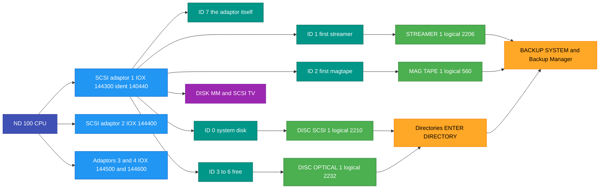
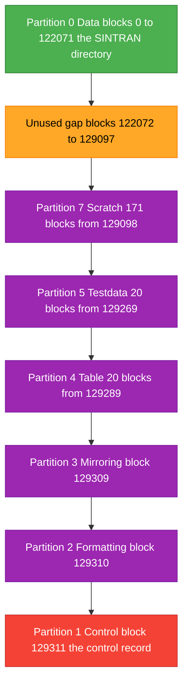
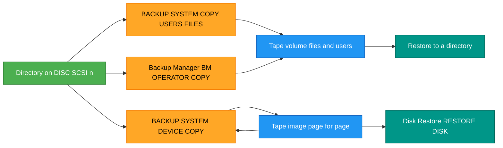

# SCSI storage under SINTRAN III - everything we know

Written 2026-10-31 from the sources in this repository. Every fact has a source.
Anything marked **inferred** is reasoning from the sources, not a quote. Anything
marked **not found** was searched for here and is not there.

## Contents

1. [Sources and how they are cited](#1-sources-and-how-they-are-cited)
2. [The big picture](#2-the-big-picture)
3. [The hardware: adaptor, buses, IDs](#3-the-hardware-adaptor-buses-ids)
4. [SINTRAN device names and logical device numbers](#4-sintran-device-names-and-logical-device-numbers)
5. [Supported devices and sizes](#5-supported-devices-and-sizes)
6. [What is on a SCSI disk: blocks, pages, partitions, control record](#6-what-is-on-a-scsi-disk-blocks-pages-partitions-control-record)
7. [Setting up SCSI devices in SINTRAN](#7-setting-up-scsi-devices-in-sintran)
8. [Using disks: create, enter, subunits, directory size](#8-using-disks-create-enter-subunits-directory-size)
9. [Using tapes: streamer and magtape](#9-using-tapes-streamer-and-magtape)
   - [9.0 Getting a SCSI streamer going - the short version](#90-getting-a-scsi-streamer-going---the-short-version-measured)
10. [Backup to tape and restore](#10-backup-to-tape-and-restore)
    - [Quick procedure: whole-disk backup and restore on a SCSI streamer](#quick-procedure-whole-disk-backup-and-restore-on-a-scsi-streamer-measured)
    - [10.1 File backup with BACKUP-SYSTEM (not possible on a streamer)](#101-file-backup-with-backup-system)
    - [10.3 Backup Manager: single files on a SCSI streamer](#103-backup-manager)
11. [Optical disk (LD 1200 WORM)](#11-optical-disk-ld-1200-worm)
12. [CD-ROM](#12-cd-rom)
13. [Maintenance programs: DISK-MM and SCSI-TV](#13-maintenance-programs-disk-mm-and-scsi-tv)
14. [Errors and status words](#14-errors-and-status-words)
15. [DOMINO SCSI on ND-5000 - a different system](#15-domino-scsi-on-nd-5000---a-different-system)
16. [Known facts vs not found](#16-known-facts-vs-not-found)

---

## 1. Sources and how they are cited

All paths are inside the NDInsight repository. Citations use the short keys below,
then a line number, for example (K-REL 13105).

| Key | File |
|---|---|
| K-REL | `SINTRAN/Release-Documentation/ND-60230-5-EN SINTRAN III - Release Information - K-version.md` |
| L-REL | `SINTRAN/Release-Documentation/ND-860230-6-EN Sintran III - Release Information - L-Version.md` |
| M-REL | `SINTRAN/Release-Documentation/ND-860230-7A-EN SINTRAN III - Release Information - M-Version.md` |
| N-REL | `SINTRAN/Release-Documentation/ND-860230-8-EN SINTRAN III - Release Information - N-version.md` |
| REF | `Reference-Manuals/ND-60.128.5 EN SINTRAN III Reference Manual.md` |
| SYS-SUP | `Operations/SINTRAN/ND-30.003.007 EN SINTRAN III System Supervisor.md` |
| HANDBOK | `Reference-Manuals/SINTRAN III Håndbok for driftsansvarlig.md` |
| BACKUP-UG | `Reference-Manuals/ND-60.250.1_EN_BACKUP_User_Guide.md` |
| TP-G | `Reference-Manuals/ND-210523G_Test_Programs_for_ND-100_110_120__ND_Software_Library.md` |
| TP-ADD | `Reference-Manuals/ND-899159-1-EN_Test_Program_Description_for_ND-100_ND-110_-_Addendum_December_1998.md` |
| TP-OLD | `Reference-Manuals/ND-830005.3 EN Test Program Description for ND-100-110.md` |
| TP-H | `Installation/Installation-Description/ND-895076-1p-EN.md` (test programs product info, SCSI-TV-C) |
| TP-I | `Installation/Installation-Description/ND-895076-2A-EN.md` (test programs 210523I, DISK-MM-C03, SCSI-TV-C04) |
| LD-INST | `Installation/Installation-Description/ND-99118-1-EN.md` (installing the LD 1200 optical drive) |
| ES-INST | `Installation/Installation-Description/ND-895560-2-EN.md` (ND-5000 ES basic software install) |
| APP-INST | `Installation/Installation-Description/ND-895496-1-EN.md` |
| BM-INST | `Installation/Installation-Description/ND-895055-1A-EN.md` (Backup Manager) |
| BM-UG | Backup Manager User Guide, ND-860276.2 EN (version B). A scan without a text layer, not in this repository (`ND-860276-2-EN.pdf` in the Oddene manual collection). Cited by the manual's own page numbers ("book page"). |
| BM-FLOPPY | The RetroCore Labs software archive (`RetroCoreLabs/norskdata-software-archive`, folder `images/<md5>/`): the six 211226B02 floppy images, listed with `ndtool`, mode files read with the parity bit stripped, 2026-11-02. |
| BM-SRC | `Installation/Installation-Description/ND-250351-3-EN.md` (Backup Manager source/C01) |
| PATCH-L | `Installation/Installation-Description/ND-895230-1A-EN.md` (SINTRAN patch notes) |
| PATCH-2 | `Installation/Installation-Description/ND-896058-2-EN.md` |
| ES-ADMIN | `Reference-Manuals/500/ND-830147-3-EN ND-5000 ES System Administrator Guide.md` |
| DOMINO | `Reference-Manuals/500/ND-814009-1-EN DOMINO SCSI Operator Guide.md` |
| PI-LD | `Installation/Product-Info/ND-110230-A1-EN.md` (LD 1200 product sheet) |
| PI-EMD | `Installation/Product-Info/ND-110326-A1-EN.md` (310/630 MB SCSI disk) |
| PI-GTS | `Installation/Product-Info/ND-110579-A1-EN.md` (ND Gigatape) |
| PI-HP | `Installation/Product-Info/ND-110580-A1-EN.md` (free-standing SCSI magtape) |
| BOARD | `SINTRAN/Devices/SCSI/nd-scsi-3201.md` |
| CTLREC | `SINTRAN/Devices/SCSI/scsi-control-record-and-mount-math.md` |
| DISKFMT | `SINTRAN/Devices/SCSI/scsi-disk-format.md` |
| ENTDIR | `SINTRAN/Devices/SCSI/SCSI-ENTER-DIRECTORY-COMPLETE.md` |
| STRINGS | `tools/boot-floppy/SCSI-DEVICE-STRINGS.md` |
| BF-README | `tools/boot-floppy/README.md` |
| INSTALL | `tools/boot-floppy/INSTALL-PROCEDURE.md` |
| CARVED | `tools/boot-floppy/CARVED-DISC-SUPPORT.md` |
| LDN | `SINTRAN/SINTRAN Structures/LOGICAL-DEVICE-NUMBERS.md` |
| OPCOM | `Operations/SINTRAN/OPCOM-COMMAND-REFERENCE.md` |
| SYMB | `SINTRAN/NPL-SOURCE/s3vs-4.symb` (SINTRAN symbol listing) |
| NPL-DISK | `SINTRAN/NPL-SOURCE/NPL/IP-P2-SCSI-DISK.NPL` |
| NPL-MAGTP | `SINTRAN/NPL-SOURCE/NPL/IP-P2-SCSI-MAGTP.NPL` |
| NPL-OPDI | `SINTRAN/NPL-SOURCE/NPL/IP-P2-SCSI-OPDI.NPL` |
| RUN | A run on the nd100x emulator, 2026-10-31: DISK-MM-B00 and SCSI-TV-B00 from floppy 210523G02-XX-02D. Measured, but not written down anywhere else in this repository. |
| RUN-TV | Runs on the nd100x emulator, 2026-11-01: SCSI-TV-B00 (floppy 210523G02-XX-02D) and SCSI-TV-C04 (floppy 210523I01-XX-02D) against an emulated Tandberg TDC 3600 at SCSI ID 1, with the SCSI command log on. |
| RUN-BK | Runs on the nd100x emulator, 2026-11-01, on copies of the nd100x `SMD0.IMG` pack (SINTRAN III VSX/500 L, system disk `DISC-75MB-1` unit 0) with an emulated Tandberg TDC 3600 at SCSI ID 1 and the SCSI command log on: S3-CONFIG, `@DEVICE-FUNCTION`, BACKUP-SYSTEM I02. |
| BASY-INST | `Installation/INSTALL-ND-LINKAGE-LOADER-AND-BACKUP-SYSTEM.md` (Backup System I04 install, verified live 2026-07-19) |
| TV-REL | `Installation/Installation-Description/ND-895560-1-EN.md` (ND-5000 basic platform install, Disk Restore from `STREAMER-1`) |
| TPS | `Installation/Installation-Description/ND-896058-4-EN.md` (Backup Manager restore from `STREAMER-1`) |
| TRACE | DISK-MM-B00 FORMAT-INITIALIZE traced on the nd100x emulator under its DAP debugger, 2026-10-31, with the SCSI command log on. DISK-MM is loaded at file word + 065400; the numbers given are its memory addresses (octal), read with nd100-dis. |
| PCB-LIST | The ND board list (PCB number, part number, short description per board), entries for PCB 3112 and 3201-3207, supplied by the repository owner 2026-11-02. Not in this repository. |
| MICROP | Micropolis 1370 Series product description, document 101689 rev D (not in this repository; a scan is on the bitsavers mirrors). Appendix A: formatted capacity. Appendix B: MODE SENSE pages and their default values. It refers to Micropolis document 110011 (SCSI implementation) for the details; 110011 is **not found**. |

Numbers ending in `B` or written with a subscript 8 are octal. The release notes
were scanned and OCR'd; where the OCR is plainly broken, that is said.

---

## 2. The big picture



In words:

- The ND-100 has up to **4 SCSI adaptors**. Each adaptor is one SCSI bus with 8 IDs,
  0-7. The adaptor takes ID 7, so each bus has room for 7 devices (K-REL 13045,
  13093, 13198).
- SINTRAN does not find devices by itself. An operator ties each SINTRAN device
  name (for example `DISC-SCSI-1`) to an **adaptor number and an ID** in the
  configuration program, then warm starts (K-REL 6936-6971).
- Disks get directories with `@CREATE-DIRECTORY` / `@ENTER-DIRECTORY`. Tapes are
  used by the BACKUP-SYSTEM, the Backup Manager, `@DEVICE-FUNCTION` and the tape
  monitor calls.
- The stand-alone programs **DISK-MM** (format and prepare disks) and **SCSI-TV**
  (test) talk to the bus directly, by adaptor and ID.
- The SINTRAN driver itself only reads the device **type** from INQUIRY (byte 0,
  8-byte request). It never sees the vendor or product name. Only the test
  programs check vendor and product (STRINGS section 5.3; BF-README 217-258).

---

## 3. The hardware: adaptor, buses, IDs

### 3.1 The board

| Fact | Value | Source |
|---|---|---|
| Board | ND-3201 SCSI/floppy controller, PN 350001; variants 3204/3205/3206/3207 | BOARD 3 |
| Same board as named in the install guide | "ND-100 PCB 350004 FLOPPY/SCSI", holds the old floppy controller and the SCSI adaptor, one SCSI bus per card, up to four cards | LD-INST 124 |
| Sales item | "ND-100 FLOPPY/SCSI adapter 110329" | LD-INST 88 |
| 3204 | the FLOPPY-STREA test program notes "Implemented Floppy/SCSI card 3204"; the 3204 adds an external word count register | TP-G 861; BOARD 726-727 |
| SCSI chip | NCR 5386, its registers sit straight on the ND-100 IOX bus; SINTRAN's driver runs the SCSI phases itself | BOARD 18 |
| Floppy half | Z80 + AM9517 DMA + FD1797; the Z80 never touches the NCR 5386 | BOARD 19-21 |
| Interrupt | ND-100 **level 11**, when WCONT bit 0 is set | BOARD 770, 776; TP-G 1737 ("correct IDENT code on level 11") |
| Bus | 8-bit parallel; single-ended or differential receivers (RSTAU bits 7 and 15) | K-REL 13045; BOARD 760, 768 |
| Termination | "The complete SCSI bus ... MUST have a termination plug at BOTH ends." Part 517691 | LD-INST 84, 223-229 |
| Cable | max 25 m from adaptor to disk (for the 310/630 MB drives) | PI-EMD 46 |

PCB number: BOARD says 350001, LD-INST says 350004. Both are right. The ND board
list (PCB-LIST) gives one part number per board edition:

| PCB | Name | Part number |
|---|---|---|
| 3201 | N-100 SCSI/Floppy Ctrl | 350001 |
| 3204 | N-100 SCSI/Floppy Ctrl I | 350004 |
| 3205 | N-100 SCSI/Floppy Ctrl II | 350005 |
| 3206 | N-100 SCSI/Floppy Ctrl III | 350006 |
| 3207 | N-100 SCSI/Floppy Ctrl IV | 350007 |

The last edition, 3207, is described as "SCSI (DL or SE) and floppy interface" with
one 8192 x 8 SRAM (8 KB). Every edition carries the SCSI adaptor **and** a floppy
controller on the same card.

#### The other streamer: PCB 3112, not used with SCSI

| Fact | Value | Source |
|---|---|---|
| Board | N-100 8" + 5.25" Floppy & Streamer Ctrl, PCB 3112, part number 324012 | PCB-LIST |
| Drives | up to 3 floppy drives (units 0, 1, 2) and one streamer (unit 0) | PCB-LIST |
| Interrupt | level 11 | PCB-LIST |
| Memory | two 2048 x 8 SRAM chips (4 KB) | PCB-LIST |
| SINTRAN | "The streamer drive did not have it's own driver/data field in Sintran III, only accessible from the Backup-System." | PCB-LIST |
| BACKUP-SYSTEM name | `STREAMER-TAPE-1` / `-2`. The I02 device table maps them to the floppy units: `STREAMER-TAPE-1` = 1000B `FLOPPY-1`, 1001B `FLOPPY-2`, 1002B `FLOPPY-3`; `STREAMER-TAPE-2` = 1003B-1005B `FLOPPY-4..6`. This fits the line above: the streamer is reached through the floppy controller's own units. | `BACKUP-SYS-I02:PROG` device table, decoded (10.1) |

The 3112 is a machine **without** SCSI. A machine with SCSI has a 3201-3207 card,
which already holds the floppy controller, so it does not also carry a 3112. That
means the two streamers belong to different machines:

- `STREAMER-TAPE-1` / `-2`: the 3112 streamer. BACKUP-SYSTEM file backup supports it,
  and the manual's tape examples use it.
- `STREAMER-1` / `-2`: the SCSI streamer on a 3201-3207 card (logical 2206B/2207B,
  I/O data field 2226B/2227B).

Text written for one of them does not hold for the other.

### 3.2 The four buses

| Adaptor | IOX range (octal) | Ident (octal) | SINTRAN logical device | Source |
|---|---|---|---|---|
| ADAPTOR-1 | 144300-144377 | 140440 | 2202B (1154 dec) | BOARD 206; K-REL 13142; RUN |
| ADAPTOR-2 | 144400-144477 | 140441 | 2203B | BOARD 207; K-REL 13144 |
| ADAPTOR-3 | 144500-144577 | 140442 | 2204B | BOARD 208; K-REL 13145 |
| ADAPTOR-4 | 144600-144677 | 140443 | 2205B | BOARD 209; K-REL 13146 |

The test programs take the adaptor in any of these forms: `ADAPTOR-n` (n = 1-4), the
number 1-4, the logical number 2202B-2205B, or the hardware number
144300B/144400B/144500B/144600B (TP-G 1073-1076).

The RUN `LIST-DEVICES` on nd100x showed ADAPTOR-1, hardware 144300, ident 140440,
logical 2202B, which matches the table.

### 3.3 Thumbwheels

| Source | What it says |
|---|---|
| BOARD 196-209 | TH1 = SCSI ID of the adaptor (strapped onto the NCR 5386 ID pins); TH2 = IDENT / IOX address (settings 0-3, repeated, select bus 1-4); TH3 = floppy |
| LD-INST 126-167 | The figure labels **TH1** "IOX and Ident" with settings 0-3 = SCSI bus 1-4, and **TH2** "SCSI ID-no. Range 0-7 (7 means host computer)" |

**The two sources swap the names TH1 and TH2.** Both agree on what the two switches
do (one picks the bus 1-4, one the adaptor's own SCSI ID). Which label is printed on
the board I do not know.

### 3.4 SCSI ID rules

From the K release notes (K-REL 13198-13204) and the LD 1200 install guide
(LD-INST 180-191):

| ID | Standard use |
|---|---|
| 0 | Main swapping device (system disk). If the system disk is SCSI it **must** be ID 0 on adaptor 1. |
| 1 | The first streamer (`STREAMER-1`) **should** be ID 1 on adaptor 1. Free if no streamer. |
| 2 | The first magtape (`MAG-TAPE-1`) **should** be ID 2 on adaptor 1. Free if no magtape. |
| 3-6 | Free |
| 7 | The ND-100 SCSI adaptor (host). With more host adaptors on one bus, use 6, 5 and so on. |

More rules:

- The MEMTOS memory-dump program needs its streamer at "ID no. 1 on SCSI adaptor
  number 1 ... (hardware device number 144300)" (N-REL 1763).
- The test programs say "ID 0 is normally equivalent to "DISC-SCSI-1" which is the
  boot disk" (TP-G 1078).
- Two ND-100s may share one SCSI bus. `@DEVICE-FUNCTION ... RESERVE-DEVICE` /
  `RELEASE-DEVICE` give one CPU sole use of a tape on that bus (L-REL 810-816).
- In a two-bus filestore cabinet, "optical disks can only be connected to the bus on
  the left side" (LD-INST 273).

### 3.5 Booting from SCSI

- The SCSI bootstrap driver is only in K standard system D (K-REL 934). It is in
  all L, M and N standard systems (L-REL 397; M-REL 466; N-REL 490).
- NDInsight's OPCOM table lists `#144300&` as the SCSI disk bootstrap command
  (OPCOM 155). That table is NDInsight's own summary. I did not find the original
  ND manual line behind it.
- The ND-3201 ROM has an "autoload" path. It copies an ND-100 SCSI boot driver
  into ND-100 memory at 6000B and puts `JMP I` at address 0. That driver uses
  bus 1 (144300) (BOARD 83-131).
- MACM, the generation program, cannot talk to a SCSI disk. `IOXT` appears zero
  times in it, and 144300 needs 16 bits while `IOX` carries 11 (BF-README 170-174).

---

## 4. SINTRAN device names and logical device numbers

### 4.1 The official name list

K-REL section 22.2 (K-REL 13091-13136), with the logical device numbers from 22.3
(K-REL 13142-13190):

| Device type | Max per system (K) | SINTRAN device names | Logical device numbers (octal) |
|---|---|---|---|
| SCSI adaptor | 4 | (no file-system name; test programs call them ADAPTOR-1..4) | 2202-2205 |
| Magnetic disk | 14 | `DISC-SCSI-1` ... `DISC-SCSI-14` | 2210-2225 (DISC-SCSI-1 = 2210, ..., DISC-SCSI-7 = 2216, DISC-SCSI-8 = 2217, ..., DISC-SCSI-14 = 2225) |
| Optical disk | 4 | `DISC-OPTICAL-1` ... `DISC-OPTICAL-4` | 2232-2235 |
| Streamer tape | 2 | `STREAMER-1`, `STREAMER-2` | 2206, 2207 |
| Magnetic tape | 4 | `MAG-TAPE-1` ... `MAG-TAPE-4` | 560, 1111, 1231, 1224 |

The SINTRAN symbol listing agrees for the streamers, disks 1-8 and optical 1-2
(SYMB 25062-25092). The LDN summary file gives the same ranges (LDN 423-428).

**Subdivided disks.** "The device name is expanded (in the same way as for SMD
disks) with the number of subunits included in the name". The K notes give two
examples (K-REL 13133-13136):

- `DISC-2-SCSI-3` means SCSI disk number 3 divided into 2 subunits.
- `DISC-8-OPTICAL-1` means optical disk 1 divided into 8 subunits.

So the full name set is `DISC-SCSI-n` and `DISC-k-SCSI-n`, for k = 2..8 and
n = 1..14. That is 112 names. The L07 and M06 images carry all 112; K images carry
fewer (INSTALL 402-424; CARVED 285-290).

> Note on a wrong reading in NDInsight: INSTALL 426-431 guesses that the leading
> number in `DISC-n-SCSI-u` counts spindles. The K release notes say it is the
> number of **subunits** (K-REL 13135). The release notes are the authority.

**DISC vs DISK.** The manuals and the name table in the image say `DISC-SCSI-n`
(K-REL 13105; INSTALL 406). Comments in the symbol listing and one patch note write
`DISK-SCSI-n` (SYMB 25066; PATCH-L 251-252). Inferred: the name SINTRAN accepts is
`DISC-...`. The `DISK-...` spelling is loose writing in comments.

### 4.2 Two numbers per tape drive

A tape drive has more than one logical device number. The difference matters when
you make a peripheral file.

| Drive | Device / config number | Number used in the peripheral file | Source |
|---|---|---|---|
| SCSI streamer 1 | 2206B ("SCSI streamer tape drive no. 1") | **2226B** ("SCSI STREAMER 1 I/O, UNIT 0") | K-REL 13148; SYMB 25062, 25082; BM-INST 611; ES-ADMIN 1675 |
| SCSI streamer 2 | 2207B | **2227B** | K-REL 13150; SYMB 25084; BM-INST 612 |
| SCSI magtape 1 | 560B | `MAG-TAPE-0` = **40B** | K-REL 13180, 13210; BM-INST 613 |
| SCSI magtape 2 | 1111B | `MAG-TAPE-4` = **32B** | K-REL 13181, 13211; BM-INST 614 |
| SCSI magtape 3 | 1231B | `MAG-TAPE-8` = **1232B** | K-REL 13182, 13212; BM-INST 615 |
| SCSI magtape 4 | 1224B | `MAG-TAPE-12` = **1225B** | K-REL 13183, 13213; BM-INST 616 |

The streamers also have a "DF data field" number: 2230B / 2231B (LDN 427;
SYMB 25086-25088).

Inferred, from the tables above: the first number (2206B, 560B, ...) is the
device's data field. It is used to tie the drive to an adaptor and ID (MON IOMTY
function 300B accepts 560, 1111, 1224, 1231, 2210-2225, 2232-2235; K-REL 3700). The
second number (2226B, 40B, ...) is the I/O data field. A peripheral file for
`@DEVICE-FUNCTION` and for file-style tape access points at that one.

Two warnings from the source:

- **Overlap.** Magtape 3 and 4 numbers overlap the ST-506 (Winchester) controllers
  2 and 1. So with 1 ST-506 controller you can have at most 3 SCSI magtapes; with
  2, at most 2 (K-REL 13215).
- **Streamers missing from MON 300B.** The list of numbers accepted by MON IOMTY
  300B-303B does not include 2206/2207 (K-REL 3700, 3719, 3747, 3766). Yet the
  configuration program has a "SCSI streamer 1" line (K-REL 6925). I have not found
  why. It could be an omission in the manual; I do not know.

### 4.3 Names used elsewhere for tapes - careful

| Name | What it is | Source |
|---|---|---|
| `STREAMER-1` / `STREAMER-2` | SCSI streamer, SINTRAN device name and Backup Manager device name | K-REL 13124; BM-INST 611; ES-INST 359, 461 |
| `STREAMER-TAPE-1` / `-2` | The streamer on the **3112 floppy-and-streamer controller**, not SCSI. It has no SINTRAN data field of its own; BACKUP-SYSTEM reaches it through the floppy units 1000B-1005B (3.1). | PCB-LIST; TP-OLD 4001-4006; BACKUP-UG 4389; SYS-SUP 11496 |
| `MAG-TAPE-1..4` | Used for both the old magtape controllers (Cipher, Pertec, STC) and SCSI magtapes | K-REL 937-938, 13130 |

**Not found** anywhere in NDInsight: `SCSI-STREAMER`, `SCSI-MAGTAPE`, `SCSI-TAPE`,
`CDROM`, `CD-ROM` as a SINTRAN device name.

---

## 5. Supported devices and sizes

### 5.1 What SINTRAN K says it supports

K-REL 13066-13081 lists:

- magnetic disks of 60, 125 and 150 MB (5 1/4 inch, fixed);
- magnetic disks of 310 and 630 MB (8 inch, fixed);
- a 1 GB optical disk drive (Laserdrive 1200);
- a 125 MB streamer tape drive;
- an STC magnetic tape drive.

All SCSI magnetic disks "may be divided into 2, 3, 4, 5, 6 or 8 subunits". The
optical disk may be divided into 2-8 subunits (K-REL 13074-13077).

Later versions, per standard system (L-REL 390-394; M-REL 459-466; N-REL 483-490):

| | L std A | L std B | Source |
|---|---|---|---|
| SCSI host adaptors | 3 | 2 | L-REL 390 |
| SCSI disks per system | 8 | 8 | L-REL 391 |
| SCSI streamers per system | 2 | 2 | L-REL 392 |
| SCSI magtapes per system | 3 | 2 | L-REL 393 |
| SCSI optical disks per system | 2 | 2 | L-REL 394 |

M adds "SCSI magnetic tape drives with several logical units on each controller"
(M-REL 435).

### 5.2 Drive models

The model names come from the test programs' supported-product lists (TP-G
1567-1575; TP-ADD 944-955) and from the vendor/product tables decoded from the
program binaries (STRINGS section 3). SINTRAN itself does not check any of these
names (section 2).

| Class | Vendor / product (INQUIRY strings) | What it is | Size | Source |
|---|---|---|---|---|
| Disk, 5 1/4" | `NDMICROP` / `1375` (also `MICROP`) | Micropolis 1375 | ND lists 60 MB and 125 MB variants; block size 1024 | TP-G 1061, 1120-1125; STRINGS 63; RUN |
| Disk, 8" | `NDCDC` / `EMD 97201 (736)`, `(368)`, `(000)`, `(1.2)` | CDC EMD 97201 | 310 and 630 MB; block size 512 | TP-G 1062, 1124-1125; STRINGS 64, 211, 221; PI-EMD 22 |
| Disk, 5 1/4" | `NDCDC` / `94171-9` (also -7, -5); listed as "WREN IV, 5 1/4" fixed disk" | CDC WREN IV | Inferred 310 MB (DOMINO lists "310 Mbyte disk drive (5 1/4 inch WREN)") | TP-H 339; DOMINO 349-350; STRINGS 192, 222 |
| Disk | `NDCDC` / `94181-15`, `94181-13` | CDC (family not named) | not found | STRINGS 192, 223 |
| Disk, 5 1/4" | (not named) | "155MB SCSI 5.25" disk drive (326392)" | 155 MB | TP-ADD 51; APP-INST 439 |
| Streamer | `TANDBERG` / ` TDC 3600`, ` TDC 3600 EXPR.`, `RG TDC 3600` | Tandberg TDC 3600 | Inferred: the "125-megabyte streamer" of K-REL 13079; not stated | TP-G 1570; STRINGS 156 |
| Streamer | `ARCHIVE` / `VIPER 150  21247` (and serial variants 99999, 25066, 21835) | Archive Viper 150 | "the 155MB Archive streamer" | TP-G 1575; STRINGS 193; BM-INST 91 |
| Streamer (8 mm) | `EXABYTE` / `EXB-8200`, later `EXB-8500` | ND Gigatape System (GTS), ND 110579 | 2.2 GB per cartridge | TP-H 340; PI-GTS 38; STRINGS 197 |
| Magtape | `NDSTK` / `2925` | StorageTek 2925, ND 110324 | "<250 Mb/tape" | TP-G 1574; LD-INST 77 |
| Magtape | `HP` / `88780` | HP 88780; inferred to be ND 110580, the free-standing 1600/6250 bpi SCSI magtape | 140 MB per 2400 ft reel at 6250 bpi GCR | TP-H 341; TP-ADD 51; PI-HP 3, 62 |
| Optical (WORM) | `OSI` / `LD 1200 SCSI` | Laserdrive LD 1200, ND 110230 | 1 GB per side, two sides | TP-G 1572; PI-LD 23; LD-INST 76 |
| Disk (DOMINO list only) | `CDC WREN IV` | | block size 512 | STRINGS 65 |

Notes:

- "Early versions of the MICROPOLIS disk 1370 for 60MB will not be recognized" by
  SCSI-TV-B (TP-G 1902). SCSI-TV-C04 fixed this (TP-I 638).
- SCSI-TV-C04 "will now accept any SCSI device without giving any warnings. Devices
  unknown to the program are treated as standard disk/streamer/magtape devices"
  (TP-I 634). DISK-MM-C "is now able to format disks not delivered from ND"
  (TP-I 45).
- The test programs do not store the device class. They read it from the live
  INQUIRY reply (STRINGS 136-141, 236-250).

### 5.3 The Micropolis 1375 as seen in the RUN

From RUN (not in NDInsight):

- vendor `NDMICROP`, product `1375`, rev `B0C`;
- 1024-byte blocks, 129312 blocks.

The same block count is in NDInsight's decode of a real SCSI-K disk image: raw
129312 blocks = 64656 pages, of which 122072 blocks = 61036 pages are usable
(DISKFMT 44-47, 129-138).

SINTRAN shows this disk as `DISC-SCSI-1 UNIT 0 ** 125 Mb **`, with 61036 pages
(ENTDIR 264-268).

Open: the Micropolis 1370-series data sheet (document 101689, on bitsavers;
not in this repository) says the 1375 has 8 heads, 1018 formatted cylinders and
18 blocks of 1024 bytes per track. That is 146592 blocks, about 150.1 MB. The ND disk
has 129312 blocks. 129312 = 898 x 8 x 18, so the ND disk may use only 898 of the
1018 cylinders. But DISKFMT 133 warns that this split comes from our own emulator
and is not proven. K-REL lists both a 125 MB and a 150 MB 5 1/4-inch disk
(K-REL 13069-13070). Why the ND unit is 129312 blocks is **not found**.

### 5.4 Block and page sizes

| Unit | Size | Source |
|---|---|---|
| SINTRAN "logical" block | always 1024 bytes | TP-G 1104 |
| SINTRAN file-system page | always 2048 bytes = 2 blocks | TP-G 1108; DISKFMT 37 |
| Media block | the drive's own sector size (1024 for Micropolis 1375, 512 for CDC EMD 97201 and WREN IV) | TP-G 1100; STRINGS 63-65 |
| Disk record size in the driver | 1024 bytes for direct-access devices | NPL-DISK 1266-1267 |
| Tape | fixed block mode (1024-byte records) if READ BLOCK LIMITS gives min = max; otherwise variable, byte count | NPL-DISK 1256-1273 |
| Streamer MODE SELECT | the driver sets block size 1024 unless the device is in fixed block mode | NPL-DISK 555-556 |
| Optical | two disc types: `DTOD1` RS=1024 and `DTOD2` RS=2048 | SYMB 2977-2978; CARVED 114-115 |
| LD 1200 medium | 32000 tracks x 32 sectors x 1024 user bytes per side | PI-LD 57 |
| Hard limit in SINTRAN | block size must fit 16 bits, be > 1, and be a power of two, else `RSZER` / `ILRCS`. No maximum disk size anywhere | BF-README 210-213 |

SINTRAN holds **no table of valid SCSI disk sizes**. Every `DISC-n-SCSI-m` and
`DISC-n-OPTICAL-m` entry in the name table has size 0. The size comes from READ
CAPACITY and from the disk's own control record (CARVED 250-262; BF-README
182-208).

---

## 6. What is on a SCSI disk: blocks, pages, partitions, control record

A SCSI disk used by an ND-100 is not just a file system. DISK-MM puts a small
partition table at the top of the disk, and SINTRAN reads it when it mounts the
disk.

### 6.1 The partitions (from the RUN)

`LIST-DISK-INFORMATION` in DISK-MM, on a Micropolis 1375 of 129312 blocks (RUN):

| No. | Name | Start block | Length (blocks) |
|---|---|---|---|
| 0 | Data | 0 | 122072 |
| 1 | Control | 129311 | 1 |
| 2 | Formatting | 129310 | 1 |
| 3 | Mirroring | 129309 | 1 |
| 4 | Table | 129289 | 20 |
| 5 | Testdata | 129269 | 20 |
| 6 | (none listed) | | |
| 7 | Scratch | 129098 | 171 |

The disk said "Formatted by DMM - Version C02, 1989-08-17". The test-program product
notes list DISK-MM B00, B01 and C03 (STRINGS 39-43; TP-I 473). A C02 is **not
listed** in NDInsight.

What the manuals say about partitions:

- "Table partition": REASSIGN and REFRESH-DATA are logged there (TP-G 1165, 1177).
- "Data partition": SCSI-TV test 14 copies from it to the scratch area (TP-G 1858).
- "Scratch partition": SCSI-TV tests 12 and 14 write there (TP-G 1850, 1858).
- DISK-MM-C03 has `LIST-DISK-PARTITIONS` and write protection levels Off / Normal /
  On. In Normal, every partition except Data is write-protected (TP-I 582-588).
  "If the disk is not initialized, the entire disk will be treated as a data
  partition" (TP-I 522).

The names Control, Formatting, Mirroring and Testdata do **not** appear in any
manual in NDInsight. They come from the program's own output (RUN).

The Scratch partition's length is not a fixed number. FORMAT-INITIALIZE works it out
from the drive: (heads + 1) x sectors per track, both read from MODE SENSE (TRACE;
section 13.3). On the emulator, with 8 heads and 18 sectors per track, it is 162. The
171 above is 9 x 19, which fits a 1375 formatted with 19 sectors of 1024 bytes per
track, the example in MICROP Appendix A. **Inferred**: that the RUN disk was
formatted that way is reasoning from the number, not read from the disk.

### 6.2 The control record (last block)

NDInsight decoded the last block of a real SCSI-K image byte by byte (CTLREC
149-190; DISKFMT section 4):

- Header word 0 = `0x080054D9`. Its high byte 8 is read as **NPART = 8** (CTLREC 169).
- Header word 3 = `0x0001DCD8` = 122072 = **UHLIM**, the usable block count
  (CTLREC 172).
- Then 12-byte entries `{flag, LBA, length}`:

| Entry | Flag | LBA | Length |
|---|---|---|---|
| 0 | C0 | 129311 | 1 |
| 1 | C0 | 129310 | 1 |
| 2 | E0 | 129309 | 1 |
| 3 | E0 | 129289 | 20 |
| 4 | E0 | 129269 | 20 |
| 5 | (empty slot) | | |
| 6 | E0 | 129098 | 171 |

**Inferred, but the match is exact:** this record **is** DISK-MM's partition table.

- Header word 3 is the length of partition 0 (Data).
- Entry k is partition k+1: Control, Formatting, Mirroring, Table, Testdata, (6
  unused), Scratch.
- NPART = 8 is partitions 0-7.

NDInsight's DISKFMT and CTLREC call entries 2-6 "spare-pool extents" and block
129310 a "disk-parameter block". The RUN names should replace those guesses.
NDInsight also says block 129310 holds "device-type / vendor / revision /
format-date" (DISKFMT 61-62). That fits the name "Formatting partition" (inferred).

How SINTRAN uses the record:

- When a SCSI disk is connected, the driver's function 42 reads the last block. It
  checks NPART and an XOR checksum, sets UHLIM from header word 3, and copies the
  partition table (CTLREC 196-205; BF-README 201-208).
- If the record is missing, the driver error is "11B No control record on magnetic
  disk" (K-REL 13322).
- READ CAPACITY reports the **raw** size (last LBA 129311), not the usable size
  (DISKFMT 49-53, 160-186).



What the 7026-block gap between the Data partition and the Scratch partition is for
is **not found** (DISKFMT 148-156 calls it open).

---

## 7. Setting up SCSI devices in SINTRAN

### 7.1 Order of work (put together from the sources)

This order is a summary. Each step has its own source.

1. **Hardware.** Set the adaptor's bus number (1-4) and its own SCSI ID (7), give
   each device a free ID (section 3.4), terminate both ends of the bus (LD-INST
   174-191, 227-229).
2. **Check the bus.** Run SCSI-TV `LIST-DEVICES` (C version: `LIST-PRESENT-DEVICES`)
   and see that every device answers (LD-INST 474; TP-ADD 1027).
3. **Prepare each new disk** with DISK-MM: `SELECT-DEVICE`, then `FORMAT-INITIALIZE`
   (or `INITIALIZE` on an already formatted disk). INITIALIZE "Prepares the disk for
   use under SINTRAN" (TP-G 1112, 1129). See section 13.
4. **Tie names to adaptor and ID** in the SINTRAN configuration program (section
   7.2).
5. **Warm start** (or cold start, see below).
6. **Make peripheral files** for tapes (section 9.1), and add
   `@DEFINE-MASS-STORAGE-UNIT` lines to LOAD-MODE where needed (section 7.3).
7. **Create and enter directories** on disks (section 8).

### 7.2 The configuration program (S3-CONFIG), SCSI command

- The program is called **S3-CONFIG**, run as user SYSTEM. Give the command `SCSI`
  (LD-INST 317).
- Menu 1 (K-REL 6911-6925; LD-INST 319-328): lines "SCSI disk no. 1" to "SCSI disk
  no. 14", and "SCSI streamer 1" / "SCSI streamer 2". Each line has a **Current**
  and a **Next** column.
- Menu 2, reached with the scroll-down key or `N` (K-REL 6949-6957; LD-INST
  339-347): "Optical disk no. 1-4" and "Mag. tape no. 1-4".
- **Each entry is `adaptor.ID`.** You type the adaptor number (1-4) left of the
  period and the SCSI ID (0-7) to the right. For example, `1.0` is adaptor 1, ID 0
  (K-REL 6936, 6965).
- An example from the manual (K-REL 6918-6925, 6953-6956):

| Line | Value |
|---|---|
| SCSI disk no. 1 | 1.0 |
| SCSI disk no. 2 | 1.3 |
| SCSI disk no. 3 | 1.5 |
| SCSI streamer 1 | 1.1 |
| Optical disk no. 1 | 1.4 |
| Mag. tape no. 1 | 1.2 |

- Changes "will be stored in the SINTRAN III image and save areas immediately, and
  ... a warm start is required for the changes to take effect" (K-REL 6971). The
  LD 1200 guide instead says "Do a COLD-START to make the new definition in
  S3-CONFIG active" (LD-INST 489). The two sources do not agree. A cold start
  would cover both cases (inferred).
- The same tie can be made by program: MON 336 (IOMTY) functions 300B (set), 301B
  (get), 302B (delete) and 303B (get current), "VSX only", user SYSTEM only. Word 1
  is the SINTRAN logical device number, word 2 the adaptor's logical number
  2202B-2205B, word 3 the SCSI ID 0-7 (K-REL 2357-2360, 3692-3780).

### 7.3 @DEFINE-MASS-STORAGE-UNIT

- Format: `@DEFINE-MASS-STORAGE-UNIT <device name>,<device unit> [,<F or R>]
  [,<device sub-unit>]` (REF 2535).
- It reserves a directory-table index for a device that is not entered yet. "A
  definition of a device in the directory table does not survive a warm start"
  (REF 2528, 2547). That is why it goes in **LOAD-MODE**.
- The LD 1200 guide says: put `@DEFINE-MASS-STORAGE-UNIT <device name> <device
  unit> ...` in LOAD-MODE. The device name is `DISC-OPTICAL-1` to `DISC-OPTICAL-4`
  and must match S3-CONFIG (LD-INST 357-363).
- A real K load-mode file defines `FLOPPY-DISC-1 0` and also `STREAMER-1`
  (NDInsight paraphrase in `Installation/OS/research/HDD-IMAGE-FINDINGS.md`
  line 98; the exact line was not checked).
- On an ND-5000 ES system, `@LIST-MASS-STORAGE-DEVICES` shows `DIR INDEX 3 :
  STREAMER-1 UNIT 0` beside the SCSI disk subunits (ES-ADMIN 1642-1651).
- Related commands: `@DELETE-MASS-STORAGE-UNIT`, `@LIST-MASS-STORAGE-UNITS`
  (REF 2531-2532, 2867).

---

## 8. Using disks: create, enter, subunits, directory size

### 8.1 Commands

| Command | Format | Source |
|---|---|---|
| `@CREATE-DIRECTORY` | `<directory name>,<device name>,<unit>[,<F or R>][,<subunit>],<bit file address>` - user SYSTEM only for hard disk; `<unit>` always required | REF 2080-2109 |
| `@ENTER-DIRECTORY` | `<directory name>,<device name>,<unit>[,<F or R>][,<subunit>]`; from K, device unit is always required | REF 4669; K-REL 1565-1569 |
| `@RELEASE-DIRECTORY` | `<directory name>` | REF 7434 |
| `@SET-MASS-STORAGE-SIZE` | `<device name>,<device unit>[,<F or R>][,<sub-unit>],<number of pages>` - set the directory size on a SCSI disk | K-REL 1853-1863, 13376-13388 |
| `@EXPAND-DIRECTORY` | for SCSI/DOMINO disks, M version | M-REL 1043, 1057 |

`F` / `R` (fixed / removable) does not apply to SCSI disks. It "only apply to disks
which have both a fixed and a removable part" (REF 2090).

Real examples:

- `@ENTER-DIRECTORY,,DISC-SCSI-1,0`, then `@DIR` gives `DIR INDEX 0 : DISC-SCSI-1
  UNIT 0 ** 125 Mb ** : PACK-ONE ... OUT OF 61036 PAGES` (ENTDIR 264-268).
- 310 MB disk in 6 subunits: `@ENTER-DIRECTORY PACK-USERS-2 DISC-6-SCSI-1 0 3`
  (APP-INST 470). "The device DISC-6-SCSI-1 is used for 310 MByte discs. The device
  DISC-3-SCSI-1 is used for 155 MByte discs" (APP-INST 438-439).
- ND-5000 ES system disk: `DISC-4-SCSI-1`, unit 0, subunits 0 and 1 (ES-INST
  457-467, 525-533). Another ES system uses `DISC-2-SCSI-1,0,0` and `,0,1`
  (PATCH-2 134-135).

### 8.2 How directory size is set on SCSI

- For SMD and Winchester disks the size is part of the device name (for example
  DISC-70MB-1).
- On SCSI disks, "the directory size is set to the total disk capacity divided by
  the number of subunits on the device" (K-REL 13371). Here "total capacity" means
  the usable count from the control record, not the raw size (inferred from
  section 6.2: 61036 pages = UHLIM / 2).
- `@SET-MASS-STORAGE-SIZE` changes it, for example to match an SMD directory so a
  directory can be copied page for page. It cannot be changed while a directory on
  that device is entered. The unit and sub-unit parameters "are dummy, but must be
  within legal ranges" (K-REL 13376-13383).
- Example: `@SET-MASS-STORAGE-SIZE DISC-2-OPTICAL-1,,,220584` matches the 450 MB
  SMD size (K-REL 13388). 220584 pages is the tabled size for 450 MB (BF-README 192).
- Error 3204, "INCOMPATIBLE DIRECTORY SIZES ON THIS CONTROLLER", belongs to the
  same area (K-REL 13358).

### 8.3 Sharing and reserve

New error texts for systems with SCSI (K-REL 13357-13363):

- "3203 DIRECTORY ENTERED BY ANOTHER SYSTEM"
- "3210 DEVICE RESERVED BY ANOTHER SYSTEM"

These are about two ND-100s on one bus (inferred from the wording).

`@DISC-ACCESS-LOG` "does not support SCSI disks in generations 312 nor 406 nor 500"
(K-REL 6488).

---

## 9. Using tapes: streamer and magtape

### 9.0 Getting a SCSI streamer going - the short version (measured)

Done on SINTRAN L with the streamer at adaptor 1, SCSI ID 1 (RUN-BK). Three steps,
in this order:

| Step | What to do | What goes wrong if you skip it |
|---|---|---|
| 1 | In **S3-CONFIG**, menu `SCSI`, set **SCSI streamer 1** to `1.1` (adaptor 1, ID 1). Boot again. | Every `@DEVICE-FUNCTION STREAMER-1 ...` answers `ILLEGAL PARAMETER`, and **no SCSI command reaches the drive at all**. `READ-LAST-STATUS` still answers, so the file looks alive. |
| 2 | `@SET-PERIPHERAL-FILE "STREAMER-1" 2226B` (and `@SET-FILE-ACCESS STREAMER-1 RWACD RWACD RWACD`). | `NO SUCH FILE NAME` on every tape command. Use 2226B, not 2206B: 2206B gives `NO SUCH LOGICAL UNIT`. |
| 3 | Test: `@DEVICE-FUNCTION STREAMER-1 LOAD`, then `... REWIND`. Both return straight to `@` with no message. | - |

Step 1 is the trap. The pack used for RUN-BK came with **SCSI streamer 1 = 0.0**,
which means "not configured", while SCSI disk 1 was `1.0`.

What the drive saw on the first LOAD after the fix, in order (RUN-BK, SCSI log):
INQUIRY (12h), TEST UNIT READY (00h), which got a UNIT ATTENTION, REQUEST SENSE (03h),
INQUIRY, TEST UNIT READY, MODE SENSE (1Ah, 12 bytes), MODE SELECT (15h, 12 bytes,
buffered mode 1, density 0), LOAD (1Bh, load bit set). REWIND then sent REWIND (01h).

**Driving S3-CONFIG from a plain terminal** (RUN-BK). S3-CONFIG is a full-screen
program:

1. `@S3-CONFIG`, then answer the terminal type question (36 = Tandberg TDV 2215).
2. Type `SCSI` and Return. The cursor lands on SCSI disk 1.
3. Each Return moves one half field: adaptor, then ID, for disk 1, 2, ... 8. The
   empty rows (disks 9-14) are skipped. **15 Returns** reach the adaptor field of
   SCSI streamer 1.
4. Type `1`, Return, `1`, Return.
5. Type `.` **without** Return. This leaves the form. A Return here would pick the
   SCSI menu again.
6. Type `E` **without** Return (it highlights EXIT), then Return. The program
   answers `- EXIT from SINTRAN III configuration program -`. Typing the whole word
   `EXIT` does not work: the menu jumps on every letter (E = EXIT, X = XMSG,
   I = IO-COMM), so Return then opens IO-COMM.
7. Boot again. The new value was in force after a fresh boot from the disk.

The sources disagree on whether a warm or a cold start is needed (section 7.2). RUN-BK
only shows that a new boot from the disk is enough.

### 9.1 Peripheral file

To use a tape with `@DEVICE-FUNCTION` or a tape monitor call, you need a peripheral
file. The ND-5000 ES mode file `(MODE-FILES)DEF-PERIPHERALS:MODE` does this
(ES-ADMIN 1661-1676):

```
@DELETE-FILE STREAMER-1
@SET-PERIPHERAL-FILE "STREAMER-1" 2226B
@SET-FILE-ACCESS STREAMER-1 RWACD RWACD RWACD
```

`@SET-PERIPHERAL-FILE <file name>,<logical device no.>` (REF 9117). For SCSI
magtapes, the recommended peripheral files are `MAG-TAPE-0` = 40B, `MAG-TAPE-4` =
32B, `MAG-TAPE-8` = 1232B and `MAG-TAPE-12` = 1225B (K-REL 13206-13213). The Backup
Manager needs exactly these files to find ND-100 tape drives (BM-INST 607-616).

### 9.2 @DEVICE-FUNCTION

- Format: `@DEVICE-FUNCTION <peripheral file name>,<function> [,<opt1>[,<opt2>]]`
  (REF 3068).
- For **SCSI streamers**, K added two functions: `LOAD` - "should always be used
  after a new tape is inserted" - and `RESET-DEVICE` - "performs a hard reset of the
  device. Any tape loaded will be rewound" (K-REL 1550-1555). The numbers 312 and
  406 printed beside them in the OCR text look like scan noise; I do not know what
  they are.
- L added `RESERVE-DEVICE` and `RELEASE-DEVICE`, for two ND-100s on one SCSI bus.
  "Note that the commands will not reserve any device for use by a program in the
  usual SINTRAN III way" (L-REL 810-816).
- Other functions (REWIND, ADVANCE-RECORDS, ADVANCE-TO-EOF, WRITE-EOF, UNLOAD,
  ...) follow the REF chapter from line 3087. Example after a backup:
  `@DEVICE-FUNCTION MAG-TAPE-1 WRITE-EOF`, then `@DEVICE-FUNCTION MAG-TAPE-1
  UNLOAD` (HANDBOK 12519-12520).

### 9.3 Tape monitor calls

MON ABSTR (MON 131) supports SCSI streamers for these functions (K-REL 13225-13254):

| Function | Name |
|---|---|
| 0 | read |
| 1 | write |
| 2 | read parity |
| 3 | compare |
| 7 | erase tape |
| 10 | advance through EOF |
| 12 | write EOF |
| 13 | rewind |
| 16 | advance records |
| 17 | unload |
| 20 | read status |
| 24 | read last status |
| 30 | load |
| 31 | reset |
| 34 | reserve unit |
| 35 | release unit |
| 37 | read extended status |
| 42 | read format |
| 54 | copy |
| 60-63 | double-amount versions |
| 70 | retension |
| 73 | test unit ready |
| 74 | execute user CDB |
| 75 | inquiry |
| 76 | advance to end of recorded area |

The functions marked with `*` in the manual are also allowed through MON MAGTP
(MON 144) and `@DEVICE-FUNCTION` (K-REL 13256).

The magtape driver has its own, longer list, including select density (23), read
error counters (25), byte records (26/27) and multiple records (50/51)
(NPL-MAGTP 10-53).

**Magtape density (MON 144 function 23):** the codes mean different things on
SCSI magtape and on STC (K-REL 1941-1951):

| Code | SCSI magtape | STC |
|---|---|---|
| 0 | drive default | 1600 BPI |
| 1 | 800 BPI | 6250 BPI |
| 2 | 1600 BPI | 800 BPI |
| 3 | 6250 BPI | illegal |
| 800 / 1600 / 6250 | that density | that density |

---

## 10. Backup to tape and restore

### Quick procedure: whole-disk backup and restore on a SCSI streamer (measured)

Proven end to end on SINTRAN L, BACKUP-SYSTEM I02, a Tandberg TDC 3600 at adaptor 1,
SCSI ID 1 (RUN-BK). Details and the errors you get when a step is missing: 9.0, 10.0a,
10.2.

```
-- once: S3-CONFIG, menu SCSI, "SCSI streamer 1" = 1.1, then boot again (9.0)
@SET-PERIPHERAL-FILE "STREAMER-1" 2226B
@DEFINE-MASS-STORAGE-UNIT STREAMER-1 0
@SINTRAN-SERVICE
START-XMSG
EXIT
@MODE (UTILITY)BACKUP-LOAD-I00:MODE TERMINAL
@RT DMASRV
@DUMP-PROGRAM-REENTRANT BACKUP-SYSTEM-I, (UTILITY)BACKUP-SYS-I02:PROG
@BACKUP-SYSTEM
Ba-sy: DEVICE-COPY STREAMER-1 0 DISC-75MB-1 0 COPY      <- backup  (disk to tape)
Ba-sy: DEVICE-COPY DISC-75MB-1 0 STREAMER-1 0 COPY      <- restore (tape to disk)
```

In RUN-BK each name and the word COPY were typed as answers to the prompts, one per
line. Whether the program also takes them on one line was not tested. Replace
`DISC-75MB-1 0` with your own disk name and unit (`@LIST-DIRECTORIES-ENTERED`).

What does **not** work with this streamer and BACKUP-SYSTEM I02: file backup to a
volume (`CREATE-VOLUME` refuses the device, 10.1). For files, use the Backup Manager
(10.3).

### 10.0 Which tool does what with a SCSI streamer

| Tool | Backup to `STREAMER-1` | Restore from `STREAMER-1` | Source |
|---|---|---|---|
| **BACKUP-SYSTEM** (ND 210337), `@BACKUP-SYSTEM`, prompt `Ba-sy:` | **Whole disk unit only**, with `DEVICE-COPY`. Single files (`CREATE-VOLUME` + `COPY-USERS-FILES`) are refused for the streamer in I02 (measured, 10.1). | `DEVICE-COPY` the other way round, source `STREAMER-1` | L-REL 3572; BACKUP-UG 4252-4500; RUN-BK |
| **Backup Manager** (ND 211226), `@BM-OPERATOR` | Files or whole directories, to a `VOLUME` or `TAR` on `STREAMER-1` | `COPY` with `From VOLUME ... STREAMER-1 0`, `To DIRECTORY` | BM-INST 607-616; ES-INST 350-415; TPS 184-189 |
| **Disk Restore** (ND 211187B), stand-alone | - | A whole-disk image from `STREAMER-1` to a SCSI disk | TV-REL 225-275; ES-INST 453-499 |
| DIR-BACKUP (stand-alone, SINTRAN stopped) | Not for SCSI. It asks for a "STREAMER system (1-2)" and handles disks up to 75 MB. Inferred: the 3106/3112 streamer. | same | BACKUP-UG 3266-3555 |
| MCOPY (stand-alone) | No: "Cipher, Tandberg, Pertec and STC Mag-tape drives" | - | BACKUP-UG 3016 |

Versions (L-REL 3571-3573; N-REL 2353-2354): BACKUP-SYSTEM version H is needed for
more than 256 files per user. **Version I is needed for SCSI streamers.** Revision I05,
with DMA server I05, is needed for SCSI optical disks and SCSI magtapes. K-REL 14032
gives "revision I03 / DMA server I02" for the same optical and magtape support; the two
release notes do not agree.

### 10.0a Putting BACKUP-SYSTEM I on a pack (measured)

The official way is the installer on floppy 210337I04-XX-01S/02S/03S (or I05-XX-01D).
It copies the files and then does the steps below (BASY-INST §3). The steps, as run by
hand in RUN-BK:

```
@DUMP-PROGRAM-REENTRANT BACKUP-SYSTEM-I, (UTILITY)BACKUP-SYS-I02:PROG
@BACKUP-SYSTEM
BACKUP-SYSTEM / I02  870827
Ba-sy:
```

What each piece is, and what happens without it (RUN-BK):

| File | Where | Without it |
|---|---|---|
| `BACKUP-SYS-I02:PROG` | UTILITY | - |
| `UE-ERMSG-EN-C05:ERR` (error texts; the program opens `UE-ERMSG-EN-C`) | SYSTEM | `@BACKUP-SYSTEM` prints `NO SUCH FILE NAME` and then hangs, with no prompt. An older `UE-ERMSG-EN-B03` on the pack does not match. |
| `BACKUP-SERV-I02:PROG` (the DMA server) and `BACKUP-LOAD-I00:MODE`, which loads it onto segment `DMASEG` with the RT-loader | UTILITY | BACKUP-SYSTEM still runs. For DEVICE-COPY its own text says "Unable to start DMA-server. Copy will be done using File-system". |
| XMSG running | - | `@RT DMASRV` stops at once: `(050003) Communication initial error / (041700) XMSG is not running`. |

The dump is lost at a cold start. The installer says to append the
`@DUMP-PROGRAM-REENTRANT` line to the DUMP-REENTRANT file on SYSTEM, and
`BACKUP-LOAD-I:MODE` to HENT-MODE (BASY-INST 102-109).

Two things that look like faults and are not:

- Running the program file directly (`@(UTILITY)BACKUP-SYS-I02`) prints `WARNING; NO
  SUCH PAGE IN DATA BANK, PROGRAM STARTS AS 1-BANK` and then `NO SUCH FILE NAME`.
  Use the reentrant dump above.
- `BAK01` in a SINTRAN error report is the console's own background program, not a
  backup program.

**A damaged copy of the program on the RUN-BK pack.** The `(UTILITY)BACKUP-SYS-I02:PROG`
on nd100x `SMD0.IMG` has 97 pages where the original has 120. Pages 85, 96-104 and
106-118 are holes. The dump fails with `NO SUCH PAGE / ERROR IN ACCESSING THE PROG-FILE
/ ERROR DETECTED BY RT-LOADER IN BUILDING SEGMENT`. In the original (floppy
210337I04-XX-02S) those pages are real pages holding zeros. Twelve more pages (0, 64,
65, 86, 87, 90-92, 94, 95, 105, 119) have different contents; why is not known. The
copy from the floppy works.

### 10.0b How BACKUP-SYSTEM writes a device copy to a tape (from the manual)

When DEVICE-COPY writes to a streamer or a magtape, the tape becomes a normal
**volume** holding one volume file (BACKUP-UG 4733-4760):

- Volume name (VOL1 field 3): always `BACKUP`, picked by the program. Owner: `SYSTEM`.
- File name (HDR1 field 3): the source device name, for example `DISC-75MB-1`.
- File type (HDR1 field 4): the unit, for example `1`, or `1-2` for subunit 2.
- Labels follow ANSI X3.27-1969 with ND changes: 80-character labels, data in blocks
  of 1 to 8 pages of 2048 bytes, and a `HOLE` label in front of a block that does not
  follow on from the one before (BACKUP-UG 4485-4530).
- On disk and streamer volumes all labels sit in one sector at fixed places
  (BACKUP-UG 4865-4880).

The program itself decides between a volume and a plain directory copy: "The device
should contain a volume if it is a streamer or magnetic tape, or if the source and
destination devices have different sizes" (BACKUP-UG 4735).

The LD 1200 / filestore guide asks for SINTRAN K and "BACKUP-SYSTEM: Version 1I03 or
later" (LD-INST 94-95; "1I03" is as printed, probably I03).



### 10.1 File backup with BACKUP-SYSTEM

1. Create a volume on the tape (BACKUP-UG 985-998):

   ```
   @BACKUP-SYSTEM
   Ba-sy: CREATE-VOLUME
     Volume name: ANNUAL
     Device name: <tape device name>
     Device unit '0': 0
   ```

   The volume name is at most 6 characters and can never be abbreviated. The manual
   lists "FLOPPY-DISC-1, FLOPPY-DISC-2 or MAG-TAPE-1 to MAG-TAPE-4" as standard names
   and units 0-3 (BACKUP-UG 996-998). It does not show a SCSI streamer here.

   **Measured with I02: a SCSI streamer cannot hold a BACKUP-SYSTEM file volume.**
   `CREATE-VOLUME TEST01 STREAMER-1 0` and `CREATE-VOLUME TEST01 STREAMER-SCSI-1 0`
   both answer `* Illegal device name` (RUN-BK). The program's own help text for this
   field names only `FLOPPY-DISC-1, FLOPPY-DISC-2, or MAG-TAPE-1 to MAG-TAPE-4`.
   The same answer comes back with the full set-up of 9.0 in place (streamer in
   S3-CONFIG, peripheral file, `DEFINE-MASS-STORAGE-UNIT`, XMSG, DMA server).

   **Why: ND switched the SCSI streamer off in the program's device table.** The table
   in the `:PROG` file holds one group per device name the user can type: the name,
   then up to four pairs of (logical device number, peripheral file name). Decoded from
   the I02 floppy original (`210337I04-XX-02S`, `BACKUP-SYS-I02:PROG`):

   | Name the user types | Logical number, peripheral file |
   |---|---|
   | `MAG-TAPE-1` .. `MAG-TAPE-4` | 4 classic mag tape units each (40B `MAG-TAPE-0`, 41B `MAG-TAPE-1`, ...) |
   | `FLOPPY-DISC-1` | 1000B `FLOPPY-1`, 1001B `FLOPPY-2`, 1002B `FLOPPY-3` |
   | `STREAMER-TAPE-1` | the same three floppy units (the old floppy streamer, not SCSI) |
   | **`xTREAMER-1`** | **2206B `STREAMER-1`** (SCSI streamer tape drive 1) |
   | **`xTREAMER-2`** | **2207B `STREAMER-2`** |

   The SCSI entries exist and carry the right numbers, but the first letter of the
   name is `x` instead of `S`, so no name the user types can match them. The other
   versions confirm it is deliberate: BACKUP-H02 has no SCSI entries at all, and
   BACKUP-SYS-I05 (`210337I05-XX-01D`) has dropped them again. I02 and I05 keep
   `STREAMER-SCSI-` only for `DEVICE-COPY` through the DMA server (10.2).

   The S3-CONFIG SCSI menu of this SINTRAN (VSX/500 L) offers SCSI disks 1-14 and
   SCSI streamers 1-2, and no SCSI mag tape, so the streamer cannot be set up as a
   `MAG-TAPE-n` either.

   **Test with the entry switched back on (measured, RUN-BK, 2026-11-02).** On a copy
   of `BACKUP-SYS-I02:PROG`, the two `x` were changed back to `S`. This is not an ND
   procedure, only a test of what the hidden entry does:

   | Change to the copy | Peripheral file `STREAMER-1` | Result |
   |---|---|---|
   | `S` only (table still says 2206B) | 2226B | `CREATE-VOLUME`: `* Not standard log. dev. no. for: or SYSTEM's peripheral file should be named: STREAMER-1` - the program checks that the peripheral file has the number in its table |
   | `S` only | 2206B | `CREATE-VOLUME`: `* Illegal device name` (SINTRAN L has no unit 2206B, 9.0) |
   | `S`, and the table number 2206B -> 2226B | 2226B | `CREATE-VOLUME`: `* Illegal device name` after the unit, no SCSI command sent. `LIST-VOLUME STREAMER-1 0` **works**: INQUIRY, TEST UNIT READY, MODE SENSE, MODE SELECT, LOAD, REWIND, READ 2 fixed blocks; on a blank tape it gets BLANK CHECK and prints `* No data detected` |

   So the program can read a SCSI streamer, but refuses to create a file volume on
   it. The manual says why, in its section on label layout for disk and streamer
   volumes: "... when normal file backup on disk or streamer volumes is implemented"
   (BACKUP-UG 4867). **File backup to any streamer, the 3112 one or SCSI, was never
   implemented in BACKUP-SYSTEM.** On a streamer the program writes only device
   copies (10.2), and it names that volume `BACKUP` itself (BACKUP-UG 4733-4745).

   So no shipped ND-100 version of BACKUP-SYSTEM writes a file volume to a SCSI
   streamer. ND's tool for files on a SCSI streamer is the Backup Manager (10.3). It
   runs on the ND-500/5000. The full B02 floppy set is in the software archive (10.3.2).

2. Copy files (BACKUP-UG 1013-1027):

   ```
   Ba-sy: COPY-USERS-FILES
     Destination type: VOLUME
     Destination volume name: ANNUAL
     Destination device name: <tape device name>
     Destination device unit: 0
     Destination file generation: 1
     Source type: DIRECTORY
     Source directory name: .
     Source user name: 'P-HANSEN'
     Source file name: '.;TEXT'
     Manual selection: YES
   ```

   "VOLUME to VOLUME copying is not implemented" (BACKUP-UG 1044). If a file
   reaches the end of the tape, its part on that tape is deleted. The program asks
   for a new tape and writes the file again as the first file there (BACKUP-UG 1139).

3. **Restore**: run `COPY-USERS-FILES` the other way round. The source is `VOLUME`
   with the volume name, the destination is `DIRECTORY` (BACKUP-UG 1143-1145). To
   delete from a volume: `Ba-sy: DELETE-VOLUME-FILES <volume-name>,<device-name>,
   (<device-unit>),(<generation>),[(<file-name>)]` (BACKUP-UG 1170).

A mag-tape unit is reserved automatically. It "IS NOW RESERVED WHEN ACCESSED AND STAYS
RESERVED UNTIL A NEW UNIT IS ACCESSED OR EXIT FROM THE BACKUP-SYSTEM IS PERFORMED"
(`Installation/Installation-Description/ND-10337-2-EN.md` line 121). That note is
about the mag-tape unit; it says nothing about streamers.

### 10.2 Image backup with DEVICE-COPY

`Ba-sy: DEVICE-COPY` asks for `<Destination device name> <Destination device unit>
<Source device name> <Source device unit> <Function>`. The functions are `COPY`,
`APPEND-DEVICE`, `LIST-DEVICES-APPENDED` and `DELETE-LAST-APPENDIX` (BACKUP-UG
4373-4437).

- COPY counts the pages, copies, then compares, and prints `- OK` (BACKUP-UG 4439).
- The unit can be `<Unit:unit>`, "only ... for tapes", a list so that several tapes
  can be mounted in advance (BACKUP-UG 4405).

The manual's tape example uses the 3112 streamer (`STREAMER-TAPE-1`), not a SCSI
one. It still shows the dialogue (SYS-SUP 11489-11536):

```
@BACKUP-SYSTEM
Ba-sy: SERVICE-PROGRAM-CUF
Cuf-serv: COMPARE-MODE
Mode DEVICE: RETENTION
Cuf-serv: EXIT
Ba-sy: DEVICE-COPY
Destination device name: STREAMER-TAPE-1
Destination device unit: 0
Source device name: DISC-74MB-1
Source device unit: 1
Function: COPY
...
Continue copying by mounting a new medium: STREAMER-TAPE-1.0
For object DISC-74MB-1,1
Mounted (YES/NO, you can push ESC): Y
```

- `RETENTION` compare mode means "Compare for streamer tape. The tape is wound and
  rewound before use" (SYS-SUP 11474).
- The cartridge size differs between sources: "60MB" (SYS-SUP 11533) and "45MB"
  (HANDBOK 13599). Both are the 3112 streamer.

**DEVICE-COPY to a SCSI streamer, measured (RUN-BK).** No BACKUP-SYSTEM example with a
SCSI streamer exists in NDInsight. This one ran on SINTRAN L, BACKUP-SYSTEM I02 and DMA
server C00, with the streamer set up as in section 9.0.

Everything that must be in place first, each step with the message you get without it:

| # | Command | Without it |
|---|---|---|
| 1 | S3-CONFIG: SCSI streamer 1 = `1.1`; peripheral file `STREAMER-1` = 2226B (section 9.0) | tape functions refused |
| 2 | `@DEFINE-MASS-STORAGE-UNIT STREAMER-1 0` | DEVICE-COPY asks for all four names, then answers `NO SUCH DEVICE NAME` |
| 3 | XMSG started: `@SINTRAN-SERVICE`, `START-XMSG`, `EXIT` | `COPY` answers `* RR: XMSG is not running` / `* Last command aborted` |
| 4 | DMA server loaded and started: `@MODE (UTILITY)BACKUP-LOAD-I00:MODE TERMINAL`, then `@RT DMASRV`. It answers `(050100) Ready, Version : C00 JULY 16, 1987`. | not tried without it |
| 5 | `@DUMP-PROGRAM-REENTRANT BACKUP-SYSTEM-I, (UTILITY)BACKUP-SYS-I02:PROG` (section 10.0a) | `@BACKUP-SYSTEM` is not a command |

Steps 2-5 do not survive a new boot. On a real system they belong in LOAD-MODE (step
2, section 7.3) and in the start-up mode files (steps 3-5). On the RUN-BK pack, XMSG is
not started at boot because LOAD-MODE calls `XMSG-START:MODE`, which is not on the pack.

Also learned from the program, without a manual saying so: `NO SUCH LOGICAL UNIT` for
a source unit means that unit does not exist in this SINTRAN (SMD unit 1 on the RUN-BK
generation).

The dialogue. The system pack itself, unit 0, is the source. The manual says to run
`RESERVE-SYSTEM:MODE` first on a real system, to stop all other work (BACKUP-UG 4268);
RUN-BK had no other users.

```
@BACKUP-SYSTEM
BACKUP-SYSTEM / I02  870827
Ba-sy: DEVICE-COPY
   Destination device name: STREAMER-1
   Destination device unit and optional subunit: 0
   Source device name: DISC-75MB-1
   Source device unit and optional subunit: 0
   Function: COPY
Operation starts at : 88.12.16 - 09:39:46
Pages to copy: 36945
----------
Copying   >>>>>>>>>>
Comparing >>>>>>>>>>
Operation completed : 88.12.16 - 09:46:47
  - OK
Ba-sy:
```

36945 pages (75.6 MB) took 7 minutes of guest time to copy and compare. No question is
asked when the destination is a tape.

What the drive saw, in order (RUN-BK, SCSI log):

| Phase | SCSI commands |
|---|---|
| Start | MODE SENSE (1Ah), INQUIRY (12h, 36 bytes), MODE SENSE |
| Labels | WRITE (0Ah) 2 blocks: VOL1 / HDR1 / HDR2 / UHL1 in one sector |
| Data | 279 × WRITE 528 blocks + 1 × WRITE 468 blocks = 147780 blocks of 512 bytes = 36945 pages. 528 blocks = 132 pages per command. |
| End | WRITE 2 blocks (end labels), WRITE FILEMARKS (10h) 1, REWIND (01h) |
| Compare | MODE SENSE, SPACE (11h) 2 blocks past the labels, 279 × READ (08h) 528 blocks + 1 × READ 468 blocks |
| Finish | REWIND, then UNLOAD (1Bh with the load bit clear) |

The tape starts with the labels described in 10.0b, read straight off the tape image:
`VOL1BACKUP ... SYSTEM`, then `HDR1DISC-75MB-1 ... 0`. The end label reads
`EOF1DISC-75MB-1 ... 036945SINTRAN III L`, which holds the page count.

**Restore from the streamer, measured (RUN-BK).** Same set-up (steps 1-5 above), then
DEVICE-COPY with the names swapped. The system pack itself was restored while
SINTRAN ran from it, as the manual allows (BACKUP-UG 4480-4490):

```
Ba-sy: DEVICE-COPY
   Destination device name: DISC-75MB-1
   Destination device unit and optional subunit: 0
   Source device name: STREAMER-1
   Source device unit and optional subunit: 0
   Function: COPY
   Operation starts at : 88.12.16 - 09:39:46
   Pages to copy: 36945
   Copying   >>>>>>>>>>
   Comparing >>>>>>>>>>
   Operation completed : 88.12.16 - 09:55:21
     - OK
   You should now restart the system.
```

- No `Copy to directory. OK?` question came, although the manual shows one when the
  destination is an entered directory (BACKUP-UG 4476).
- After `You should now restart the system.` the machine stopped. Expected behaviour,
  since the running system's own disk had just been overwritten.
- What the drive saw: REWIND, MODE SENSE, SPACE 2 blocks past the labels, 279 × READ
  528 + 1 × READ 468 (the copy), then the same again (the compare), REWIND, UNLOAD.
- Checked from outside: before the restore, the disk differed from the tape data in
  183 pages, and it carried a marker file that is not on the tape. After the restore,
  **all 36945 pages are identical to the tape data**, the marker file is gone, the
  file system check gives the same result as the original pack, and the pack boots,
  takes the SYSTEM login and enters PACK-ONE. Right after the DMA server's `Ready` line, the console shows
`ND-210337 Backup-System Version: I02 AUGUST 28, 1987` and `Special version for TDC 3640
REV.Y1`. So this BACKUP-SERV-I02 build names the Tandberg TDC 3640 itself.

Other CUF service commands (BACKUP-UG 1961, 1971, 2084-2090, 2151-2153):

- `SET-DENSITY <device> <unit> <density>`: 1600 or 6250, STC tape only.
- `SET-BLOCK-SIZE-FOR-TAPE <pages>`: 0-8; 0 means the system chooses.

### 10.3 Backup Manager

The Backup Manager (ND 211226) is ND's tool for **single files** on a SCSI streamer.
BACKUP-SYSTEM cannot do that (10.1). Nothing in this section has been run on an
emulator yet. It is put together from the install papers, the user guide and the
floppies themselves.

#### 10.3.1 What it is and what it needs

Four programs (BM-INST 9-16; BM-UG book page 5):

| Program | Start with | Does |
|---|---|---|
| BM-Operator | `@BM-OPERATOR` | the main program: copy files, directories or SIBAS databases, run predefined sets, service commands |
| BM-Definition | `@BM-DEFINITION` | define backup and restore sets (stored in the job database) |
| BM-Scheduler | `@BM-SCHEDULER` | run sets or batch jobs at set times, through the RT program `BMSERV` |
| BM-FileRestore | `@BM-FILERESTORE` | restore single files from an **image** backup on tape or disk |

| Needs | Value | Source |
|---|---|---|
| CPU | ND-500 or ND-5000. The programs are ND-500 domains (`:DOM`). | BM-INST 66-68 |
| Operating system | SINTRAN III VSX for ND-500/5000, 210576L | BM-INST 80 |
| Other products | ND LINKER 211224B01; Backup System 210337I05 (used during install, and its DMA server does the image copies on the ND-100) | BM-INST 84-90 |
| Disk space | SYSTEM 230 pages; ND-OPERATIONS 34 pages, 2 files; BACKUP-MANAGER 2900 pages, 25 files (B version) | BM-INST 1.3 |
| ND-100 side | 1 segment, 1 RT description (for `BMSERV`) | BM-INST 1.3 |
| Login | image copies, database copies and BM-FileRestore need user SYSTEM when User Environment is not running | BM-UG book page 15-16 |

The papers are for B04 (BM-INST, 1990) and C (ND-895055-3A). The floppies that exist
are **B02**. In the commands below, `<rev>` is the revision on the floppies, here `02`.

#### 10.3.2 The floppies (B02)

All six are in the RetroCore Labs software archive (BM-FLOPPY), each checked against
its MD5 when downloaded:

| Floppy | Archive image, MD5 | Files on it |
|---|---|---|
| `211226B02-XX-01D` | ND-disk-00032, `d91616fbc2dfb42c4cacd61141c2b529` | installer `IN-BCKMAN-XX-B02:PROG`, `:INIT`, `:XCOM`; `BM-JOBDB-B02:DATA` (job database with examples); `BM-PARAMETER-B02:DATA`; `BM-SIBDUM-B02:NRF` (no-SIBAS stub); `BM-OSIBAS-B02:NRF` (SIBAS/R link); `BM-SERVER-B02:PROG` (the scheduler server); mode files `BM-DRSIB-B02`, `BM-DNOSIB-B02`, `BM-SERVER-B02`, `BM-DUMP-B02`, `BM-START-B02`, `BM-DMAPTC` |
| `211226B02-XX-02D` | ND-disk-00031, `b5b2c0e6c5265a212ff520dcae6b2a51` | `BM-FILERE-B02:DOM` (BM-FileRestore) |
| `211226B02-XX-03D` | ND-disk-00030, `58bc43dc1c8e70664f6ddacbc80772a1` | `BM-OPERATOR-B02:DOM` (BM-Operator) |
| `211226B02-XX-04D` | ND-disk-00035, `4e2d509bf12ca1fdcebe24acfc3f5679` | `BM-DEFINI-B02:DOM`, `BM-SCHED-B02:DOM`, `BM-OPERATOR-B02:DO02` (second part of BM-Operator) |
| `211226B02-EN-01D` | ND-disk-00034, `9ceed9f8b02aaa1ad44df78f0ec39d48` | English screen texts `BM-FILERE-EN-B02:SEG`, `BM-OPERAT-EN-B02:SEG`, `BM-DEFINI-EN-B02:SEG`, `BM-SCHED-EN-B02:SEG`; `BM-LANG-EN-B02:MODE` |
| `211226B02-EN-02D` | ND-disk-00033, `8216d1a692387f1cbd3371ca845007ca` | `BM-FILERE-EN-B02:DATA`, `BM-OPERAT-EN-B02:DATA`, `BM-DEFINI-EN-B02:DATA`, `BM-SCHED-EN-B02:DATA` |

The B04 paper says the installer copies XX-01D to 04D and EN-01D (BM-INST 271-279). It
does not name EN-02D. Whether the B02 installer asks for EN-02D is **not known** until
it is run. The NDInsight catalogue entry for this set is
`Installation/Software/ND-211226/ND-211226B02/README.md`.

#### 10.3.3 Installing (BM-INST 4.1-4.2)

1. Check the prerequisites (10.3.1). BACKUP-SYSTEM I05 must already be on the pack.
2. Log in as SYSTEM.
3. Put floppy `211226B02-XX-01D` in the drive and enter it:

   ```
   @ENTER-DIRECTORY 211226B02-XX-01D <device name> <device number>
   ```

4. Start the installer:

   ```
   @(211226B02-XX-01D:FLOPPY-USER)IN-BCKMAN-XX-B02:PROG
   ```

   It asks for the other floppies itself. It also asks whether BM-Operator gets a
   SIBAS interface. Choose **no SIBAS** unless SIBAS/R-B is installed. The two choices
   are the mode files `BM-DNOSIB-B02:MODE` (links the stub `BM-SIBDUM-B02:NRF` into
   BM-Operator) and `BM-DRSIB-B02:MODE` (links `BM-OSIBAS-B02:NRF` and
   `(SIBR-B)SIBR-LIBRARY`). The files go to user `BACKUP-MANAGER`; the job database
   and parameter file go to `ND-OPERATIONS`. The names in the installer
   (`BM-OPERAT-XX-<VERREV>:SEG`, `BM-LANG-<LANG>`) show that it also installs one
   language as the default: `BM-LANG-EN-B02:MODE` creates `BM-OPERAT-XX-B02:SEG` and
   so on, and copies the `-EN-` texts into them.
5. Add these lines to `(SYSTEM)HENT-MODE:MODE` (run at cold start):

   ```
   @MODE (BACKUP-MANAGER)BM-SERVER-B02:MODE,,,
   @MODE (BACKUP-MANAGER)BM-DUMP-B02:MODE,,,
   ```

   `BM-SERVER-B02:MODE` loads `BM-SERVER-B:PROG` onto a new segment `BMSERV` with
   the RT loader, as RT program `BMSERV` at priority 32. `BM-DUMP-B02:MODE` defines
   the four standard domains in the ND-500 monitor (`@ND`): `BM-OPERATOR`,
   `BM-DEFINITION`, `BM-SCHEDULER`, `BM-FILERESTORE`. Those names are what makes
   `@BM-OPERATOR` etc. work as commands.
6. Add this line to `(SYSTEM)LOAD-MODE:MODE` (run at every warm start):

   ```
   @MODE (BACKUP-MANAGER)BM-START-B02:MODE,,,
   ```

   It only does `@RT BMSERV`, which starts the scheduler server.
7. Add the DMA server patch to the DMA server's load file
   `(UTILITY)BACKUP-LOAD-I00:MODE` (10.0a), after the DMA server is loaded:

   ```
   @MODE (BACKUP-MANAGER)BM-DMAPTC:MODE,,,
   ```

   The file holds two `@DMAC` patches to segment `DMASEG`:
   - "Patch to set the block size in MON ABSTR for BDIO disk calls to 1000b words":
     word `BIOnn+3` goes from 1 to 2 in each of the 16 routines `BIO01`..`BIO16`
     (065110-065242), and word 41166 goes from 2000 to 1000.
   - "Patch to disable write of FM and rewind on streamer in all error situations
     and termination of dev. oper.", in three places: `Finish_Device` (045105),
     `Retry`, so that no file mark is written after end of medium (047740), and
     `Clear_Device`, which now returns at once (011072).

   Both carry the header "Must only be execute on DMA-SERVER-C01, Nov. 5 1988".
   Inferred from that header: the octal addresses fit only that build. The B04 paper
   says the installer runs these patches itself (BM-INST 91); whether the B02
   installer does is not known. Which DMA server version `BACKUP-SERV-I02` or `-I05`
   holds has **not** been checked; the program file shows no version string. Check
   that before running this patch.
8. Make the peripheral files for the ND-100 tape drives. Backup Manager finds them
   only through these files (BM-INST 605-616):

   | Peripheral file | Number in the file | Name in Backup Manager |
   |---|---|---|
   | `STREAMER-1` | 2226B | `STREAMER-1` |
   | `STREAMER-2` | 2227B | `STREAMER-2` |
   | `MAG-TAPE-0` | 40B | `MAG-TAPE-1` |
   | `MAG-TAPE-4` | 32B | `MAG-TAPE-2` |
   | `MAG-TAPE-8` | 1232B | `MAG-TAPE-3` |
   | `MAG-TAPE-12` | 1225B | `MAG-TAPE-4` |

   For the SCSI streamer that is `@SET-PERIPHERAL-FILE "STREAMER-1" 2226B`, the same
   file as in 9.0. Devices on a DOMINO SCSI controller need no peripheral file
   (BM-INST 618-620); this machine has no DOMINO.

#### 10.3.4 Using it

All screens are forms. Fill a field, then press Return to go to the next one. EXIT
leaves a program. SHIFT + EXIT leaves the Backup Manager altogether. `@` gives a
SINTRAN command from inside a form (BM-UG book page 16).

**File backup to the SCSI streamer** (directory to volume, BM-UG 2.8.2, book page
52-53):

```
@BM-OPERATOR
BmOp: Copy
Object    Copy method   Incremental
SINTRAN   FILE          NO
From      Computer name   Directory name   User area   Control
DIRECTORY                 PACK-4
To        Volume name   Computer name   Device name   U  S  Mode   Devs
VOLUME    MY-VOLUME                     STREAMER-1    0     Ap     1
Selection File name                                     Selection date
INCLUDE   (ANN):TEXT
Select execution mode (Manual/Stop-on-error/Automatic): MANUAL
```

- *Volume name*: up to 16 letters, digits and hyphens, not starting with a hyphen.
  It can be left empty, but a name is recommended.
- *Device name*: up to three devices. When one tape is full, copying goes on to the
  next. Press F2 in the field to add one.
- *Mode*, for a volume: `Ap` append, `Ar` archive and delete the file, `Co` compare,
  `Ov` overwrite the volume, `Re` retension, `Sm` shrinking mode, `Ul` unload after
  the copy.
- Execution mode: *Manual* asks before each file; *Stop-on-error* runs on its own and
  stops at an error; *Automatic* runs on its own and marks failed items `Er`
  (BM-UG book page 27).

**Restoring files from a file backup** (volume to directory, BM-UG 2.8.3, book page
54-55): the same `Copy` form with `From VOLUME`, the volume name and `STREAMER-1`, and
`To DIRECTORY`. For example `From VOLUME MY-VOLUME ... STREAMER-1 0 Re`,
`To DIRECTORY PACK-5 ANN Of`, `INCLUDE REPORT:TEXT`.

**Restoring single files from a whole-disk (image) backup** with BM-FileRestore
(BM-UG chapter 5, book page 139-146). This also reads **tapes written by
BACKUP-SYSTEM `DEVICE-COPY`**: "Backup Manager can restore from a tape produced by
Backup System" (BM-UG 1.15, book page 17). Such a volume shows the name `Backup`
(BM-UG book page 143). So the DEVICE-COPY tapes of 10.2 are the input:

```
@BM-FILERESTORE
BmFi: Restore-file   File-statistics   User-statistics   BM   Exit
Define the device(s) where your backup volume is mounted.
From     Device name   U  S  Devs
VOLUME   STREAMER-1    0
BmFi: Continue with defined device(s)? (Yes/No): Yes
BmFi: Start   Next-medium   Wrong-medium
Reel:01 Volume: TOTAL-BACKUP
Index Directory name  Device name   U S Pages   Backed up Control
00001 PACK-ONE        DISC-SCSI-1   0   61036   89-03-03  No
```

Give `Start` on the right entry, then `Restore-file`:

```
Source file name     : (MARLEEN)REPORT:TEXT
Destination file name: (MARLEEN)REPORT:TEXT
```

- The source name must be unique, and its user area must be given; SYSTEM is the
  default. Type and version can be added: `(MARLEEN):TEXT`, `(MARLEEN);2`.
- The destination is overwritten if it exists, unless the name is in double quotes.
  A new file without a type gets `:DATA`.
- `File-statistics (MARLEEN)B` lists the files of a user area that start with `B`.
  `User-statistics` lists the user areas on the image.
- A backup spread over several tapes: start with the first; the program asks
  "Mount medium number 2 on STREAMER-1 unit 0".

The Backup Manager writes its own volume format, which differs from BACKUP-SYSTEM's.
It can hold several devices and a mix of files and images on one volume (BM-UG 1.15).

#### 10.3.5 Example from the ND-5000 ES upgrade guide

Example from the ND-5000 ES upgrade guide (ES-INST 350-362):

```
@BM-OPERATOR
BmOp:    COPY
Object   Copy method      Incremental
SINTRAN  SELECTION FILE   NO
From     Computer name    Directory name       User area   Control
DIRECTORY               PACK-BASIC
To       Volume name     Computer name         Device name  U   S  Mode
VOLUME                   EXCL-PACK-BASIC       STREAMER-1   0   Nc.Ov
Selection Selection file name
EXCLUDE  (SYSTEM)ES-EXCLUDE-FILES:SYMB
Select execution mode (Manual/Stop-on-Error/Automatic): Stop-on-Err
```

- Restore uses the same form with `From VOLUME ... STREAMER-1 0` and `To DIRECTORY`
  (BM-SRC 104-108).
- The Backup Manager finds ND-100 tape drives only through the peripheral files in
  section 9.1 (BM-INST 607-616).
- It needs DMA-SERVER patches "for handling DOMINO/SCSI-disks and the 155MB Archive
  streamer" (BM-INST 91). Those are `BM-DMAPTC:MODE`, 10.3.3 step 7.

### 10.4 Whole-disk restore from a SCSI streamer (Disk Restore, ND 211187B)

From the ND-5000 ES install guide (ES-INST 453-499):

```
Di-Re: RESTORE-DISK
  From (Directory/Volume)    : VOLUME
  Source device name         : STREAMER-1
  Source device unit         : 0
  Retension (Yes/No)         : YES
  Compare (Yes/No)           : YES
  Destination device name    : DISC-4-SCSI-1
  Destination device unit    : 0
  Destination device subunit : 0
Mounted volume is: ES-PLATFORM on device: STREAMER-1,0
Give command (Continue/Retry/Cancel) : CONTINUE
...
Confirm start of restore (Start/Next-Image/Cancel) : START
...
Give command (Retry/Overwrite/Cancel): OVERWRITE
Copying (DMA)  Rewinding  Comparing
```

- It is started from floppy with `I560&` (ES-INST 453).
- It "takes about 22 minutes with compare" for 37685 pages (ES-INST 484, 499).

### 10.5 Memory dump to a SCSI streamer (MEMTOS)

From N, MEMTOS replaces MEMTOF. It can dump memory to a streamer cartridge. The
streamer must be ID 1 on adaptor 1 (144300). The procedure:

1. Stop the system.
2. Dump the register block with `0<17RD`, then the internal registers with `IRD`.
3. Press MCL.
4. Type `15!` (N-REL 1757-1773).

### 10.6 Timing figures

| Job | Time | Source |
|---|---|---|
| 310 MB disk copy to ND Gigatape (Exabyte) | about 21 minutes; 42 minutes with compare | PI-GTS 84-85 |
| 1 GB optical: 220584 pages from DISC-450MB-1-F | about 1 h 5 min copy, then 12 min compare (start and end times shown) | K-REL 13453-13461 |

---

## 11. Optical disk (LD 1200 WORM)

- LD 1200 is a 12-inch WORM drive. The disk is double-sided and removable, 1 GB per
  side, and you turn it over by hand (PI-LD 23; LD-INST 295-297).
- Names are `DISC-OPTICAL-1..4`, logical 2232-2235. They can be split into up to 8
  subunits, all of equal size on one drive (K-REL 13117, 13187-13190, 13397).
- The driver accepts only INQUIRY device type 3 or 4; anything else is an "ILLEGAL
  DEVICE TYPE" (NPL-OPDI 214-215).
- Write recovery: the driver verifies with BYTCHK, finds the first blank block
  (sense BLANK CHECK) and rewrites from there (NPL-OPDI 299-329; summarised in
  `SINTRAN/Devices/SCSI/SCSI-Master-Index.md` Q6).

**Read only from SINTRAN.** Applications can read SINTRAN files from a read-only
directory on the optical disk. Any change to directory, user or object entries fails.
"The whole directory structure must be written to the optical disk in one operation
... It is not possible to copy single files or use the Backup-System command
MULTI-USER-COPY" (K-REL 13393-13395).

Making an optical directory (K-REL 13411-13473):

1. Build the directory on a magnetic disk first. Contiguous files read fastest. Note
   the directory name: two directories with the same name on optical can never be
   renamed.
2. `@DIRECTORY-STATISTICS <source directory>` gives the page count.
3. Set the destination size to match: `@SET-MASS-STORAGE-SIZE DISC-2-OPTICAL-1,,,220584`.
   If the sizes do not match, BACKUP-SYSTEM treats the destination as a tape and
   writes a volume header, "This makes it impossible to access the files on optical
   disk later".
4. Copy:

   ```
   @BACKUP-SYSTEM
   Ba-sy: SERVICE-PROGRAM-CUF
   Cuf-serv: TOTAL-RESERVATION
   Reservation? 'YES' : NO
   Cuf-serv: EXIT
   Ba-sy: DEVICE-COPY
   Destination device name: DISC-2-OPTICAL-1
   Destination device unit and optional subunit: 0-0
   Source device name: DISC-450MB-1-F
   Source device unit and optional subunit: 0
   Function: COPY
   Blocksize in Pages: 36
   ```

5. Release the source directory, then `@ENTER-DIRECTORY,,DISC-2-OPTICAL-1,0,0`. The
   directory is now available read-only.

A copy cut short by a power failure can be resumed. The DMA server compares pages
already written and goes on, as long as the source was not changed (K-REL 13425).

SIBAS databases on optical have special rules: each realm must have a small first
file, and that file plus the schema must be copied to magnetic disk (K-REL
13475-13522).

SCSI-TV-C has an optical test (tests 40 and 41). By default it uses "the last
megabyte on the disk, will not be used by other ND software products".
`CREATE-OPTICAL-TEST-DISK` gives up a whole cartridge to testing. "The last block
on the disk is used as 'optical disk control record'" (TP-ADD 963-967, 1343-1353).

---

## 12. CD-ROM

**No evidence that SINTRAN III or any ND product supported a CD-ROM.**

- The words CD-ROM, CDROM, compact disc, ISO 9660, High Sierra and READ TOC do not
  appear in any ND manual, release note or NPL source in NDInsight. The only hits are
  in notes written for this project, and in general SCSI tables that list type 05h
  "CD-ROM" with no ND device beside it (for example
  `SINTRAN/Devices/SCSI/scsi_inquiry_explained.md` line 68).
- The test programs' product tables (all versions B00, C00, C04 of SCSI-TV; B00,
  B01, C03 of DISK-MM) list no CD-ROM drive (STRINGS section 3; RUN).
- The optical driver rejects every INQUIRY type except 3 and 4 (NPL-OPDI 214-215).
  A CD-ROM answers type 5. Inferred: the optical driver would refuse a CD-ROM. The
  disk driver also checks for a "DIRECT ACCESS DEVICE" (NPL-DISK 655), and the INQUIRY
  routine accepts device types 0, 3 and 4 as direct access (NPL-DISK 1216-1256, quoted
  in STRINGS 360-369).
- One NDInsight document, `SINTRAN/Devices/SCSI/SCSI-Optical-Commands-Addendum.md`
  line 495, lists "0x01: CD-ROM". That is generic SCSI-2 density text. It does
  not come from the ND source, so it is not evidence.
- Another, `tools/sintran-segment-carver/RE-MASTER-PLAN.md` line 135, calls OPDI
  "optical/CD-ROM". That is wrong: OPDI is the WORM driver.

---

## 13. Maintenance programs: DISK-MM and SCSI-TV

Both are TPE programs, type `:TEST`. They are loaded together with `TPE-MON-100` from
the test-program floppy.

| Floppy | DISK-MM | SCSI-TV | Source |
|---|---|---|---|
| 210523G02-XX-02D | DISK-MM-B00 (1988-06-09) | SCSI-TV-B00 (1988-06-15) + OVL1-4 | TP-G 93-106; STRINGS 38-39 |
| 210523G02 05S / 06S (single-sided) | DISK-MM-B00 on 05S | SCSI-TV-B00 on 06S | TP-G 242-283 |
| 210523H00-XX-02D | DISK-MM-B01 (1988-11-14) | SCSI-TV-C00 (1988-12-08) | STRINGS 40-41 |
| 210523I01-XX-02D | DISK-MM-C03 (1990-06-11) | SCSI-TV-C04 (1990-06-11) | STRINGS 42-43; TP-I 36, 473, 632 |

- SCSI-TV-C "is designed to run STAND-ALONE as well as under SINTRAN (ver. L) as
  user SYSTEM" (TP-ADD 940).
- DISK-MM-C03 also runs online and then asks for a device name instead of adaptor
  and ID (TP-I 45, 478-485).
- The exact TPE load command for these two programs is **not found** in the SCSI
  sections. The other floppy test programs use `TPE\>Load <name>` (TP-OLD 3993).

### 13.1 DISK-MM ("DISK Media Maintenance")

"Used to format, initialize and verify SCSI disks connected to the ND-100 SCSI host
adaptor"; the B version is for the Micropolis 1375 and the CDC EMD 97201
(TP-G 1054-1062).

| Command | What it does | Source |
|---|---|---|
| `SELECT-DEVICE <adaptor> <ID>` | pick the disk; defaults ADAPTOR-1, ID 0 | TP-G 1069-1080 |
| `CONVERT-DISK-ADDRESS <type> <address>` | convert between Media, Logical-SINTRAN and page addresses | TP-G 1084-1108 |
| `FORMAT-INITIALIZE` | format and initialise. On the 1375, MODE SENSE pages 3 and 4 are set and the cylinder and track skew are tuned | TP-G 1112-1116 |
| `INITIALIZE` | "Prepares the disk for use under SINTRAN" | TP-G 1129 |
| `LIST-DISK-INFORMATION` | static and dynamic disk facts (in the RUN this printed the partition table) | TP-G 1133; RUN |
| `LIST-PARAMETERS` | show the SET-PARAMETERS values | TP-G 1137 |
| `LIST-REASSIGN-TABLE` | blocks moved by REASSIGN, in time order | TP-G 1141 |
| `LIST-REFRESH-TABLE` | blocks rewritten by REFRESH-DATA | TP-G 1145 |
| `REASSIGN <media address>` | let the drive move one bad block to a spare; "done by the disk drive itself"; logged in the Table partition | TP-G 1159-1167 |
| `REFRESH-DATA <media address>` | read a block and write it back, to cure soft parity errors; logged in the Table partition | TP-G 1171-1177 |
| `SET-PARAMETERS` | `BUS-RESET` (set "No" on multi-host buses while other hosts run), `RESET-TIMEOUT`, `ADDRESS-INPUT-RADIX`, `FIRST-/LAST-PHYSICAL-BUFFER-PAGE` | TP-G 1181-1217 |
| `VERIFY <from> <to>` | read-check media blocks, default the whole disk | TP-G 1221-1224 |
| C03 adds `COPY-DATA`, `MATCH-DATA`, `LOOK-AT-DATA` (with `List-Disk-Partitions`, write-protect levels) | | TP-I 487-606 |

Times from the manual (TP-G 1120-1125, 1228-1233):

| Disk | FORMAT-INITIALIZE | VERIFY |
|---|---|---|
| Micropolis 1375, 60 MB | 2 min | 1 min |
| Micropolis 1375, 125 MB | 4 min | 2 min |
| CDC EMD 97201, 310 MB | 10 min | 3 min 30 s |
| CDC EMD 97201, 630 MB | 20 min | 7 min |

Known fault: DISK-MM does not clean up after MPM4 errors. Reload the program and set
`FIRST-/LAST-PHYSICAL-BUFFER-PAGE` to MPM5 memory before `SELECT-DEVICE`
(TP-G 1247-1271).

### 13.2 SCSI-TV ("SCSI Test and Verify")

"Test program for the Floppy/SCSI print (SCSI part only) and SCSI devices connected
to the bus" (TP-G 1553).

| Command | What it does | Source |
|---|---|---|
| `LIST-DEVICES` | list every SCSI adaptor and its devices. In C this becomes `LIST-DEFINED-DEVICES` (SINTRAN's view) and `LIST-PRESENT-DEVICES` (the bus) | TP-G 1628; TP-ADD 1023-1027 |
| `SELECT-DEVICE <adaptor> <ID>` | as DISK-MM. Online in C, a SINTRAN device name is accepted too | TP-G 1644-1653; TP-ADD 1047-1069 |
| `CLEAR-DEVICE` | SCSI bus reset, for "hang" situations | TP-G 1581 |
| `DECODE <item>` | decode interface register bits, message, command, sense key, ASC, status, memory address | TP-G 1588-1610 |
| `DUMP-SENSE-DATA` | hex dump of the last sense block | TP-G 1624 |
| `RUN-ADAPTOR-TESTS`, `RUN-DEVICE-TESTS <list>` | run the tests below | TP-G 1636-1640 |
| `SET-PARAMETERS`, `SET-TAPE-PARAMETERS`, `SET-BUFFER-LIMITS` | loop/abort mode, tape test defaults, DMA buffer pages | TP-G 1657-1675 |
| `TAPE-SERVICES` | LOAD, UNLOAD, REWIND | TP-G 1679 |
| `PRINT-TAPE-STATISTICS` | tape test statistics | TP-G 1632 |
| C adds `CREATE-OPTICAL-TEST-DISK`, `SET-OPTICAL-DISK-PARAMETERS` | | TP-ADD 963-967, 1077 |

Tests (TP-G 1689-1778; TP-ADD 1229-1230, 1343-1353):

- **Adaptor tests 1-6:** register read-back; control/status bits; DMA in test mode;
  level 11 interrupt with the right ident; NCR self test; NCR command checks.
- **Device tests 1-5:** INQUIRY contact (always run first), SEND DIAGNOSTIC, bus data
  path with WRITE/READ BUFFER, bus stress.
- **Disk tests 10-14** ("none destructive"): seek, random seek, write/read to the
  scratch area, random read, data partition to scratch.
- **Magtape tests 20-23.** The NDSTK 2925 "must be in 'select mode'" (TP-G 1781).
- **Streamer tests 30-32.**
- **Optical tests 40-41** (C only).

**SCSI-TV on a Tandberg TDC 3600 streamer** (RUN-TV, emulated drive at ID 1,
`RUN-DEVICE-TESTS ALL-TESTS`):

| Version | Passed | Failed |
|---|---|---|
| B00 (floppy 210523G02-XX-02D) | 1, 2, 4, 5, 30, 31, 32 | 3 |
| C04 (floppy 210523I01-XX-02D) | 1, 2, 4, 5, 30, 31, 32 | 3 |

- Test 3 sends SEND DIAGNOSTIC `1D 07` (self test 2). The emulated drive at first
  refused it, because the Tandberg manual does not describe that self test. ND's test
  description says test 3 "will perform no operation" on the TDC 3600 (TP-G, "3.5
  Known but not Corrected Errors"), so the emulated drive now answers GOOD without
  doing anything, and C04 test 3 then ends with no error. What a real drive answers is
  not known.
- Test 4 (bus data path) uses the standard SCSI-2 commands **READ BUFFER (3Ch)** and
  **WRITE BUFFER (3Bh)**, mode 0. C04 first reads the 4-byte buffer header (3Ch,
  length 4), then writes and reads back 24 blocks of 48 KB. B00 does 24 blocks of
  65531 bytes. An emulator that swaps the two opcodes (as an OCR'd Tandberg manual
  did) fails C04 test 4 with `177777` against `000000`, while B00 test 4 still
  "passes" because nothing is compared.
- C04's service commands all ran without error: `LIST-PRESENT-DEVICES` (shows
  `Seq Rem TANDBERG TDC 3600`, block size 512), `PRINT-TAPE-STATISTICS`,
  `TAPE-SERVICES` REWIND / UNLOAD / LOAD, `DUMP-SENSE-DATA`, `CLEAR-DEVICE`.
  `LIST-DEFINED-DEVICES` prints `Not executable stand alone`, because it reads
  SINTRAN's tables.

The LD 1200 install guide's check is: `LIST-DEVICES`, then `SELECT-DEVICE <adaptor>
<ID>`, then `RUN-DEVICE-TESTS,ALL-TESTS`. The most common faults it names are a broken
bus, a missing terminator at either end, and two devices on the same ID
(LD-INST 472-482).

### 13.3 What FORMAT-INITIALIZE expects of the drive: mode pages and skew

The manual says only: "Special for Micropolis 1375: Before format starts, MODE-SENSE
default page 3 and 4 is set to current, and cylinder skew and track skew is
optimized." (TP-G 1112-1116). What that means in commands and numbers was traced
(TRACE).

**Skew does not move any data.** Track skew and cylinder skew only say where sector
0 of the next track starts, so the head finds it sooner after a head or cylinder
switch. A block number still maps to the same place. DISK-MM never works anything out
from the skew; it sets it before the format and reads it back afterwards to decide
whether the disk was formatted.

**What it sends**, in order (TRACE, DISK-MM-B00 on a 1375 at SCSI ID 3):

1. INQUIRY, TEST UNIT READY, READ CAPACITY, RESERVE, then READ(6) of the last block
   (129311, the control record).
2. MODE SENSE page 3 with page control 2 (default values; CDB byte 2 = 83h).
3. MODE SELECT of 37 bytes: the mode header, an 8-byte block descriptor (129311
   blocks of 1024 bytes as the drive reported them), and the default page 3 with
   track skew set to 0 and cylinder skew set to ceil(sectors per track / 3). For 18
   sectors per track:
   `00 00 00 08 00 01 F9 1F 00 00 04 00 03 16 1C 10 00 00 00 00 00 00 00 12 04 00 00 00 00 00 00 06 00 00 00 00 00`
   (sectors per track 0012h, bytes per sector 0400h, track skew 0000h, cylinder skew
   0006h).
4. MODE SENSE page 4 with page control 2, then MODE SELECT of 33 bytes with page 4
   as it came.
5. FORMAT UNIT with CDB byte 1 = 10h (FmtData), followed by a 4-byte defect list
   header of all zeros (no defects given).
6. INQUIRY, TEST UNIT READY, READ CAPACITY, then MODE SENSE of pages 3 and 4, each
   with page control 2 (default) and 3 (saved).
7. MODE SENSE page 3Fh (all pages, current values), then WRITE(6) of the blocks at
   the top of the disk: the partition table and the control area.

**The check after the format** (TRACE, DISK-MM 124516-124565 and 124175-124236).
DISK-MM compares the saved page with the default page:

| Page | Field (page bytes) | Must be |
|---|---|---|
| 3 | track skew (16-17) | 0 (124130 returns a constant 0) |
| 3 | cylinder skew (18-19) | ceil(sectors per track / 3), worked out at 124077 |
| 3 | alternate sectors per zone, alternate tracks per zone, alternate tracks per volume, sectors per track, bytes per physical sector | the same in the default and the saved page |
| 4 | cylinders (2-4), heads (5) | the same in the default and the saved page |

If any of these fails it prints "(DF) Must be formatted" and stops. So a drive that
does not keep what MODE SELECT set, as saved values, through FORMAT UNIT, can never
be formatted by DISK-MM. **Inferred**: that the 1375 keeps the current values as the
saved values when it formats comes from this check; MICROP does not say it, and
110011, which would, is not found.

Cylinder skew for some formats, by that rule:

| Sectors per track | Bytes per sector | Cylinder skew | Track skew |
|---|---|---|---|
| 18 | 1024 | 6 | 0 |
| 19 | 1024 | 7 | 0 |
| 36 | 512 | 12 | 0 |

The drive's own default cylinder skew is 12 and its default format 36 sectors of 512
bytes (MICROP Appendix B), which fits the same rule. **Inferred**: Micropolis and ND
may have used the same rule; nothing found says so.

**The Scratch partition from the drive** (TRACE, DISK-MM 125076-125146 and
133034-133072). After the format DISK-MM sends MODE SENSE page 3Fh and reads two
fields at fixed byte offsets in the reply: sectors per track from bytes 42-43 and the
heads from byte 61. The Scratch partition (entry 7) gets (heads + 1) x sectors per
track blocks, placed just below the Testdata partition. Those offsets are only right
when the drive sends the 4-byte header, one 8-byte block descriptor, and then its
four pages in ascending order with the lengths of MICROP Appendix B:

| Page | Name | Page length byte | Bytes in the reply | Starts at byte |
|---|---|---|---|---|
| 1 | error recovery | 06h | 8 | 12 |
| 2 | disconnect/reconnect | 0Ah | 12 | 20 |
| 3 | format parameters | 16h | 24 | 32 |
| 4 | drive geometry | 12h | 20 | 56 |

Byte 42 is then page 3 byte 10 (sectors per track) and byte 61 is page 4 byte 5
(heads). A drive that sends other pages, or the pages in another order, gives DISK-MM
the wrong numbers: on the emulator, before this was fixed, both read 0, the Scratch
partition got length 0, and DISK-MM stopped with "(CS) Error in consistency of
partition block (not INITIALIZED ?)" (message code 050261; the check at
131044-131047 refuses a Scratch entry of length 0).

**Where a real drive keeps the saved values.** MODE SENSE page control 3 reports
them and they are expected to outlive power-off. MICROP Appendix A says "3 cylinders,
used by the drive, are not user accessible". **Inferred**: those reserved cylinders
are where the 1375 keeps its saved pages; MICROP does not say what they hold.

---

## 14. Errors and status words

### 14.1 Status word

The status word from MON ABSTR for SCSI devices (K-REL 13263-13272):

| Bit | Meaning |
|---|---|
| 0-3 | SCSI sense key |
| 4 | error |
| 5 | ILI (illegal block size on tape) |
| 6 | EOM |
| 7 | filemark |
| 10 | return value valid |
| 11-16 | driver error code |

Magnetic disk and magtape also return an old-style status for compatibility. The
new status is given in errors 22 and 24 (K-REL 13260).

### 14.2 Driver error codes

The driver error codes are in K-REL 13312-13349. Ones worth knowing:

| Code (octal) | Meaning |
|---|---|
| 1 | illegal SCSI device type |
| 2 | illegal device record size |
| 11 | no control record on magnetic disk |
| 26 | connection timeout |
| 30 | reservation conflict |
| 31 | illegal (not extended) sense |
| 40 | not able to select device (no answer) |
| 43 | SCSI bus reset received |
| 63 | memory address register not as expected |

Error 63 ("63020 - MAR not as expected") was a real fault on 32 MB systems, fixed by
a patch (PATCH-2 1001-1003, 1418).

### 14.3 SINTRAN messages

SINTRAN messages for SCSI are 3203-3211 (K-REL 13357-13363).

### 14.4 Mount failure on emulators

Error 243B on `@ENTER-DIRECTORY` of a SCSI disk was an emulator RDIV bug, not a
disk fault (ENTDIR; CTLREC section 0). It is listed here because the symptom - block
0 is never read - points at the disk, but the disk was fine.

---

## 15. DOMINO SCSI on ND-5000 - a different system

DOMINO SCSI is a different system. It is not the ND-100 adaptor described above.

- "There are two types of SCSI mass storage systems on ND computers: the
  DOMINO-based and the ND-100-based. Both systems use the same type of filestore
  cabinets, but use different disk storage formats and host adapters" (DOMINO 256).
- A disk moved from the ND-100 adaptor to DOMINO must be backed up, prepared again
  and restored (DOMINO 258-288).
- DOMINO disks are cut into **pools** with the BDIO program. You give the pool name
  instead of the disk name in `@CREATE-DIRECTORY` (DOMINO 319-325).
- Mirroring is done by mirror pools (DOMINO 333-335).
- DOMINO tapes are reached only through the Backup Manager or the tape access
  library, not MAGTP or `@DEVICE-FUNCTION` (DOMINO 337-339).
- Device names and IDs are kept in `DDS-DEVICES:CNFG`, set by the ND-100 program
  DP-SERVICE (DOMINO 360).
- From L, the ND-100's SCSI adaptor can also be put behind a DOMINO controller
  (L-REL 374).

The DOMINO hardware list (DOMINO 349-356) names the same device families:

- 310 MB WREN, single-ended and differential;
- 310 and 630 MB EMD;
- STK magtape;
- LD 1200 optical;
- Archive Viper streamer;
- Exabyte Gigatape.

---

## 16. Known facts vs not found

### Known (with source)

- Four adaptors: IOX 144300/144400/144500/144600, idents 140440-140443, logical
  2202B-2205B, interrupt level 11 (section 3).
- ID rules: 7 is the adaptor, 0 the system disk, 1 the first streamer, 2 the first
  magtape (section 3.4).
- Device names: `DISC-SCSI-1..14`, `DISC-k-SCSI-n` (k = 2..8 subunits),
  `DISC-OPTICAL-1..4`, `STREAMER-1/2`, `MAG-TAPE-1..4`, with logical numbers
  (section 4).
- The configuration path: S3-CONFIG `SCSI` menus, `adaptor.ID`, warm or cold start;
  MON 336 functions 300B-303B (section 7).
- Disk models and sizes listed in section 5. Block 1024 bytes, page 2048 bytes.
  No size table in SINTRAN.
- The disk's top-of-disk partition table and control record (section 6).
- What DISK-MM FORMAT-INITIALIZE sends to a 1375 and checks: the skew rule (track
  skew 0, cylinder skew ceil(sectors per track / 3)), the saved-against-default
  check, and the fixed offsets it reads in the all-pages MODE SENSE reply (section
  13.3).
- Backup with BACKUP-SYSTEM (version I or later for SCSI streamers) and the Backup
  Manager; restore with COPY-USERS-FILES or Disk Restore (section 10).
- Measured (RUN-BK): a SCSI streamer works under SINTRAN L only after S3-CONFIG sets
  "SCSI streamer 1" to `adaptor.ID`, plus the peripheral file `STREAMER-1` = 2226B
  (section 9.0). BACKUP-SYSTEM I02 refuses the streamer for `CREATE-VOLUME` (10.1).
- Measured (RUN-TV): SCSI-TV B00 and C04 pass tests 1, 2, 4, 5, 30, 31 and 32 on a TDC
  3600; test 4 uses READ BUFFER 3Ch / WRITE BUFFER 3Bh (section 13.2).
- Optical is read-only from SINTRAN and written whole with DEVICE-COPY (section 11).
- No CD-ROM support anywhere (section 12).

### Not found in NDInsight

1. **Any CD-ROM support** in SINTRAN or ND software.
2. **A BACKUP-SYSTEM example with a SCSI streamer in a manual.** All manual examples
   use a floppy, a magtape or the 3112 `STREAMER-TAPE-1`. `DEVICE-COPY` to and from
   `STREAMER-1` is now measured (RUN-BK, section 10.2). Still not known: whether
   BACKUP-SYSTEM I05 accepts a SCSI streamer for `CREATE-VOLUME` / `COPY-USERS-FILES`.
   I02 does not.
3. **Why MON 336 functions 300B-303B omit 2206B/2207B** (the streamers).
4. **Which thumbwheel is TH1 and which is TH2**: BOARD and LD-INST disagree. Also
   PCB 350001 or 350004.
5. **Warm start or cold start** after S3-CONFIG: K-REL says warm, LD-INST says cold.
6. **The partition names in a manual.** Control, Formatting, Mirroring and Testdata
   come only from the RUN. What Mirroring and Testdata hold, and how the Mirroring
   partition ties to the Disk Mirroring product 210855 (N-REL 2356-2358), is not
   found.
7. **What the 7026-block gap** between the Data partition and the Scratch partition
   is for.
8. **Why the ND Micropolis 1375 is 129312 blocks** and not the 150.1 MB of the
   Micropolis data sheet. Also whether the 60 MB / 125 MB / 150 MB disks are all
   1375s.
9. **What `EMD 97201 (368)`, `(736)`, `(000)` and `(1.2)` mean**, and which one is
   310 MB and which 630 MB.
10. **Capacity of the Tandberg TDC 3600 cartridge** under ND. The "125 MB streamer"
    is not tied to a model in the text.
11. **The DISK-MM version C02** that formatted the RUN disk (1989-08-17). NDInsight
    lists only B00, B01, C03.
12. **The exact TPE load command** for DISK-MM and SCSI-TV.
13. **The original manual line for `#144300&`** as the SCSI boot command.
    NDInsight's OPCOM table states it but does not cite a manual.
14. **What INITIALIZE writes, step by step**, beyond "Prepares the disk for use under
    SINTRAN".
15. **SCSI magtape block size and streamer block size in bytes** as used by
    BACKUP-SYSTEM. Only `SET-BLOCK-SIZE-FOR-TAPE` (0-8 pages) was found.
16. **Whether an unknown drive makes DISK-MM-B / SCSI-TV-B stop or only skip tests**
    (STRINGS 295-301). C04 accepts any device (TP-I 634).
17. **What the numbers 312 and 406** beside LOAD and RESET-DEVICE in K-REL 1554-1555
    mean.
