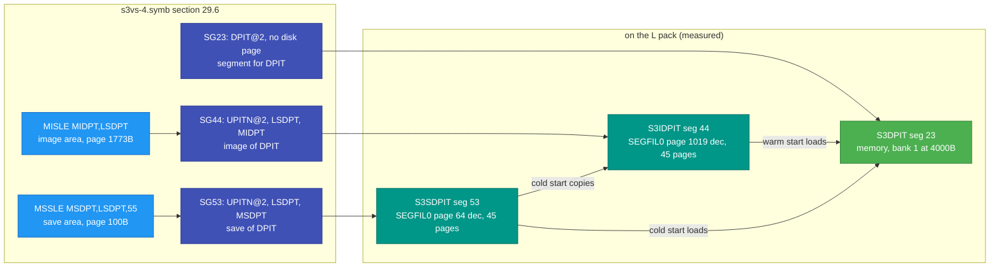
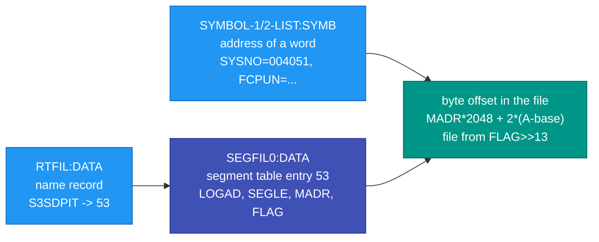

# The Segment Map From the Generation Listing: Which NPL File Lands in Which Segment, on Which Disk Page

**Status:** read from the generation listing `NPL-SOURCE/s3vs-4.symb` and checked against the
K and L packs on 2026-10-29. Every claim is tagged **VERIFIED** (with the place it was read),
**INFERRED** or **OPEN**. Numbers are octal unless marked dec.
**Purpose:** answer three questions with the build's own words instead of guesses: which NPL
source file produced which addresses, which segment holds which address range, and where that
segment sits on the pack.

Cross-references:
- [01-BOOT-SEQUENCE.md](01-BOOT-SEQUENCE.md) - how the segments named here get into memory
- [11-RT-SEGMENTS-AND-SEGFIL.md](11-RT-SEGMENTS-AND-SEGFIL.md) - what a segment and a segment
  file are, the segment-table entry
- [22-READING-RT-AND-SEGMENT-TABLES-FROM-MEMORY.md](22-READING-RT-AND-SEGMENT-TABLES-FROM-MEMORY.md)
  §6.5 - the RT-loader name records that give a segment's name on a pack
- [30-SYSTEM-SEGMENTS-AND-PAGE-TABLES-BY-RELEASE.md](30-SYSTEM-SEGMENTS-AND-PAGE-TABLES-BY-RELEASE.md)
  - every system segment by name and purpose, every page table, as the J to N release
  information describe them and as the packs name them
- [28-CPU-NUMBER-AND-TYPE-ON-DISK.md](28-CPU-NUMBER-AND-TYPE-ON-DISK.md) - the one worked case
  (the data page) of the method described here
- [../NPL-SOURCE/README.md](../NPL-SOURCE/README.md) and
  [../NPL-SOURCE/NPL-COVERAGE-AND-GAPS.md](../NPL-SOURCE/NPL-COVERAGE-AND-GAPS.md) - what the
  listing is and what source we hold
- [../SINTRAN-SOURCE-RECOVERY-PLAN.md](../SINTRAN-SOURCE-RECOVERY-PLAN.md) - the open work

---

## 0. The one-paragraph version

SINTRAN is not linked by a linker. A **generation job** (SI-GEN) runs the NPL sources through
the compiler and the MAC assembler in one long listing, and that listing is where the mapping
lives: an `@DEV` line names the source file being read, the left column is the logical address of
every generated word, part markers `%$--:COMMON / RPIT / MPIT / IPIT / 5PIT / DPIT` say which page
table that part is for, and section 29.6 of the listing defines the disk layout of `SEGFIL0:DATA`
and every entry of the segment table, each with a comment naming what it holds. The install
floppies carry the result: the segment files and the symbol lists. So "which segment is file X
in" is a lookup in the listing, not a guess, and a pack's own symbol lists and RT-loader name
records let a tool do the same lookup offline. **VERIFIED** for the data page (chapter 28);
**method, not yet a complete table**, for the code parts (§6).

## 1. Which listing this is

`s3vs-4.symb` (3.9 MB, 92 029 lines) is the output of one real SINTRAN III generation job: NPL
source, generated MAC text and the octal address of every word. Three facts about it matter here:

| Fact | Status |
|---|---|
| Its **disk layout and segment table** are the ones on the L packs: `MSDPT=100`, `MIDPT=1773`, `LSDPT=55` in the listing (§3) are the values in the packs' own `SYMBOL-2-LIST:SYMB`, and the measured segment-table entries (S3SDPIT page 64 dec, S3IDPIT page 1019 dec, 45 pages) are exactly those symbols. | VERIFIED |
| Its **code addresses are not the L07 build's** (`M1` is 071455 here, 071633 on L07), so an address read from the listing must not be used on a pack without checking the pack's own symbol list. | VERIFIED (`../NPL-SOURCE/NPL-COVERAGE-AND-GAPS.md`) |
| There is **no generation listing for K** in this repository; for K only the pack's symbol lists and name records exist (chapter 28 §5). The J listing is `../NPL-SOURCE-2/BOUT-6.SYMB` with its own layout (`../NPL-SOURCE-2/README.md`). | VERIFIED |

## 2. How the listing is organised

### 2.1 Parts, one per page table

The job emits the kernel in parts, each marked `%$--:NAME % FOR SPLITTING AV LISTING`, and each
part is code or data for one page table (PIT) of the ND-100's four. **VERIFIED** (line numbers of
the marker, and the logical address the part starts at):

| Marker | Listing line | Starts at | Page table | Source file prefix |
|---|---|---|---|---|
| `%$--:COMMON` | 14235, 14238, 16127, 17302 | 014742, 017307, 176000, 026000 | resident common (all PITs) | `CC-P2-*`, `XC-P2-*`, `PH-P2-*` |
| `%$--:RPIT` | 30321 | 041130 | RPIT | `RP-P2-*` |
| `%$--:MPIT` | 43579 | 033744 | MPIT | `MP-P2-*` |
| `%$--:IPIT` | 63894, 90243 | 032112 | IPIT | `IP-P2-*` |
| `%$--:5PIT` | 76832 | 176000 | 5PIT (ND-500 monitor) | `5P-P2-*` |
| `%$--:DPIT` | 79720 | 000000 | the data page and the segment table (§3) | inline generation text, `DP-P2-VARIABLES` |

The two-letter prefixes of the NPL file names match the parts (INFERRED from the markers; "P2"
is attested as pass 2 in `../NPL-SOURCE/README.md`).

### 2.2 File switches: which file produced which addresses

Every source file is opened with `@DEV (S-S-L)<file>:NPL` and closed with `@DEV 1`, and the left
column keeps counting, so the address range of a file is the range between its two markers.
**VERIFIED**, the complete list:

| Part | Listing lines | File | First address |
|---|---|---|---|
| DPIT | 447-674 | DP-P2-VARIABLES | 010773 |
| COMMON | 14237-15316 | CC-P2-COMMON | 017307 |
| COMMON | 15317-16121 | CC-P2-N500 | 022140 |
| COMMON | 16129-16526 | XC-P2-1 | 026000 |
| COMMON | 16527-16874 | XC-P2-2 | 027075 |
| COMMON | 16875-16969 | XC-P2-N500 | 030235 |
| COMMON | 16976-17299 | PH-P2-START-BASE | 170000 |
| COMMON | 17303-18021 | PH-P2-MEMTOF | 026000 |
| COMMON | 18022-19220 | PH-P2-RESTART | 031775 |
| COMMON | 19221-19561 | PH-P2-CONFG-TAB | 036177 |
| COMMON | 19630-23748 | PH-P2-OPPSTART | 041352 (SINTR at 042557) |
| RPIT | 30323-31395 | RP-P2-SEGADM | 066341 |
| RPIT | 31396-32576 | RP-P2-1 | 071776 |
| RPIT | 32577-36579 | RP-P2-MONCALLS | 076223 |
| RPIT | 36580-37168 | RP-P2-PIOC | 113750 |
| RPIT | 37169-38648 | RP-P2-TAD | 115561 |
| RPIT | 38649-38900 | RP-P2-ACCRT | 122677 |
| RPIT | 38901-39210 | RP-P2-MON-ADP | 123376 |
| RPIT | 39211-39802 | RP-P2-CONFG | 124305 |
| RPIT | 39803-40836 | RP-P2-N500 | 126464 |
| RPIT | 40837-41816 | RP-P2-MSYSU | 132431 |
| MPIT | 43581-44802 | MP-P2-1 | 050716 |
| MPIT | 44803-48102 | MP-P2-TERM-DRIV | 054630 |
| MPIT | 48103-48696 | MP-P2-2 | 070520 |
| MPIT | 48697-49129 | MP-P2-DISK-START | 072706 |
| MPIT | 49130-50117 | MP-P2-TAD | 074266 |
| MPIT | 50118-50705 | MP-P2-PIOC-DRIV | 077552 |
| MPIT | 50706-51520 | MP-P2-HASP-ETC | 101115 |
| MPIT | 51521-52146 | MP-P2-HDLC-DRIV | 103426 |
| MPIT | 52147-53357 | MP-P2-X21-DRIV | 105411 |
| MPIT | 53358-53973 | MP-P2-PERF-DATA | 111651 |
| MPIT | 53974-56767 | MP-P2-PERF-CODE | 116075 |
| MPIT | 56768-58306 | MP-P2-PERF-SAMP | 125337 |
| MPIT | 58307-62113 | MP-P2-N500 | 132147 |
| MPIT | 62114-63418 | MP-P2-DIMIR | 147610 (and again at 88463) |
| IPIT | 63896-65879 | IP-P2-SEGADM | 032157 (and again at 90245) |
| IPIT | 65880-68618 | IP-P2-1 | 044000 |
| IPIT | 68619-68833 | IP-P2-DISK-LOGG | 053036 |
| IPIT | 68834- | IP-P2-DISK-START | 053706 |
| IPIT | 69481- | IP-P2-SCSI-DISK | 056120 |
| IPIT | 71029- | IP-P2-SCSI-MAGTP | 063546 |
| IPIT | 71552- | IP-P2-SCSI-OPDI | 065365 |
| IPIT | 71885- | IP-P2-SCSI-DRIV | 066562 |
| 5PIT | 76834- | 5P-P2-MON60 | 026000 |

Some drivers inside the parts were never split into separate NPL files in this repository
(BDISK, SCSWD, BFDIS, STC, `../SINTRAN-SOURCE-RECOVERY-PLAN.md` §3); their code is still in the
listing between the markers above.

## 3. Section 29.6: the disk layout of SEGFIL0 and the segment table

Listing lines 79720-80200 (`%$--:DPIT`, then "29.6 SEGMENT TABLE"). Two macros lay out the segment
file page by page: `MSSLE name,length,pages` reserves a **save** area and `MISLE name,length` an
**image** area, each advancing `SGMAD`, the next free page. The result is a list of symbols that
are both the disk page (`M...`) and the length (`L...`) of every system segment. **VERIFIED**
(listing lines 79726-79845; pages in octal, counted from the start of `SEGFIL0:DATA`):

| Save area (page, pages) | Image area (page, pages) | What |
|---|---|---|
| `MIMAG` 0, `LIMAG` 77 | same | image of common / start / restart code (the memory image the bootstrap loads; its save copy is on segment file 4, below) |
| `MSDPT` 100, `LSDPT` 55 | `MIDPT` 1773 | the data page (DPIT) |
| `MSSYS` 155, 3 | `MISYS` 2050 | system segment |
| `MSPDF` 160, 1 | - | spooling datafields / queue |
| `MSECO` 161, 2 | `MIECO` 2053 | extended common |
| `MSRPT` 163, 63 | `MIRPT` 2055 | RPIT code |
| `MSMPT` 246, 63 | `MIMPT` 2140 | MPIT code |
| `MSIPT` 331, 63 | `MIIPT` 2223 | IPIT code |
| `MS5PT` 414, 5 | `MI5PT` 2306 | 5PIT code |
| `MN5MO` 421, 60 | `MI5MO` 2313 | ND-500 monitor |
| `MSSGT` 501, 20 | `MISGT` 2373 | the segment table itself |
| `MSUC1` 521, 40 | `MIUC1` 2413 | ND-110 micro code |
| `MSUC2` 561, 40 | `MIUC2` 2453 | ND-120 micro code |
| `MFILS` 621, 65 | `MIFIL` 2513 | file system |
| `MSCOM` 706, 65 | `MICOM` 2600 | command segment |
| `MSSMS` 773, 44 | `MISMS` 2664 | SINTRAN-SERVICE / MAIL |
| `MSXMK` 1037, 30 | `MIXMK` 2730 | XMSG kernel |
| `MSXRO` 1067, 50 | `MIXRO` 2760 | XMSG XROUT |
| `MSFID` 1137, 66 | `MIFID` 3030 | XMSG watchdog (XMFIDO) |
| `MSNMT` 1225, 6 | `MINMT` 3116 | device name table |
| `MSDMW` 1233, 4 | `MIDMW` 3124 | DIMIR WD |
| `MSNKS` 1237, 64 | `MINKS` 3130 | NUCLEUS server |
| `MSNKN` 1323, 100 | `MINKN` 3214 | NUCLEUS name server |
| `MSERC` 1423, 20 | `MIERC` 3314 | ERSWD code |
| `MSERD` 1443, 70 | `MIERD` 3334 | ERSWD data |
| `MSPRM` 1533, 64 | `MIPRM` 3424 | processor manager server |
| `MSEMG` 1617, 64 | `MIEMG` 3510 | event message server |
| `MSBOP` 1703, 64 | `MIBOP` 3574 | BOPCOM server |
| `MSMTS` 1767, 4 | `MIMTS` 3660 | MTSERV |
| | `SGMAD` 3664 | first free page on SEGFIL0 |

Two save areas are **not** in `SEGFIL0`: `MERRP=100` (error program) and `MRTLO=137` (RT-loader)
are absolute disk pages on **segment file 4** (`SGFI4=100000`, "DIVERSE SAVE AREAS"), which the
start-up code bases at disk page 1, inside `SINTRAN:DATA` and `MACM-AREA:DATA`
(`PH-P2-OPPSTART.NPL:751`, K release information line 7941). **VERIFIED.**

Then every segment-table entry is written with eight fields, `SGnn, SEGLI; PRESE; LOGAD; SEGLE;
MADR; FLAG; SGSTA; BPAGL`, where `LOGAD` is `<page table>@6+<logical page>`, so the page table is
stated in the entry. **VERIFIED**, listing lines 79870-80191 (the system segments; configuration
dependent segments follow from 400B):

| Seg | Page table @ logical page | Length | Disk page | File | Comment in the listing | Name on the packs |
|---|---|---|---|---|---|---|
| 2 | UPITN@0 | LIMAG | MIMAG | 0 | memory image | S3IMAGE |
| 3 | - | LOPCO | MICOM | 0 | command segment | S3CP (K: S3COM) |
| 4 | - | - | MRTLO | 4 | RT-loader | S3RTL |
| 6 | - | LFILS | MIFIL | 0 | file system | S3FS |
| 7 | - | - | - | - | DMAC | S3DMAC |
| 10 | - | - | - | 0 | RTFIL (the name records, §5) | S3RTFIL |
| 11 | UPITN@00 | CSGLE | SGMAD | 0 | error log | |
| 12 | UPITN@13 | LFILS | MFILS | 0 | initial (save) file system | |
| 13 | UPITN@13 | LOPCO | MSCOM | 0 | initial (save) command segment | |
| 14 | SPIT@14 | CSGLE | SGMAD | 0 | error program | S3ERRP |
| 16 / 25 / 47 | UPITN@15 / UPITN@15 / RPIT@15 | LSRPT / LSRPT / LIRPT | MSRPT / MIRPT / - | 0 | initial RPIT / image of RPIT / segment for RPIT | S3RPIT family |
| 17 / 26 / 35 | UPITN@15 / UPITN@15 / MPIT@15 | LSMPT / LSMPT / LIMPT | MSMPT / MIMPT / - | 0 | initial MPIT / image of MPIT / segment for MPIT | S3MPIT family |
| 65 / 66 / 67 | UPITN@15 / UPITN@15 / IPIT@15 | LSIPT / LSIPT / LIIPT | MSIPT / MIIPT / - | 0 | initial IPIT / image of IPIT / segment for IPIT | S3IPIT family |
| 46 / 50 / 51 | UPITN@13 / UPITN@13 / 5PIT@13 | LS5PT / LS5PT / LI5PT | MS5PT / MI5PT / - | 0 | initial 5PIT / image of 5PIT / segment for 5PIT | 5PIT family |
| 60 / 61 / 64 | UPITN@13 / UPITN@13 / RPIT@13 | LSECO / LSECO / LIECO | MSECO / MIECO / - | 0 | initial / image / segment for extended common | S3ECOM family |
| 23 / 44 / 53 | DPIT@2 / UPITN@02 / UPITN@2 | - / LSDPT / LSDPT | - / MIDPT / MSDPT | - / 0 / 0 | segment for DPIT / image of DPIT / save of DPIT | S3DPIT / S3IDPIT / S3SDPIT |
| 24 / 27 | UPITN@0 | LSSGT | MSSGT / MISGT | 0 | initial / image of the segment table | S3SSGT / S3ISGT |
| 45 / 54 | UPITN@SYSST | LSSYS | MISYS / MSSYS | 0 | image / save of the system segment | |
| 52 | UPITN@0 | LIMAG | MIMAG | **4** | save of common and re/start | S3SAVE |
| 55 | UPITN@14 | LERRP | MERRP-1 | **4** | save of error program | S3SERRP |
| 56 / 57 | UPITN@14 / UPITN@0 | 20 / 13 | MRTLO-1 / MRTLO+20-1 | **4** | save of RT-loader code / data | S3SRTC / S3SRTD |
| 62 / 30 | UPITN@20 / 5PIT@20 | LN5MO | MN5MO / MI5MO | 0 | save / running ND-500 monitor | S3SM5 |
| 63 | UPITN@75 | LSMTF | MSMTF-1 | **4** | MEMTOF (memory to floppy) | S3MEMTF |
| 70 / 71 | UPITN@14 / SPIT@14 | LSSMS | MSSMS / MISMS | 0 | initial / running SM segment | S3SM |
| 74 / 76 | UPITN@050 / UPITA@050 | LSXMK | MSXMK / MIXMK | 0 | save / running XMSG kernel | |
| 75 / 77 | UPITN@0 / UPITA@0 | LSXRO | MSXRO / MIXRO | 0 | save / running XROUT | |
| 100 / 101 | UPITN@072 / DPIT@072 | LSNMT | MSNMT / MINMT | 0 | save / running device name table | S3SDNAM / S3DNAM |
| 102 / 103 | UPITN | LSFID | MSFID / MIFID | 0 | save / running XMSG watchdog | |
| 104 / 105 | SPIT@14 | LSNKS | MSNKS / MINKS | 0 | save / image NUCLEUS server | |
| 106 / 107 | UPITN | LSNKN | MSNKN / MINKN | 0 | save / image NUCLEUS name server | |
| 110 / 111 | UPITN | LSUC1 | MSUC1 / MIUC1 | 0 | save / image ND-110 micro code | |
| 112 / 113 | UPITN | LSUC2 | MSUC2 / MIUC2 | 0 | save / image ND-120 micro code | |
| 114-117 | UPITN / UPITA | LSERC, LSERD | MSERC.. | 0 | ERSWD code and data, save and image | |
| 120-127 | SPIT@14 | LSPRM, LSEMG, LSBOP, LSMTS | MSPRM.. | 0 | processor manager, event message, BOPCOM, MTSERV servers | |
| 43 | UPITA@76 | CSGLE | SGMAD | 0 | S3PATCH (addresses for the patch mode file) | S3PATCH |

Reading of the entry: `UPITN` means "not mapped in any page table at run time" (a disk-only copy),
`UPITA` a copy mapped on demand; `DPIT`, `RPIT`, `MPIT`, `IPIT`, `SPIT`, `5PIT` name the page table
the running segment is mapped in; an entry with disk page `0` and status `162010` is memory-only
(the running DPIT, RPIT, MPIT, IPIT, 5PIT, extended-common segments are built in memory from the
image copies at start, chapter 01). **INFERRED** for the meaning of UPITN/UPITA from the pattern
(every save and image copy has it, every running segment has a real PIT); the rest **VERIFIED**
from the listing text. The "Name on the packs" column is the RT-loader record decoded on the K and
L packs (§5), **VERIFIED** where filled in, blank where no record was looked up.

### 3.1 The three copies, as the generation sees them



## 4. From the listing to a disk page: the formula and its check

For a segment with table entry `LOGAD`, `SEGLE`, `MADR`, `FLAG`:

```
logical base (words) = (LOGAD & 77B) * 2000B
word A is in the segment when  base <= A < base + SEGLE * 2000B
byte in the segment's file   = MADR * 2048 + 2 * (A - base)
file                          = segment file (FLAG >> 13) & 7:  0 = SEGFIL0:DATA, 4 = SINTRAN:DATA / MACM-AREA:DATA
```

Checked on the packs (**VERIFIED**, chapter 28 §4-§6): `MSDPT=100B` is page 64 dec, `MIDPT=1773B`
is page 1019 dec, `LSDPT=55B` is 45 pages, and the words SYSNO 4051B, HWINF+2 4054B, REVLE 4057B
read at those offsets are the values the boot banner prints. On the K pack segment 53 carries
`FLAG` segment file 4 and its words are found in `SINTRAN:DATA` at page 27.

## 5. What the pack carries of all this

The install floppies and the running system leave three things on every pack that make the map
usable without the listing (**VERIFIED** on K-100, L2-100, L-SEMICS, nd100x SMD0):

1. `(SYSTEM)SYMBOL-1-LIST:SYMB` and `SYMBOL-2-LIST:SYMB`: every symbol of that build, including
   `MSDPT`, `MIDPT`, `LSDPT`, `MSSGT`, `MISGT` on L (the K list lacks the `M...` layout symbols but
   has `MSSGT`/`MISGT`), and the code addresses of that build.
2. `(SYSTEM)RTFIL:DATA`: the RT-loader's "DEFINED SEGMENT NAME" records (type 25B, SIXBIT packed
   name, segment number), one per segment; decoded to S3DPIT 23, S3IDPIT 44, S3SDPIT 53, S3IMAGE 2,
   S3RTFIL 10, S3PATCH 43, S3ISGT 27, S3SSGT 24 on K and L alike (chapter 22 §6.5, chapter 28 §4.1).
3. `(SYSTEM)SEGFIL0:DATA` with the segment table at a page the reader finds by shape (chapter 26
   §3.2), and the segment copies at the `MADR` pages.



## 6. Mapping a routine to its segment: the method, and what is not done

For any routine or variable:

1. take its address from the pack's symbol list (not from the listing: the code addresses differ
   between builds, §1);
2. take its **part** from the listing: the `@DEV` range in §2.2 that contains the routine in the
   listing says which file it is in, and the part marker says which page table (COMMON, RPIT,
   MPIT, IPIT, 5PIT, DPIT);
3. pick the segment-table entry of §3 whose page table matches that part and whose logical range
   contains the address; the page table is what resolves the ambiguity of four tables sharing the
   same 64 KW logical space;
4. the entry gives the running segment and, through the `M...` symbol, the image and save copies
   on disk.

Worked, **VERIFIED**: `SINTR` is in `PH-P2-OPPSTART` (listing 19630-23748, part COMMON); the
common/start/restart code is `MIMAG`, segment 2 `S3IMAGE` with its save copy segment 52 `S3SAVE` on
segment file 4; it is loaded by the page-0 bootstrap at every start (chapter 01). `SYSNO` is in
`DP-P2-VARIABLES` (listing 447-674, part DPIT), segments 23 / 44 / 53 (chapter 28).

**Not done:** a complete table of every `@DEV` file against its segment, with the addresses checked
against a carved pack. The carver (`tools/sintran-segment-carver`) has carved 79 L07 segments and
`../SINTRAN-SOURCE-RECOVERY-PLAN.md` §3 holds the coarse version of the table (segment family, NPL
prefix, source held or not). Finishing it is step 2 of that plan. **OPEN.**

## 7. Cautions

- The listing is one generation; another SI-GEN run with other answers gets other lengths and
  pages (the `MSSLE` lengths are the answers). A tool reads the pack, never this table.
- `UPITN`/`UPITA` are read as "unmapped" and "mapped on demand" from the pattern of the entries,
  not from a manual. **INFERRED.**
- The K packs carry no `M...` layout symbols and no listing; their layout was measured (chapter 28
  §4.1: 35-page copies, save copy on segment file 4).
